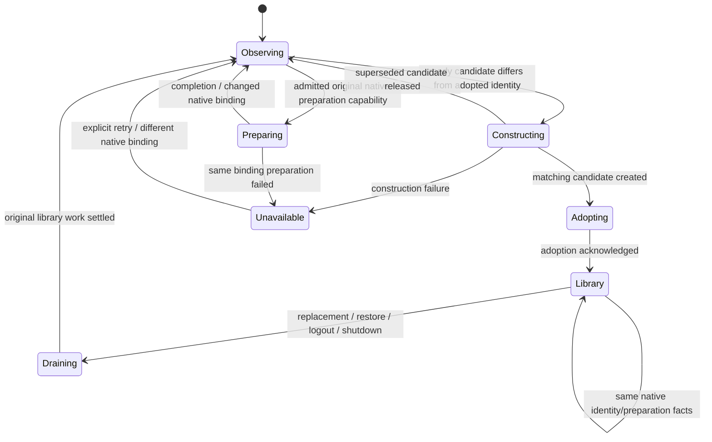
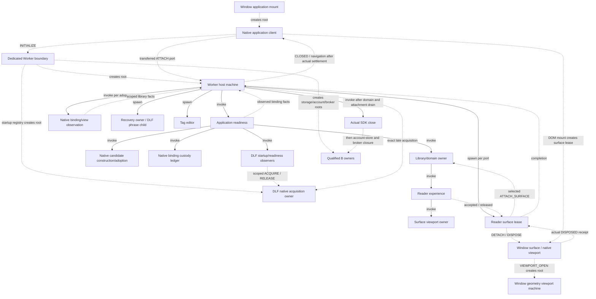

# Account binding and realm lifecycle

Change set C keeps application readiness as the account authority and the Worker
host as the realm/attachment owner. The Window client owns native UI and transport
resources. DLF retains session acquisition/readiness and transaction settlement.
No identity namespace, schema, third-party dependency or catalog wording changes.

## Binding facts and adoption

The Jazz adapter's `read()` returns observations with opaque account, client and
DB identity tokens plus preparation facts. Its WeakMaps translate native resource
identity; they do not select a current library. A library capability is constructed
only when the application chart admits a candidate and invokes `libraryBinding`.
The captured root/prepare/record operations stay bound to their original native
DB. Release revokes the capability without cancelling or replaying issued writes.

The application chart compares account/client/DB identity and preparation facts.
Duplicate observations reuse the adopted capability and library actor. Changed
facts stop old admission, drain the original library through its existing owner,
and admit only the latest candidate. A → B → C during an A write can skip B; C
cannot receive that write or its receipt. Metadata-only observations can refresh
sign-in feedback without rebuilding the library.

Candidate custody remains with the constructing callback until adoption. A native
binding ledger is invoked for the application's lifetime; selected OWN/RELEASE
commands transfer/revoke capabilities. Its disposer and direct owner-error observer
release retained bindings on forced stop. Release wrappers are idempotent. Neither
callback chooses replacement or retries. Failed bindings retain identity facts,
not SDK capabilities, until explicit retry or a different binding. Preparation
captures the original observation rather than consulting a later session snapshot.

## Host-owned attachments and publication

Application snapshot observations report library/recovery facts to the host chart.
The host retires the old binding, waits for surface leases, allocates a fresh scope
through owned native identity logic, then spawns its tag/recovery actors. Repeated
facts do not reset pagination, recreate actors or duplicate subscriptions.

Library/reader eligibility and tag facts arrive through an owned subscription
adapter with the binding generation. Old-scope commands, late generations and old
OAuth redirects cannot affect a replacement binding. The adapter's subscription
map is native listener bookkeeping; it does not adopt accounts or dispose readers.

`serve-application.ts` now publishes projections and messages. It does not choose
bindings or scan reader internals to decide disposal. Reader-byte revision caching
remains a transport optimization. Recovery uses its existing separate sensitive
view channel and is withdrawn on retirement, failure or UI detach.

Solid arrows below mean actor ownership; dotted arrows mean messages/capabilities.
Every independent root has its invocation boundary labeled.

## Reader handoff and native release

One finite `readerSurfaceLeaseMachine` owns each transferred port. It offers the
surface to the selected library, observes reader acceptance/release, then waits
for the original Window's matching DISPOSED receipt. A refused attachment also
cleans up its native listener lease. Forced actor stop is disruptive disposal,
not a successful cleanup acknowledgement.

The reader chart reports release after the original viewport's final position,
issued/queued writes and fullscreen exit reach their retirement join. A replacement
surface arriving during detach stays pending; the existing viewport invocation
continues until its real acknowledgement. Old surfaces can then retire while the
new viewport remains open. Shutdown or detach during that wait retires the pending
replacement without opening it, while preserving the original final-position write.
The close join also waits for all pending/retiring surfaces. Each surface is released
once. The Window captures
position while its DOM exists, releases its fullscreen observer and only then
acknowledges native cleanup. Late open after detach cannot recreate a viewport.

Native local restoration changes the initiating Jazz session. It does not imply
cross-tab local account-selection following. C preserves that SDK contract; the
browser test sends the supported restore command over the real native Worker
transport with an A reader attached, exercising A → B → A without route changes.
The account settings UI supplies the independent profiles’ recovery phrases.
Native backend following, sign-out and offline durability are additionally exercised
by the production authenticated offline suite.

## Shutdown and deadline policy

The host refuses new admission and joins actual application completion with surface
lease completion. Only then does it settle any late SDK acquisition, close that
actual SDK session, and await the B account-store/broker receipts. Drain, cleanup,
retained-custody or close failure cannot select clean closure or navigation.

| Owning wait                                           | Production feedback bound  | On expiry                                                                  |
| ----------------------------------------------------- | -------------------------- | -------------------------------------------------------------------------- |
| Application/domain drain                              | 30 seconds                 | Overdue state retains application and surface owners.                      |
| Late SDK acquisition during close                     | 30 seconds                 | Keep acquisition observer; close the real late session.                    |
| Native SDK close                                      | 30 seconds                 | Keep the original close invocation; no replay.                             |
| Attachment retirement, reader release, Window cleanup | 10 seconds per finite wait | Retain the lease and matching late receipt listener.                       |
| Window client waiting for Worker CLOSED               | 45 seconds                 | Existing failure/reload presentation; keep Worker/native transports alive. |

`close-policy.ts` names these injectable local shutdown policies. The longer
SDK/drain bounds allow local WASM/disk startup and queued persistence to settle;
Window/native listener cleanup has a shorter feedback bound. These limits govern
feedback, not remote acceptance or effect cancellation. An open reader has no
completion timer. Neither expiry nor actor disposal manufactures a receipt.

Matching completion is always consumed, including after overdue feedback.
At the boundary, processed event order decides whether overdue feedback appears;
a delayed timer cannot invalidate an actual close receipt. Bounded sanitized stage
and reason facts cross the failure channel; raw exceptions or private snapshots
do not. Existing failure/retry/reload copy is reused unchanged.

## Qualification and follow-up

Focused tests cover duplicate facts, same-account client/DB replacement, rapid
replacement during an unknown write, rejected/superseded candidates, explicit retry,
forced stop, exact lease/subscription release, stale scope/generation rejection,
reader handoff, fullscreen/final-write ordering and missing/late cleanup receipts.
An independent close ledger generates 120 schedules with up to 12 commands,
seed `20261116`, with complete contract-model state/event/transition coverage.
Explicit tests cover delayed native timer delivery after actual closure.

The real Chromium case restores A → B → A while a saved reader is attached. It
checks withdrawal of the old article, recovery identity and return to the original
saved reader without navigation. Cold development startup prebundles the adopted
DLF lifecycle exports to avoid a dependency-optimizer reload during initial work.

See the [checkpoint record](workflow-hardening-progress.md#checkpoint-qualification)
for final repository, Worker, packaged-extension and production-offline results.
These are bounded qualifications, not exhaustive native scheduling proofs.

D now supplies provider/OAuth HTTP deadlines and ordered sign-out recovery; see
[its ownership and qualification record](auth-request-lifecycle.md). C covers the
host/acquisition/session-close part of REC-6. E retains search deadlines
and viewport transport failure/uncertainty recovery beyond this host-owned cleanup
protocol. F/G remain separate work. No new DLF source/artifact is required by C.
