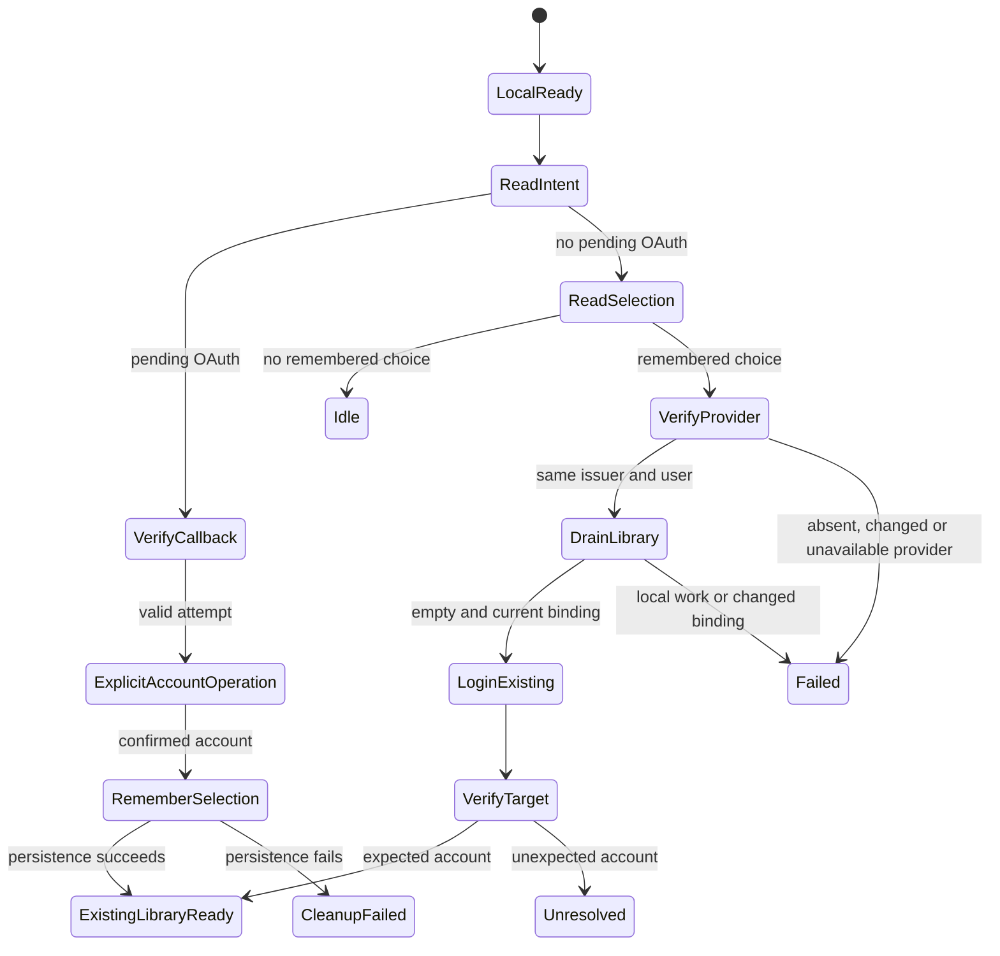

# External-account startup restoration

## Observed failure

The deployed callback and existing-account login succeed. Reload retains the
Better Auth session but opens an empty local library. The pinned Jazz SDK stores
local signing roots; it deliberately leaves external credentials to the provider.
Clipper currently has no record of a completed external-account selection.

## Approved record and process

The user approved this record and process on 2026-11-07.

A browser-local, non-secret selection `{ issuer, userId, accountId }`, scoped to
Jazz app ID, server URL and environment. Write only after confirmed Connect or
Sign in. Never persist tokens or recovery secrets. Clear on explicit sign-out.
No selection means no provider request during first-use local startup.

## Machine ownership and transitions

The shared DLF identity coordinator owns the remembered selection alongside its
existing temporary OAuth attempt. Explicit pending OAuth intent takes precedence;
an incomplete new authorization must never fall back to an older login/selection.

Normal startup: wait for usable local library -> read pending intent -> if absent,
read remembered selection -> if present, check provider session -> require matching
issuer/user -> dispatch existing-account restoration -> wait for account result.
Missing selection ends idle without contacting auth. Missing/mismatched provider,
storage failure or network failure ends explicitly without automatic mutation.
Fresh local use remains available; restoration never discards work created while
provider verification was pending.

The application owns every identity mutation: admit against current local binding,
drain library work, recheck empty-library policy and binding, call loginJWT, and
verify the resulting account ID before exposing its library. Restoration never
calls linkJWT or loginOrRegisterJWT. Target mismatch is unresolved and must not
bootstrap or expose an unexpected library. Results include the confirmed target
account ID so the coordinator can remember it after a new explicit operation.

After new OAuth success: validate receipt -> invalidate old selection -> consume
intent -> dispatch -> confirmed result -> remember selection -> success. Failure
to invalidate blocks issue. Failed selection persistence has explicit feedback;
it never causes the successful SDK mutation to replay. Shutdown waits for issued
identity work and required selection persistence. Actor states distinguish shutdown
before issue from shutdown after issue.

Explicit sign-out: after library drain, remove remembered selection -> Jazz logout.
Failure to remove selection blocks logout rather than reporting a sign-out that
would automatically restore later. Logout admission must not race an in-flight
selection write. Revoking the Better Auth session itself is outside this fix;
without remembered selection its remaining cookie cannot cause restoration.

## Required qualification

After implementation review: first-use no-auth, explicit sign-in -> new owner/reload
-> existing account restored, same library ID, no link/register call, missing or
mismatched provider, wrong target, malformed/blocked storage, interrupted OAuth with
older selection, local work appearing during verification, SDK/persistence failure,
shutdown before/after issue and during selection persistence, logout cleanup and
subsequent startup without restoration, and a new explicit sign-in after logout. Repeat real OAuth and multiple reloads in
the isolated Chrome context after preview deployment. External-account offline
restart remains deferred; do not claim offline restoration from online reload tests.

## Implementation ready for review

- Shared DLF `src/lib/machines/identity/oauth-attempt.ts`: selection read, provider
  validation, correlated restore, post-success persistence and shutdown ownership.
- Shared DLF `src/lib/identity/token-selection.ts`: strict record validation and
  browser storage leaves. The storage key is scoped in Clipper's provider adapter.
- Clipper `application-readiness.ts`: exact binding revalidation, existing-account
  restoration admission, confirmed target verification before library bootstrap,
  unresolved outcome, and selection removal before logout.
- Clipper `account-lifecycle.ts`: shared workflow ownership, logout admission while
  selection persistence is busy, signed-out reset and ready-to-render projections.

The user approved implementation testing on 2026-11-07. The complete Clipper suite
passes 665 tests with one skip. New regression coverage includes a completed
sign-in across two app lifetimes, exact target verification before bootstrap,
local-work preservation, A → B → A binding invalidation, blocked storage, provider
mismatch/failure, interrupted OAuth precedence, pending-persistence shutdown and
logout, selection scope isolation, and startup after sign-out without restoration.
Type/Svelte checks, lint, formatting, vendor integrity and production build pass.
Live OAuth and reload qualification will follow preview deployment. External-account
offline restoration remains deferred. DLF source remains uncommitted upstream.
