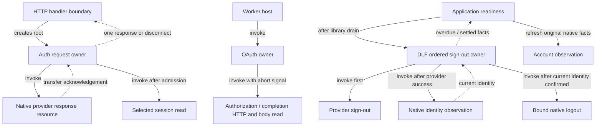

# Authentication request and sign-out ownership

Change set D extends C's drain contract. The existing provider, cookie, native
account-following and local-first policies remain authoritative.

## Owners and native boundaries

Each HTTP auth request creates one server request actor. Admission selects either
completion validation or the delegated provider handler. Invalid completion
method/origin/receipt precedes any private session read. Callback confirmation
reads only newly issued cookies, preserves the provider response body and all
provider cookies, and appends a receipt only after confirmed identity. A delegated
response is a native resource owned until transfer to the HTTP wrapper. Disconnect
aborts supported work and disposes only untransferred bodies; late results cannot
deliver a response. Failures retain the existing sanitized response contract.

The Worker OAuth owner bounds authorization and completion through header and body
reads. Authorization can start a new attempt after failure. An uncertain completion
retains its original attempt and cannot automatically replay the completion POST
or claim confirmation from native sign-in alone. Existing failure/reload feedback
is used. Native account following remains with Jazz.

DLF's ordered sign-out child owns the provider call, followed only after confirmed
success by observation of the selected native identity. Already signed-out
completes without logging out a replacement local account; replaced/unavailable
facts refuse mutation. Native logout requires the original account/client/DB at
admission; Jazz captures its selected native session before its first await. Each stage has waiting/overdue states under the same
invocation, so a deadline reports feedback without discarding or replaying the
effect. Rejection is a typed terminal outcome. Clipper refreshes native facts after
settlement before admitting a retry. Application shutdown retains the child, and
C's host cannot acknowledge closure before that drain finishes.

## Deadlines and recovery

| Owner                                       | Feedback bound | Deadline handling                                                                                               |
| ------------------------------------------- | -------------- | --------------------------------------------------------------------------------------------------------------- |
| OAuth authorization, including headers/body | 30 seconds     | Abort supported I/O, exit busy state, allow an explicit new attempt.                                            |
| OAuth completion, including headers/body    | 30 seconds     | Abort supported I/O, retain callback attempt and report uncertain confirmation; no automatic completion replay. |
| Provider sign-out                           | 30 seconds     | Retain original call; no native logout before actual provider success.                                          |
| Native logout                               | 30 seconds     | Retain original call; refresh observed identity after settlement before retry.                                  |

OAuth reads native monotonic elapsed facts as well as using its timer, so delayed
callback delivery cannot approve an expired response. Request roots follow HTTP
disconnect lifetime. An issued provider/session effect is not undone by stopping
an actor. Overdue sign-out exposes existing failure/reload controls; a reload is
disruptive recovery, not proof of clean closure. Completion's signed-cookie protocol
still does not establish atomic single use or safe replay after a lost reply.

## Qualification

Clipper passed `pnpm verify` (852 unit/native tests in 126 files, installed vendor
integrity/import checks, formatting, lint, strict types, zero Svelte errors/warnings
and production build), all 26 Worker browser cases, 12 packaged-extension cases
and eight production offline/restart cases. The latter includes actual linked
sign-out, existing/expired credentials, persisted edits and reconnection.

Focused native tests cover invalid admission before private effects, incoming vs
issued session cookies, missing sessions, sanitized failures, live response-body
transfer, disconnect and late body disposal. Actual HTTP sockets exercise both
header and body stalls for authorization/completion and prove abort delivery.
Explicit cases cover delayed timer delivery, stale completion, refreshed identity,
account replacement during provider waiting and both stages during realm shutdown.
No new catalog wording or third-party dependency was added.

The [PR34 integration review](pr34-workflow-integration.md) records preserved
native provider refresh persistence tests and the successful-terminal-output
requirement for host shutdown acknowledgements.

DLF source `5bb6605` passed 191 selected regressions in 11 files, strict test types,
zero-error/warning library checks, strict package publint and all public package
consumer declarations, fixtures and builds. An independent sign-out receipt ledger
generates 120 schedules of up to 12 commands, seed `20261117`, with complete
contract-model coverage. The consumer artifact preserves every prior Worker
archive payload byte and adds four sign-out JS/declaration files plus exports;
[provenance](../../vendor/auth-lifecycle-provenance.json) records all source hashes.

These are bounded qualifications; F–G remain separate work and Finance adoption
still requires its actual-adapter qualification. See the
[PR checkpoint](workflow-hardening-progress.md) for exact shared artifact provenance.

E now covers reader/search recovery; see [its ownership record](reader-search-lifetimes.md).
