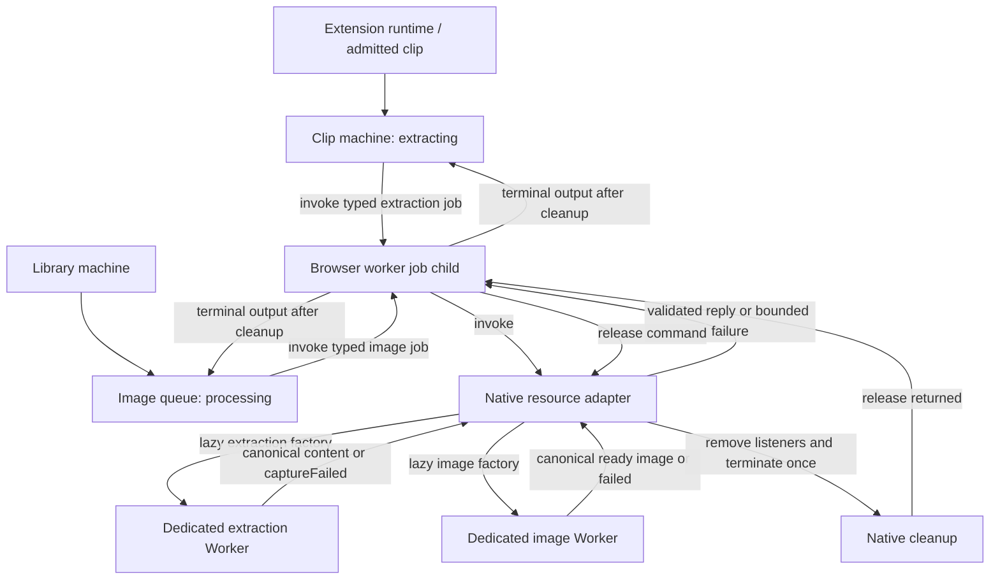
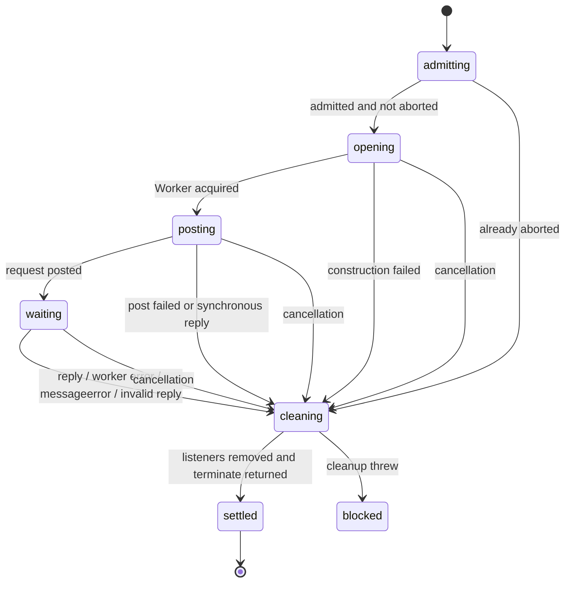

# Browser worker job ownership

Change set F shares one short-lived browser Worker lifecycle between extension
extraction and web image processing. The helper remains in Clipper; it has no
HTTP, database, account or product fallback policy. Long-lived search/article
workers and the Node parser retain their existing owners.

## Invocation and resource lifetime

Every arrow below is an invocation or a native resource operation. There is no
standalone job root in production and no promise wrapper around extraction.

The two incoming job arrows represent separate instances of the same typed
machine factory. A selected job constructs exactly one Worker. Native handles
stay in the callback adapter, outside machine domain context. Descriptors in
`apps/extension/src/worker.ts` and web `images/processing-job.ts` are inert until
the invoked child requests construction. They supply the selected payload,
optional transfer list and canonical reply parser.

The first admitted outcome wins. Cleaning ignores duplicate/late replies,
errors and cancellation. Pre-abort constructs/posts nothing. Forced stop performs
best-effort cleanup but emits no successful terminal output. If cleanup throws,
the child and parent remain blocked: neither reports clean settlement nor admits
a follow-up save/write. A second termination attempt is not fabricated.

Browser `Worker.terminate()` supplies no asynchronous exit receipt. This contract
acknowledges listener removal and the synchronous termination call returning.
The Node parser continues to require its actual native exit receipt; this helper
does not replace or weaken that contract.

## Parent decisions and deadlines

| Owner          | Existing deadline | Outcome after child cleanup                                                                                                                                                                                                                        |
| -------------- | ----------------- | -------------------------------------------------------------------------------------------------------------------------------------------------------------------------------------------------------------------------------------------------- |
| Extension clip | 15 seconds        | Timely validated content matching the captured source proceeds to issue/save. Transport/domain failure or deadline expiry selects the existing URL-only fallback. Shutdown or independent cancellation closes without admitting save.              |
| Image queue    | 20 seconds        | Timely validated ready data proceeds to the existing supervised ready write. Processing failure or expiry selects the existing nonretryable processing-failure write. Shutdown, stale account ownership or failed observation discards the result. |

Each parent owns its timer. Expiry sends `CANCEL` and retains the child until
cleanup settles. Shutdown similarly retains the child; issued database writes
keep their existing transaction owners and drain rules. The shared child has no
competing timer.

The child measures monotonic elapsed time through cleanup. Parents reject results
at or beyond the exact deadline even if a delayed timer callback has not run.
This preserves deadline precedence under event-loop delay. A failed extraction
never contributes extracted content; its authorized URL-only fallback is still a
save. Cancellation before save admission never starts one.

## Qualification

Focused regressions cover construction/post failures, worker error,
`messageerror`, malformed replies, pre-abort, reentrant abort/reply races,
duplicate/late events, cleanup failure, forced stop, exact deadline precedence
and unchanged parent fallback/write admission. Four independent generated
contract campaigns run 120 schedules each, up to 12 commands, seed `20261119`,
requiring full contract-model state/event/transition coverage.

The native browser fixture invokes both production descriptors from a dedicated
Worker, which constructs the real image and extraction Workers. It checks real
PNG processing and Readability extraction, actual uncloneable-post failures,
cancellation, one termination and removed listeners before terminal output.
The rebuilt packaged extension passes the unchanged toolbar/source-message
regression assertions and complete capture suite. An initial sign-in/settings
probe failure did not reproduce in the unchanged focused or full rerun; the
checkpoint records that qualification limit. Production-offline qualification
uses the existing real image pipeline. Current full-run results are recorded in the
[PR checkpoint](workflow-hardening-progress.md).
