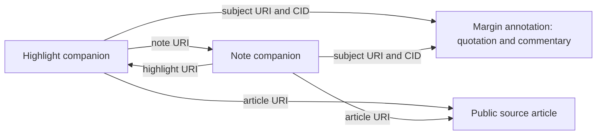

# Clipper companion Lexicon proposal

Prepared 2026-11-07 alongside [the sync proposal](margin-sync-technical-proposal.md). **Review update:** the user subsequently approved the candidate fields and grouped synchronization approach, including group-wide conflict pause and verification of stale observations. See the [accepted scope](../../specs/001-jazz-clipper/design-decisions.md#accepted-companion-fields-and-grouped-synchronization--2026-11-07). “Candidate” and “recommend” below preserve the reviewed proposal wording; they do not mean the approved subset remains undecided. Namespace, key/discovery conventions and other explicitly deferred mechanics still require review. No Lexicon has been published, DNS changed, package installed or application code implemented.

## Purpose

Keep the shared quotation and commentary in `at.margin.note`. Add a small Clipper companion family that makes the highlight and attached note separately addressable and preserves their explicit relationships. A Margin-only reader still sees one combined annotation. A reader that understands the companion can also distinguish the two entities and their article association without access to Jazz.

The addition is public application-domain information, not a second copy of Clipper's database. It does not export drafts, organizational tags, conflict history or sync bookkeeping. AT's companion-record guidance supports separate extension records and permits matching record keys across collections. [Extension guidance](https://atproto.com/blog/pinned-posts), [record-key conventions](https://atproto.com/specs/record-key)

## Candidate record family

Use two narrowly defined record types rather than one record containing nested public IDs that cannot themselves be fetched as AT records. Names below use the reserved example namespace solely for discussion:

- `com.example.clipper.highlight`
- `com.example.clipper.note`

The real namespace must use a deliberately selected, controlled domain authority. It is not implied by a repository name or an AT handle. Publishing/resolving its schemas is a later authorized task. DLF does not own this domain vocabulary. [Lexicon authority and publication](https://atproto.com/specs/lexicon#lexicon-publication-and-resolution)

| Candidate field | Where                           | Meaning and benefit                                                                                                        | Public disclosure                                              |
| --------------- | ------------------------------- | -------------------------------------------------------------------------------------------------------------------------- | -------------------------------------------------------------- |
| `subject`       | Both; required strong reference | URI and CID of the matching Margin version; identifies the common content and lets a reader recognize stale extension data | The already-public annotation and a content-version reference  |
| `article`       | Both; required URI              | Explicit public article association, including for a note attached to a highlight; no private Jazz lookup required         | The article source already selected for publication            |
| `note`          | Highlight; optional AT URI      | Direct discovery of its current independently identified note companion                                                    | The public highlight–note relationship                         |
| `highlight`     | Note; optional AT URI           | Identifies the parent highlight companion; absent for an article-level note                                                | Whether the public note is article-level or highlight-attached |

The companion record's AT URI is its public identity. No local `libraryId`, Jazz account ID, highlight UUID or note UUID is copied into it. Maintain that private-to-public mapping in Jazz. A source note's public companion identity survives its edits; a distinct replacement note gets its own identity. No public record is allocated for every note revision.

The `subject` uses the established [strong-reference definition](https://github.com/bluesky-social/atproto/blob/fe343a1b90c1de470a45b0469628a9e75e7d883f/lexicons/com/atproto/repo/strongRef.json). Relationship links use stable AT URIs rather than mutual CID references, avoiding a cycle of records whose hashes would depend on one another. A CID pins contents; it does not guarantee historical availability. [AT URI semantics](https://atproto.com/specs/at-uri-scheme)

### Illustrative Lexicon definitions

These JSON blocks show proposed schema definitions, not live records or installed schemas. The example namespace is not a deployment choice.

```json
{
	"lexicon": 1,
	"id": "com.example.clipper.highlight",
	"description": "Public highlight identity and relationships alongside a Margin annotation.",
	"defs": {
		"main": {
			"type": "record",
			"key": "tid",
			"description": "A separately addressable highlight companion.",
			"record": {
				"type": "object",
				"required": ["subject", "article"],
				"properties": {
					"subject": {
						"type": "ref",
						"ref": "com.atproto.repo.strongRef",
						"description": "The Margin annotation URI and matching content CID."
					},
					"article": {
						"type": "string",
						"format": "uri",
						"description": "The public article source associated with this highlight."
					},
					"note": {
						"type": "string",
						"format": "at-uri",
						"description": "The current note companion, when one is published with this highlight."
					}
				}
			}
		}
	}
}
```

```json
{
	"lexicon": 1,
	"id": "com.example.clipper.note",
	"description": "Public note identity and relationships alongside a Margin annotation.",
	"defs": {
		"main": {
			"type": "record",
			"key": "tid",
			"description": "A separately addressable article-level or highlight-attached note companion.",
			"record": {
				"type": "object",
				"required": ["subject", "article"],
				"properties": {
					"subject": {
						"type": "ref",
						"ref": "com.atproto.repo.strongRef",
						"description": "The Margin annotation URI and matching content CID."
					},
					"article": {
						"type": "string",
						"format": "uri",
						"description": "The public article source associated with this note."
					},
					"highlight": {
						"type": "string",
						"format": "at-uri",
						"description": "The parent highlight companion; absent for an article-level note."
					}
				}
			}
		}
	}
}
```

The writer/reader must enforce relationships beyond Lexicon validation: same publishing DID for this owner-only slice, expected collection types, reciprocal links when both records exist, matching article association and matching Margin subject. A URI format alone does not establish those rules. The collection names and field names remain reviewable.

## How the three examples look

| Case                | Public records                                                    | What Margin-only readers get          | What Clipper-aware readers additionally get                                        |
| ------------------- | ----------------------------------------------------------------- | ------------------------------------- | ---------------------------------------------------------------------------------- |
| Article note        | Margin annotation plus note companion                             | The source-linked note text           | Independently addressable note with explicit article association                   |
| Bare highlight      | Margin annotation plus highlight companion                        | The quotation and source              | Independently addressable highlight                                                |
| Highlight with note | One combined Margin annotation plus highlight and note companions | The quotation and commentary together | Separate note/highlight identities, explicit parent relationship and article links |



There is still one combined Margin annotation for the highlight and its note. The two extra records supply identity and relationships, not duplicate body or quotation fields. This is also a tradeoff: a richer reader needs extra fetches, and the publisher manages a group of up to three records.

## Identity and discovery recommendation

For a highlight root, recommend reusing the Margin record's TID for its highlight companion in the different collection. A Clipper-aware reader can derive that companion address without scanning the account. For an article-level note root, the corresponding note companion can likewise share the Margin TID.

An **attached** note gets a separately allocated stable TID tied to that independent note's private mapping, not its parent's key. The highlight's optional `note` field locates it, and the note's `highlight` field points back. This avoids conflating a new replacement note with an older deleted note simply because both belong to the same highlight.

All keys are retained privately before issue. Restore of the same source entities reuses their known public addresses under the accepted restoration rule. New entity creation is distinct from restoring the same entity. Key generation and private binding schema remain proposals; no public namespace or identity is inferred from local UUIDs.

When importing a Margin-only annotation, companion absence is normal. Do not require companions to display the common content or invent missing identities as if the original writer supplied them. The address convention is a Clipper convention, not a protocol-wide automatic discovery rule. A record using a Clipper namespace is not proof that the Clipper application created it; its repository DID identifies the author.

## Data that should remain in Jazz

| Information                                                                | Recommendation                                                                                 |
| -------------------------------------------------------------------------- | ---------------------------------------------------------------------------------------------- |
| Drafts and conflicting text revisions                                      | Private source/recovery data; not companion fields                                             |
| Library IDs, Jazz account/provider mapping and credentials                 | Private identity/integration data                                                              |
| Local organizational tags, Inbox/Archive state and reading progress        | Existing private app behavior                                                                  |
| Worker attempts, retry counts, receipts, deletion intent and pause reasons | Private synchronization evidence                                                               |
| Reader DOM paths, captured HTML, full article text and snapshot assets     | Not part of this public companion proposal                                                     |
| Private representation fingerprints or additional anchor evidence          | Defer public inclusion until there is an explicit interoperable use case and disclosure review |

This first candidate intentionally adds no duplicate text, extra timestamps, rich-text format, color or generic metadata bag. Margin already provides the shared text/context vocabulary and optional fields for several such features. Future additions should name a concrete benefit and use compatible optional evolution where possible. [Lexicon style guide](https://atproto.com/guides/lexicon-style-guide)

## Publication and synchronization impact

### Recommended group transaction

Recommend a single `com.atproto.repo.applyWrites` batch for changes to the common record and its active companions on the same publishing account. Use a repository-head condition (`swapCommit`) obtained around authoritative target inspection. That condition is coarser than a per-record CID: unrelated account writes can invalidate the attempt, so reread and reclassify rather than overwrite.

The API defines a repository batch transaction and a whole-commit condition. This does not provide atomicity with Jazz or with another account's repository. Read consistency, conditions and all-or-nothing behavior still need runtime qualification. [Batch API schema](https://github.com/bluesky-social/atproto/blob/fe343a1b90c1de470a45b0469628a9e75e7d883f/lexicons/com/atproto/repo/applyWrites.json)

Because companions reference the new Margin CID, compute that CID from the exact candidate record using maintained AT serialization tooling before retaining/issuing the batch. A JSON-string hash is not the record CID. Tooling choice or a required new dependency would need review; none is installed here. [AT data model](https://atproto.com/specs/data-model)

Retain one private **group attempt** containing every target, exact write/delete, expected repository head and expected record version. Save its issue evidence with Jazz server acceptance before sending the batch. Record/verify the resulting group; a missing response is unresolved group outcome, not permission to allocate replacement keys or declare all records absent.

### Proposed lifecycle mapping

| Event                                      | Margin record                                 | Companion records                                                                         |
| ------------------------------------------ | --------------------------------------------- | ----------------------------------------------------------------------------------------- |
| Publish article note                       | Create common note                            | Create its note companion                                                                 |
| Publish bare highlight                     | Create common highlight                       | Create its highlight companion                                                            |
| Publish highlight with note                | Create combined annotation                    | Create both companions with independent addresses                                         |
| Edit note/quotation                        | Update existing annotation                    | Refresh subject CID and any changed reviewed relationships                                |
| Metadata-only change by another app        | Preserve its additional fields                | Refresh subject CID when reconciling the group; do not fabricate a content conflict       |
| Delete attached note                       | Keep same Margin address as bare highlight    | Delete that note's companion; remove the highlight's note link; refresh highlight subject |
| Add a distinct new note later              | Update same Margin annotation with commentary | Allocate a new independent note address; relink the highlight                             |
| Trash, root deletion or explicit unpublish | Request common-record deletion                | Request deletion of the corresponding companion group                                     |
| Restore from Trash                         | Recreate at the original common address       | Recreate the same retained source entities at their original companion addresses          |

Only the product outcomes in the existing accepted decisions are approved; these batch and relationship mechanics are recommendations for review. Do not leave orphan public companion records as an unreported side effect of deleting only the common record. Retain private target/effect evidence until all required removal work is confirmed or explicitly unresolved.

### External changes and partial interoperability

If another app edits the common content, apply the accepted pause-and-resolve policy. Companions pin the previous Margin CID and are visibly stale; a richer reader should fall back to the current common view rather than apply old relationships as if freshly verified. A Margin-only reader continues to use the common record normally.

For a confirmed external deletion of the common record, recommend requesting cleanup of Clipper's companion records while preserving the Jazz originals and the accepted recreation pause. This is a proposed cleanup process, not an already-approved extra effect. If another app deletes only a companion, recommend retaining the common record and pausing richer-group synchronization for explicit resolution, rather than silently recreating the missing companion or deleting the shared content. These distinctions belong in the combined review.

Foreign edits to companion relationship fields can change meaning even if the Margin body is unchanged. Recommend treating those as relationship conflicts requiring review; foreign non-content metadata remains preserved. No blanket rule declares every added field harmless. Unknown extra fields should survive updates to companion records too.

Independent applications may not understand the companion, follow our links or keep it current when editing Margin. That is expected partial interoperability. Strong references let Clipper-aware readers detect the version mismatch; they do not require other apps to implement Clipper's extensions or erase the benefit of the common annotation.

## Auth, namespace and adoption

The proposed writer needs explicit access to `at.margin.note` and both chosen companion collections. A permission set under our own namespace must not be assumed to grant access across Margin's namespace; qualify the actual scope request and progressive consent. Finance remains identity-only. The declaration and controlled-domain resolution of our own schemas require a separately authorized publication step, not a DNS change now.

Show the companion relationships as part of initial public disclosure. They reveal that particular public entities are associated; being separate metadata does not make them private. Recommend no automatic backfill of existing Margin-only records before that reviewed authorization. Existing granted Margin-only access is not proof of permission to write new collections.

## Alternatives considered

| Alternative                                            | Why this candidate does not prefer it initially                                                                          |
| ------------------------------------------------------ | ------------------------------------------------------------------------------------------------------------------------ |
| One compound companion with nested highlight/note IDs  | Gives a common envelope, but nested IDs are not independently fetchable AT records                                       |
| One generic component record with a kind discriminator | Similar record count but more variant-specific validation and optional-field combinations than two small types           |
| Duplicating quote/text in our records                  | Creates competing content copies and conflict/version decisions without adding useful shared meaning                     |
| Publishing all reader anchors/history                  | Expands public disclosure and scope well beyond preserving identity/relationships                                        |
| Adding custom identity fields directly to Margin       | Risks collision and loss through another app's narrow edit serializer; separate records keep the common schema unchanged |

These alternatives remain available for review. The purpose is to show what the companion contributes and its cost, not make it mandatory for every Margin consumer.

## Review findings and adverse sequences

The candidate fits the existing one-active-note-per-parent rule in the [local data model](../../specs/001-jazz-clipper/data-model.md). It does not select how concurrent local note creation is reconciled. An unresolved set of active candidates must block projection rather than silently choosing one to publish.

Strong references detect version mismatch; they do not prove every relationship is still current. Reading records through separate requests or an indexer can temporarily show different repository versions even after an atomic PDS batch. Recommend treating that as incomplete observation: retain known identity, display supported common content, and avoid destructive repair until authoritative group inspection distinguishes lag from a real edit/deletion. This reader/recovery recommendation remains subject to review.

| Sequence                                                        | Required distinction / proposed disposition                                                     | Evidence to inspect before calling it correct                                                  |
| --------------------------------------------------------------- | ----------------------------------------------------------------------------------------------- | ---------------------------------------------------------------------------------------------- |
| Note edited after batch payload retained but before issue       | Recheck eligibility; superseded unissued payload cannot proceed                                 | Accepted source revisions, intent generation and immutable attempt                             |
| Note removed while its update is already issued                 | Settle issued group first, then converge to bare Margin plus highlight companion                | Same Margin/highlight addresses; old note companion removal confirmed                          |
| Old note deleted and a distinct note created                    | Do not alias the two note identities                                                            | New note URI; retained old target deletion evidence; current reciprocal links                  |
| Foreign Margin metadata changes after inspection                | Repository condition rejects stale batch; preserve metadata on reread                           | New head and full observed records, not a reconstructed narrow payload                         |
| Batch accepted but response or Jazz receipt lost                | Reconcile exact retained group before new issue                                                 | All expected addresses, payload CIDs and deletion outcomes; no duplicate keys                  |
| Reader sees new Margin and old companion through separate reads | Version mismatch is incomplete evidence, not proof of external deletion                         | Fresh authoritative inspection before any repair; stale relationship not presented as verified |
| Foreign app deletes one companion                               | Candidate pause applies to the whole publication group so no partial automatic writer continues | Common record retained; no recreated companion or silent root mutation                         |
| Foreign app deletes Margin                                      | Local originals retained; candidate companion cleanup does not authorize root recreation        | Classified root deletion, retained cleanup targets and recreation pause                        |
| Trash then Restore across process restart                       | Recover outstanding group first; preserve original entity addresses                             | Durable attempt and mapping survive restart, including pending removals                        |
| Account A → B → A while a batch finishes                        | Older A result cannot authorize current A work                                                  | Binding generation plus attempt identity; issued work retains settlement custody               |

The proposal's earlier phrase “pausing richer-group synchronization” means pausing the entire outgoing group, including automatic Margin updates, until the companion difference is resolved. Continuing only the root would create a second mutation policy and violate the single-owner proposal. This is a clarification of a candidate process, not acceptance of it.

This is a documentation invariant review, not regression evidence. No adverse sequence above has been exercised against an implementation.

## Qualification and review boundary

Before implementation, review the two candidate types/fields, key/discovery convention, public relationships, group-write mechanics, companion-only conflict/deletion behavior and namespace ownership together. Then qualify actual Lexicon resolution/validation, scope grants, canonical CID calculation, conditional batch semantics, unknown-field preservation, missing/stale companions, lost batch receipts and Trash/Restore races on isolated data. No implementation tests were written or run here.

The reviewed companion approach replaces the earlier recommendation to start with no companion. The approval above adopts the named fields and grouped synchronization direction without changing the Jazz-original model or authorizing implementation. DLF may provide generic identity/transport/operation safety, while Clipper owns the schemas, relationships and content policy. Private backup remains independent of either public representation.
