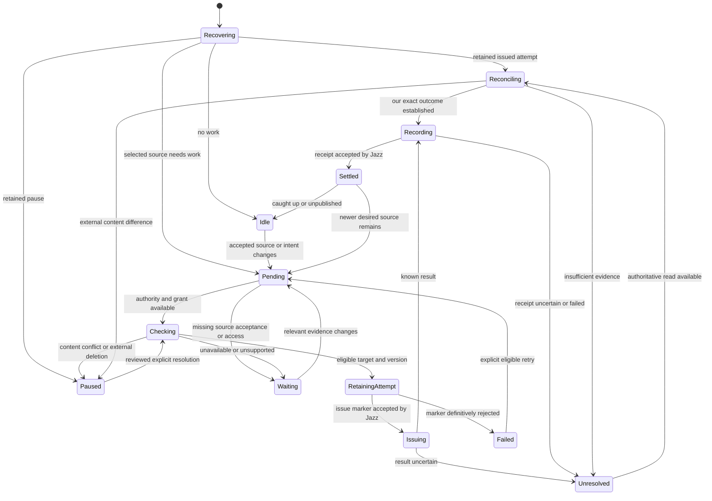

# Margin synchronization technical proposal

**Current checkpoint (2026-11-10):** Jazz alpha.60/Vercel and native identity integration are merged. [Implementation status and open publication work](../../specs/001-jazz-clipper/atproto.md) supersede the upgrade-wait instructions below. The approved publication subset remains accepted; other mechanics remain proposals, with no publication implementation yet.

Prepared 2026-11-07 for one combined review. **Approval update:** the user approved the [companion fields and grouped synchronization approach](../../specs/001-jazz-clipper/design-decisions.md#accepted-companion-fields-and-grouped-synchronization--2026-11-07). Other candidate private shapes and exact processes below remain proposals. The [product checkpoint](../atproto-research.md#accepted-publication-behavior) and [accepted decisions](../../specs/001-jazz-clipper/design-decisions.md#accepted-ongoing-publication-synchronization--2026-11-07) govern the outcome. This document authorizes no implementation, tests, dependencies, migration or deployment. Jazz alpha.60 and the Vercel backend are now adopted; native auth is merged in PR #20. Start from the standard Jazz lifecycle; the detailed executor/storage mechanics below are retained proposals, not the upgrade plan.

## Recommended approach

Use existing `at.margin.note` records for the shared public content, alongside the proposed Clipper highlight/note companions described in the [companion Lexicon proposal](clipper-companion-lexicon-proposal.md). Keep originals and private publication evidence in Jazz. Run a single synchronization executor in Clipper's backend, using the existing AT OAuth integration. Browsers save content and explicit choices through Jazz; they do not each become PDS writers. Start with one active backend writer and retain evidence across restarts; do not add an external queue, new database or general DLF publishing service for this slice.

This is a recommendation about the initial architecture, not a claim the current Node proof is qualified to host it. More replicas or overlapping writer processes require additional ownership qualification. A local mutex is not a distributed fence, and PDS conditions do not make a Jazz/PDS transaction atomic.

## 1. Public record mapping

### Proposed common fields

| Field             | Article note                                          | Highlight with commentary                                     | Bare highlight    |
| ----------------- | ----------------------------------------------------- | ------------------------------------------------------------- | ----------------- |
| `$type`           | `at.margin.note`                                      | Same                                                          | Same              |
| `motivation`      | `commenting`                                          | `commenting`                                                  | `highlighting`    |
| `target.source`   | Public article source URL                             | Source URL for the quoted representation                      | Same              |
| `target.selector` | Omitted                                               | `TextQuoteSelector` with exact text and bounded prefix/suffix | Same              |
| `body.value`      | Current selected note text                            | Current attached note text                                    | Omitted           |
| `body.format`     | `text/plain`                                          | `text/plain`                                                  | Omitted with body |
| `createdAt`       | Stable first-publication time retained in the binding | Same                                                          | Same              |
| `modifiedAt`      | Fixed timestamp of the issued content update          | Same                                                          | Same              |

Recommend a small companion family alongside Margin: a separately addressable highlight and, when present, an independently addressable note. Their candidate fields link the matching Margin version, public article and related companion; they do not duplicate quote/commentary or expose private Jazz IDs. The [companion proposal](clipper-companion-lexicon-proposal.md) contains illustrative Lexicon definitions, discovery conventions and lifecycle costs. Names use an example namespace; the real namespace remains unselected. The user approved the named companion fields in the subsequent review. These common-content examples use the inspected [Margin note schema](https://github.com/paddinglabs/margin/blob/27146212068968bfb506554332430d127d33644c/lexicons/at/margin/note.json).

Recommend omitting optional title, source hash, generator, color and other additions from newly created records until the consumer has a concrete need for them. This is payload minimization, not a proposal to remove those fields from records another app has enriched. No Clipper organizational tags are exported. The proposed fields above are the initial **owned content projection**; existing additional valid fields are preserved when updating an observed record.

Example candidate payload, with invented source text and timestamps:

```json
{
	"$type": "at.margin.note",
	"motivation": "commenting",
	"target": {
		"source": "https://example.org/offline-reading",
		"selector": {
			"type": "TextQuoteSelector",
			"exact": "A saved article should remain readable offline.",
			"prefix": "Readers expect this: ",
			"suffix": " Synchronization can wait."
		}
	},
	"body": {
		"value": "Test this after closing the browser completely.",
		"format": "text/plain"
	},
	"createdAt": "2026-11-07T12:00:00.000Z",
	"modifiedAt": "2026-11-07T12:01:00.000Z"
}
```

Deleting the attached note would omit the body and change the motivation to `highlighting` at the same public address. Restoring the note text would include the body and return to `commenting`. The common Margin target remains the highlight. A note companion identifies the independent note entity, not each revision; removing that note also removes its companion and the highlight companion’s note link. Article-level note clearing remains a content edit, not an inferred deletion; the candidate preserves that entity rather than interpreting empty text as removal.

Use the accepted note, quotation and context bounds. The actual source URL and quote evidence must describe the same representation. Do not substitute a private reader URL or reader offsets on the original webpage. Proposed normalization/extraction must have fixtures before freezing its version; unsupported or contradictory anchors are a blocked projection, not permission to guess. Existing local access to unresolved quotes/notes remains available.

### Comparing and preserving fields

Recommend two separate comparisons:

1. **Owned meaning:** compare the observed note/quote/source with the last settled owned projection, accounting for an unresolved attempt first. A change here enters the accepted content-conflict pause.
2. **Whole record identity:** retain the current full record and CID for the conditional mutation. Metadata-only changes can advance this observation without causing a content conflict.

Recommend ignoring only a change to another app's modification timestamp as a content conflict when the owned meaning is unchanged. Preserve that observation; Clipper proposes setting its own `modifiedAt` only when issuing a content mutation. The comparison must not confuse timestamp churn with a changed quotation or note.

The candidate projector changes only its reviewed fields on that freshly observed full record; it does not reconstruct the whole record from a narrow DTO. Preserve additional fields at each object level, including tags inserted by another app. Never copy those tags into private organization. A malformed/unsupported core or selector is not automatically harmless metadata. Exact equivalence rules for selectors, nested fields and app-specific additions belong in the reviewed projector contract.

Changing a body can invalidate another app's text facets. Recommend treating facets as dependent on their corresponding text, not blindly carrying byte offsets across changed text. For the initial plain-text projector, propose removing stale body facets when Clipper changes that body, while preserving independent metadata. This exception needs review with the mapping; it is not selected by the general metadata-preservation decision. The [Lexicon specification](https://atproto.com/specs/lexicon#usage-and-implementation-guidelines) warns about stripping unknown fields during serialization.

### Explicit adoption of the public version

Propose applying only supported shared content to the existing local highlight/note entities, through a normal conflict-preserving Jazz revision. Retain Clipper-only anchors/history; do not import public tags or replace the entire local object. A changed quotation/source needs new anchor validation rather than mutating old selector evidence. Recheck both compared versions before applying the user's choice; a newer difference returns to review.

An external bare highlight adopted over a combined annotation would remove the local attached commentary only as part of that explicitly reviewed action. A public article note remains an article note; an unsupported type/source cannot silently convert the local parent structure. Oversized/unsupported external content remains recoverable for comparison and cannot be silently truncated to force adoption. Exact handling for that exceptional import is deferred rather than given a new automatic policy here.

## 2. Private records and ownership

Recommend three logical groups in the existing Jazz database, with separate write authority. Names are candidate names, not implemented tables or a frozen SQL/DSL schema.

| Candidate group       | Candidate contents                                                                                                                                                                                                                                                                                                                                   | Authority                                                                                                |
| --------------------- | ---------------------------------------------------------------------------------------------------------------------------------------------------------------------------------------------------------------------------------------------------------------------------------------------------------------------------------------------------- | -------------------------------------------------------------------------------------------------------- |
| `publicationIntents`  | Intent ID; library/source-root identity; action (`publish`, `unpublish`, explicit conflict choice or authorized recreation); reviewed destination DID; causal predecessor references; reviewed source/remote version evidence where required                                                                                                         | Owner can append scoped intent; backend validates it against verified identity and current domain access |
| `publicationBindings` | Binding ID; library; source kind and independent note/highlight ID; verified destination DID; retained Margin and companion addresses, including independent note mappings; first-publication time; last settled owned projection/full-record observation/CID; observed deletion provenance; unresolved attempt reference or retained pause evidence | Backend writes; owning library can read a safe projection                                                |
| `publicationAttempts` | Attempt ID and binding; source version references; intent generation; exact group writes/deletes; observed target CIDs/absence and repository-head condition; issue marker; acceptance/rejection/unknown evidence; retained conflict comparison when needed                                                                                          | Backend writes; owner reads only appropriately scoped results/content                                    |

Private snapshots needed for reconciliation can contain note/quote text; protect them as library data, not telemetry. Tokens, DPoP keys, auth-session records and raw SDK handles never belong in these groups. Scope every relationship to the same library and verified publication identity. Clients must not forge backend receipts, public bindings or accepted status by updating an owner-readable row. Separate rows/groups avoid assuming unavailable field-level permissions.

Recommend one binding per environment, library, source root and destination DID, allocated through an authority-validated serializable transaction. A highlight is the root for its combined note; a standalone article note is its own root. Allocate valid TID keys on the backend and retain every group target before any PDS create. The Margin root and highlight companion may share a key across collections; an attached note gets its own independent retained key. Updates and restoration of the same entities reuse their addresses; a distinct replacement note gets a new address. Do not expose a local Jazz ID by using it as the public key. The public address remains distinct from each content CID. [Record-key rules](https://atproto.com/specs/record-key), [TID rules](https://atproto.com/specs/tid)

Source edits need not append a second publication command for every keystroke. The executor derives desired content from accepted source revisions plus retained explicit intent and Trash/deletion state. Publication intents exist for the user's publication choices, not as a replacement document database. Concurrent contradictory intent heads must not be ordered merely by wall-clock time or silently selected; preserve them and withhold new issue pending resolution under the existing conflict-preserving approach.

Permanent deletion must leave sufficient scoped binding/tombstone evidence to finish the public removal. Do not cascade away an unresolved attempt or the only known target before settlement. Source deletion/Trash and their necessary publication evidence must be captured coherently at the authority boundary. The concrete domain transaction and retention/cleanup schema must be reviewed before implementation.

## 3. Execution and Jazz acceptance

Recommend an invoked backend executor using the process lifetime already owned by the Node host. It reads accepted Jazz source/intent state, verifies the account-to-DID binding and current publication grant, and obtains the existing plugin's server-only authenticated client. The installed plugin exposes `getAtprotoClient`; that helper is not authorization by itself. Caller-controlled DID or source IDs cannot authorize a privileged backend operation. Evidence: installed `@kingironman2011/better-auth-bsky@0.3.2` `src/server.ts` and Clipper's `apps/web/src/lib/server/auth/server.ts`.

Credentials remain in the existing durable auth store. Private publication data remains in Jazz. Recommend a server-side content projection and native schema/policy validation even when the browser supplied the same preview. A browser preview is not trusted payload authority. The future permission grant should cover the required `at.margin.note` and both companion-collection actions, separately from identity-only use; progressive consent in the installed adapter still needs qualification.

The source acceptance rule is already approved. Recommend consuming a source/intent snapshot at Jazz authority tier rather than trusting a browser's “saved” flag or a local-only subscription. Retain the source revision IDs/fingerprint in every issued attempt and establish authoritative acceptance of the attempt's issue marker before the PDS request. A lost local write handle is not repaired by guessing that all visible rows were accepted.

Revalidate observed publication intent, binding generation and source eligibility after retaining the marker and immediately before issue. Superseded unissued work must not proceed just because a marker exists. Another device can still commit to Jazz after the final check; the PDS does not atomically check Jazz state. Treat that irreducible cross-service window as issued work requiring settlement and follow-up, not a claim of instantaneous revocation or an atomic local/public change.

The pinned SDK has global write waits and authority-validated serializable transactions, but those are **source evidence, not a selected future-release API**. Verify snapshot provenance, read tiers, related-row consistency, authorization and transaction semantics against the release before implementation. Current Clipper has independent notes/revisions but no complete highlight schema or publication records; the domain model and actor integrations must precede a claim that this proposal runs. Relevant local sources: `packages/jazz-tools/src/backend/create-jazz.ts`, `src/runtime/db.ts`, and Clipper `apps/web/src/lib/backend/jazz/{schema,permissions}.ts`.

“Latest” means the latest eligible server-accepted snapshot visible at admission. A backend cannot observe a newer edit still isolated on an offline device. That edit follows when accepted after reconnect; no cross-service atomicity or awareness of disconnected devices is promised. A source change after issue is subsequent work, not a reason to change the already-issued request or label the newer version settled.

Recommend server-side target checks on startup, before mutation and explicit refresh, plus bounded periodic checks while the backend is running. A tentative starting interval is 60 seconds, honoring service backoff; validate request volume before adopting that default. This avoids a firehose/indexer dependency for the first slice. It is eventual detection, not real-time monitoring. If the host sleeps or no valid OAuth grant remains, work waits; this proposal does not promise publishing while the host is unavailable.

One active writer is an operational requirement for this starting proposal. Do not implement automatic lease-expiry takeover as if it fences an old request at the PDS. Restart must first reconcile retained issued work, and deployment must prevent overlapping executors. Horizontal scaling, overlapping deployments or distributed scheduling are deferred until actual fencing/coordination behavior is qualified. This does not select a hosting provider or provision anything.

Browser identity changes stop that browser's admission, but cannot instantly revoke an already accepted backend task while offline. Propose server-observed logout/access-loss invalidation as an explicit admission boundary, with already-issued work retaining its owner. Do not claim that closing a tab, losing a cookie or an offline logout cancels remote work the backend already accepted. Exact sign-out/grant wiring requires review alongside execution ownership.

## 4. Conditional mutations and recovery

Recommend one `com.atproto.repo.applyWrites` batch for the Margin record and its companions, conditional on `swapCommit`. This supersedes the earlier single-record put/delete recommendation. Retain exact group operations and a coherently inspected repository head before issue; verify target presence and versions against that head. Unrelated account writes can invalidate the condition: reread and reclassify rather than overwrite. Individual batch items do not supply per-record `swapRecord` conditions.

Creates require inspected absence at the retained addresses; updates/deletes require inspected matching records. Compute the exact new Margin CID with maintained AT serialization tooling before building its strong-reference companions. No JSON-string hash or unconditional fallback. The [companion proposal](clipper-companion-lexicon-proposal.md#recommended-group-transaction) explains the group evidence and lifecycle mapping. The [batch API schema](https://github.com/bluesky-social/atproto/blob/fe343a1b90c1de470a45b0469628a9e75e7d883f/lexicons/com/atproto/repo/applyWrites.json) defines repository-local batching and its commit condition; coherent reads, canonical CID calculation and runtime atomicity remain qualification gates. This is not a transaction with Jazz.

A transport/auth failure is not confirmed record absence. Reconcile every retained group target after uncertainty, including partial observations caused by later foreign writes. Do not mark the group settled from the Margin record alone or infer that a missing companion authorizes recreation. Companion-only deletion/relationship conflicts and cleanup after external common-record deletion remain explicit proposals in the companion review.

Reconciliation first addresses the original target and exact unresolved attempt. Matching our issued payload/CID can settle our own lost response; unrelated owned-content changes pause for user resolution. A metadata-only change is preserved on a newly checked attempt, not treated as permission to overwrite a changed CID. An absence can describe never-created content, our deletion, external deletion or a lost/transient history; do not guess provenance from absence alone. Unprovable provenance stays unresolved or paused rather than automatically recreating or claiming exact attribution.

A rejected conditional mutation must not trigger delete-and-recreate fallback. An accepted PDS effect followed by failed Jazz receipt persistence remains unknown locally. The retained issue marker prevents a fresh create or another operation from bypassing reconciliation. Neither a timer nor lease expiry establishes rollback.

## 5. Proposed statechart and actor ownership

The proposed backend executor owns one bounded scheduling stream initially. For an admitted binding it invokes one synchronization owner, which invokes a finite attempt owner. Credentials/client handles stay in adapters with modeled release; components do not own the executor or reconstruct readiness.



This chart shows the main review path, not implementation code or every interrupt edge. Metadata-only changes stay within target classification, while a changed conditional CID rereads and reclassifies. A paused annotation cannot reenter automatic issue on reconnect, retry or a new local edit. “Use the public version” invokes a separate finite local adoption owner; it is not an outgoing put and cannot bypass its reviewed Jazz transaction. Only accepted adoption and fresh comparison can settle that resolution.

Every active state needs an explicit unexpected-child-error disposition. Before public issue, invalidation prevents issue and resolves the caller without a public effect. After issue, transition into a drain/custody state; retain the attempt until settlement or an explicit unresolved result. Account A → B → A uses a fresh generation, not just account equality. Cleanup failure is separate from success and cannot release permission to replay. The exact event protocol and source/receipt transaction owners remain part of the implementation review.

Propose discriminated finite attempt outcomes: accepted for an exact version/target, rejected with evidence, cancelled before issue, blocked for user/access action, unresolved mutation, or cleanup failure. Context retains immutable facts; it must not expose independent lifecycle booleans that allow combinations such as paused-and-automatically-issuing. A deferred operation is not public success. Each admitted caller gets exactly one correlated disposition while its owner runs; abrupt process loss is recovered from durable evidence rather than a fictional delivered result.

## 6. Lifecycle cases

| Sequence                                     | Proposed treatment consistent with accepted behavior                                                         |
| -------------------------------------------- | ------------------------------------------------------------------------------------------------------------ |
| Offline edit, restart, reconnect             | Keep local source and intent; backend issues only after authoritative acceptance; confirm the actual version |
| Note removed, highlight retained             | Keep same Margin address without body; remove note companion/link and refresh highlight companion            |
| Trash then Restore before any public request | Recompute current accepted desired state; do not manufacture a stale delete/recreate cycle                   |
| Trash delete issued, then Restore            | Settle/reconcile delete first; then restore at the same address when eligible                                |
| Unpublish while update is in flight          | Do not abandon the update; settle it, then remove its complete public group under retained unpublish intent  |
| External quote/note change                   | Retain comparison and pause; apply only an explicit reviewed resolution                                      |
| External metadata-only change                | Preserve valid additions and keep working with a fresh conditional CID                                       |
| External deletion                            | Preserve local source and pause; no automatic recreation                                                     |
| Public receipt lost                          | Reconcile original target/version before issuing anything new                                                |
| Later source rejected by Jazz                | Do not publish that change; retain local recovery and separate failure from any older accepted public write  |
| OAuth expires or is revoked                  | Wait for authorized reconnection without resetting source or public mapping                                  |
| New local edit during resolution             | Reviewed choice becomes stale; do not discard that newer edit                                                |

These are proposed transitions, not newly implemented guarantees. In particular, automatic reversal of an unissued Trash change is a recommendation about avoiding obsolete effects, while issued requests remain immutable evidence.

## 7. Qualification and delivery recommendation

The Jazz release is adopted and the companion/grouping subset is approved. After the remaining combined design choices are reviewed:

1. Qualify a disposable PDS client's conditional atomic group creation/update/deletion, coherent repository-head inspection, canonical CID calculation, unknown-field round trip, commit conflicts and missing/stale companion classification. No real notes or production grants are needed.
2. Implement and review Clipper's required domain entities/constraints and exact public projector. Qualify plaintext/facets, Unicode bounds, source/reader divergence and retained ambiguous content.
3. Implement the private publication records, authority policies and single-writer ownership. Review implementation before adding/running its tests, including nested transaction leaves.
4. Implement the actor tree and consumer interactions using approved copy or separately reviewed strings. Test cold offline restart, lost responses, receipt failure, duplicate/reordered events, source conflicts, concurrent intent, metadata races, Trash/Restore, account replacement and cleanup failure.
5. Qualify real OAuth consent and a second reader's display/edit/delete behavior on isolated data. A local harness does not establish deployed host durability or production interoperability.

The test matrix must compare exact target addresses, content and preserved private/foreign fields, not only counts or happy-path states. One browser going offline, the backend restarting and the PDS being unavailable are separate cases. Public copy deletion cannot prove network-wide erasure.

## Combined review requested

The recommendation package is: existing Margin record plus the candidate companion family and explicit field ownership above; three private Jazz record groups; one backend writer; stable retained public keys; authority-accepted source/issue evidence; conditional repository batches for the public group; preserved external metadata; and retained pause/unknown states. The companion fields and grouped synchronization approach are now approved as scoped above. Private record shapes, scheduling, key/discovery conventions and other exact execution mechanics remain proposals.

Release-dependent acceptance/policy APIs, progressive consent, conditional batch semantics, companion conflict/cleanup policy, imported-content edge handling and source anchoring are qualification gates, not reasons to silently substitute a weaker design. No new product-question sequence is needed unless review exposes a material ambiguity.
