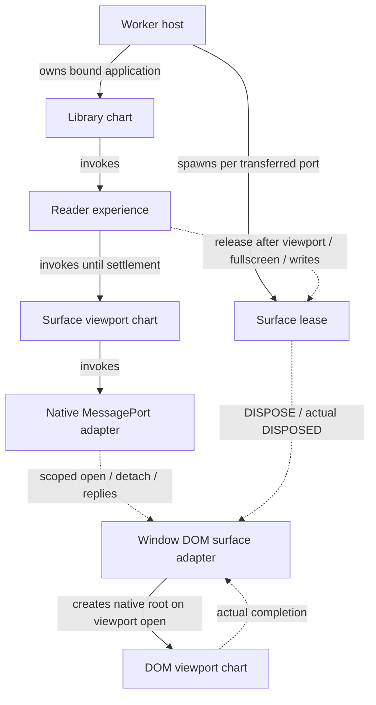
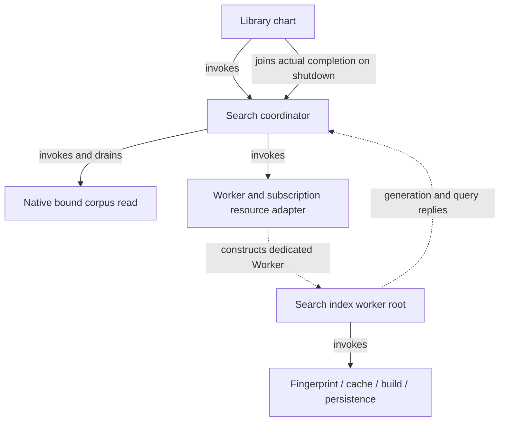
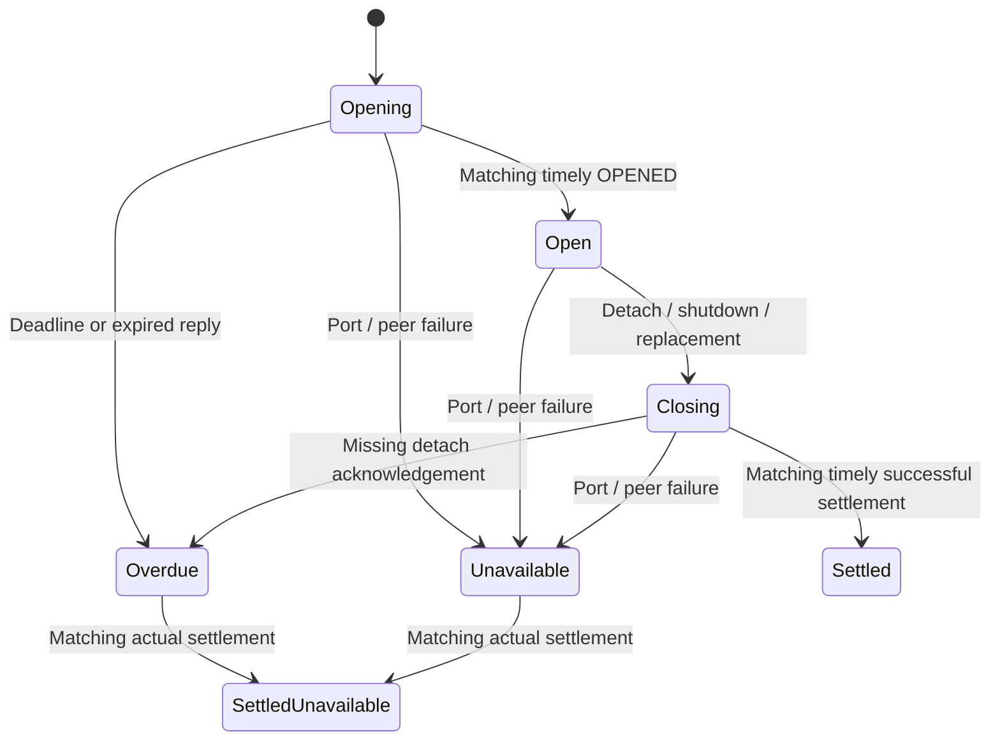

# Reader and search resource lifetimes

Change set E adds finite reply waits and recovery to the existing A–D ownership
graph. It preserves account scopes, final-position write custody, local-first
readiness and the public search error/retry controls. No dependency, catalog
wording, storage key or domain schema changes.

## Owners and invocation boundaries

The DOM viewport is an independent root at the native Window boundary. Its
adapter reports `VIEWPORT_OPENED` after startup and a scoped `VIEWPORT_SETTLED`
only after an actual terminal result. Settlement distinguishes successful and
failed native cleanup. Stopped/error roots cannot fabricate successful closure.
The direct DOM capability used by compatibility fixtures remains an invoked
viewport child. Neither native path has database access.

The search index chart starts independently at its dedicated Worker's message
boundary. Its parent coordinator bounds index/query replies, so a hung cache or
index operation does not need a second competing timer. Retiring this Worker
affects derived, account-keyed cache data. Original bound Jazz reads remain under
the coordinator until their promises settle; the library joins that completion
before allowing account/SDK shutdown. Admission is explicit: a consumer without a
search capability follows `unsupported` and owes no native-read drain. Its idle
command sink exits with the library. The extension's existing restoration flow
does not wait for unsupported search work.

## Deadline and outcome policy

The named defaults in `contracts/resource-waits.ts` are independently injectable
at the owning actor inputs. Native adapters observe monotonic elapsed facts;
guards compare those observations without reading clocks during calculation.

| Finite operation                     | Default    | Reason and expiry handling                                                                                                                                                                                              |
| ------------------------------------ | ---------- | ----------------------------------------------------------------------------------------------------------------------------------------------------------------------------------------------------------------------- |
| Viewport open/detach acknowledgement | 10 seconds | Local DOM/port work normally takes frames. This matches C's surface feedback bound. Report overdue, request detach and retain the original lease until actual settlement.                                               |
| Search corpus load                   | 30 seconds | Allow substantial local corpus/native startup work before reporting a stall. Request supported cancellation, retire the derived worker and keep the original read observed. Retry remains unavailable until settlement. |
| Search index reply                   | 15 seconds | Includes fingerprint, cache and index preparation. On silence, retire the derived worker and expose explicit retry. This is a feedback bound, not a large-corpus performance guarantee.                                 |
| Search query reply                   | 5 seconds  | An in-memory derived query should complete promptly. On silence, retire the worker and permit explicit recreation.                                                                                                      |

An open reader, dormant search, ready index and standing subscription have no
finite completion deadline. Completion exactly at a deadline is overdue, including
when timer delivery is delayed. Rejected and overdue outcomes remain distinct in
the charts. Existing localized failure messages and Retry controls are reused.

## Reader recovery and position custody

Overdue/failure feedback does not complete the viewport invocation or release the
surface. Reports with another attachment ID are ignored. Late open/measurement
messages cannot resume an unavailable reader. A late matching settlement releases
the original resource but retains the failed/overdue outcome and provides no new
final position. The last confirmed position and any already-issued write keep
their original owner; fullscreen and write settlement still precede lease release.
The separate Window `DISPOSED` acknowledgement remains required by C.

Replacement admission cannot bypass an unresolved old viewport. Once actual
cleanup and writes settle, normal detach/new-attachment admission can proceed;
a permanently lost peer requires the existing disruptive reload path. No timer
or transport error is presented as proof of clean account shutdown.

## Search recovery and native reads

Changed rows/dirty notifications continue to coalesce behind one issued corpus
read. A worker error or load deadline retires the derived resources and requests
cancellation, but keeps the original load invocation. Its late result is discarded
and enables a subsequent explicit retry; it cannot automatically index, restore
success feedback or launch overlapping whole-library reads. STOP similarly clears
private presentation facts and drains the outstanding read before completion.

Index/query timeout or failure can retry immediately because those resources are
derived. Retry allocates a new worker and generation. Disposed callbacks cannot
report into the replacement; generation/query guards reject stale replies. A
failed nonempty search has no result set; clearing its filter still reveals the
original saved library, and local saves remain available while search drains.

## Qualification

The [checkpoint record](workflow-hardening-progress.md#checkpoint-qualification)
lists final repository and browser checks: `pnpm verify` (852 tests in 126 files,
strict types, formatting/lint, zero Svelte diagnostics and production build),
26 Worker browser cases, 12 packaged-extension cases and eight production offline
cases. All passed against the final integration. Focused tests
exercise suppressed open/detach replies, failed ports/posts/observers, wrong
attachment receipts, exact-boundary completion before timer delivery, preserved
position writes, account expiry, noncancellable search drain and library shutdown.
An independent receipt-ledger campaign runs 120 schedules of up to 12 commands,
seed `20261118`, through real MessageChannels and the actual viewport chart.
Admission regressions distinguish stopping an unsupported idle actor from draining
an issued native read; account expiry cannot remove the latter's drain obligation.

Browser cases suppress the first native search Worker's index/query messages,
raise native transport/post failures and require fresh-worker search recovery.
Reader cases hold real Window settlement receipts through the production
10-second deadline and require host shutdown to wait for their late delivery.
Existing account replacement, packaged extension and production offline restart
checks remain acceptance gates. E is complete. F, G and Finance adoption keep
their separate scope and qualification requirements.
