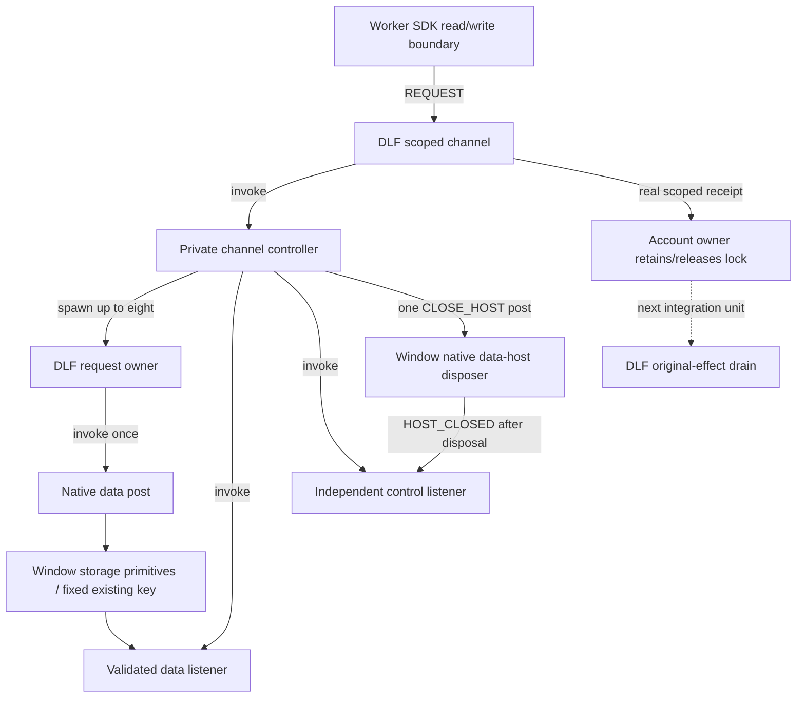

# Scoped account transport implementation

The user authorized continued implementation and testing while away. This unit
prepares the scoped storage transport; production account/broker routing still uses
the existing owners until unknown-write lock custody is integrated atomically.

## Ownership and invocation

`createScopedAccountStorage` creates one shared DLF channel at the Worker startup
boundary. SDK reads and writes send REQUEST commands to that existing root; they
do not start actors. The channel invokes its private controller, which spawns the
bounded request population and invokes native data/control listeners. Request
actors invoke one native post leaf each. All reply/deadline/close decisions remain
in those DLF charts. No generic lifecycle chart is copied into Clipper.

The diagram's account-owner connection is the required upcoming integration, not
a claim that the legacy account owner already implements it. This transport must
not be passed to the legacy `createWorkerAccountStore` owner: its write-error path
releases the lock before an uncertain host effect is proven quiescent.

## Native boundaries

`serveScopedAccountStorage` binds native primitives to exactly the supplied existing
key. It validates strict bounded wire DTOs, immutable scope and exact FIFO sequence
before any storage effect. Worker payload validation precedes channel admission,
so a refused oversized write consumes no wire sequence. Native post refusal closes
the channel; a posted peer rejection can preserve sequence continuity. Request IDs,
scope and sequences never select another storage namespace.

Window executes only synchronous `getItem`/`setItem` and reply posting. Post failure
disposes its data host without manufacturing a receipt or replaying a primitive.
The independent `serveHostClose` handler disposes the old data host before emitting
a validated receipt. Native disposed flags, FIFO counters and listener teardown are
transport resource facts; they do not select account identity or SDK transforms.

The Worker validates bounded replies, closes all unexpected transferred ports and
reports decoded facts to DLF. It does not maintain another request map or timer.
The channel correlates scope/request ID/sequence and settles each observer once.
The storage facade exposes `host.identity`, `host.closed` and `host.requestClose`
for the account owner's proof/custody composition. Failed writes preserve bounded
effect-outcome and request-identity metadata; errors contain no rejected value or
raw native diagnostic. A forced `dispose()` rejects closure observation and fails
pending observers conservatively; it is disruptive teardown, not clean closure.

## Qualification boundary

Eleven native scoped-storage tests pass: concurrency, out-of-order/stale replies,
fixed key, validation before sequence allocation, FIFO admission, native failure,
dropped WRITE acknowledgement, delayed/wrong close receipts, malformed transfer
cleanup, post failures, port failure and forced disposal without a false receipt.
The lost-acknowledgement case observes an actual completed primitive, unknown
output retaining its original scope/sequence, continued custody observation past
the close deadline, and exactly one write after late closure. It does not assert
the legacy account owner retains its Web Lock.

The compatible archive includes the qualified DLF transaction/supervisor and the
request/channel/effect-drain modules. All 258 baseline files remain byte-identical;
only public exports and the new modules are added. The A archive is preserved.
The B artifact is pinned to DLF `1571ba2`, with reproducible hashes in
`vendor/worker-transport-provenance.json`. Both application manifests use that
artifact; native Jazz alpha.60 adapters and the existing recovery/view patch remain.

Next, the account owner must retain the original issued-write receipt and native
lease through uncertainty, notify the SDK observer without stopping custody,
cancel queued locks safely, wait for actual native release, and hand native
receipts to a longer-lived keeper on forced actor stop. Root shutdown must await
that custody before acknowledging realm closure. Only then cut over production
storage/broker wiring and qualify dropped/late replies with the actual SDK owner,
extension, offline restart and account bindings. SHARE-3, REC-3 and DLF-3 stay open.

The compatible artifact passes full `pnpm verify` (vendor, format, lint, web and
extension checks, 691 unit/native tests and production Netlify build), all seven
worker browser cases, 12 packaged-extension cases and eight production-offline
cases. Final canonical-schema and complete issued-identity assertions additionally
pass strict TypeScript, all native/unit tests and the worker browser suite. The
extension/offline results qualify unchanged production routing with this artifact;
they do not claim the new account owner has been integrated. Existing app and DLF
Jazz imports resolve the same installed native SDK module. The reproducible archive
hash is `1ffa8d8490915da61fb7dc9a600733eed00dcce33cdc772ca0a12d1bbf0d95b1`.
