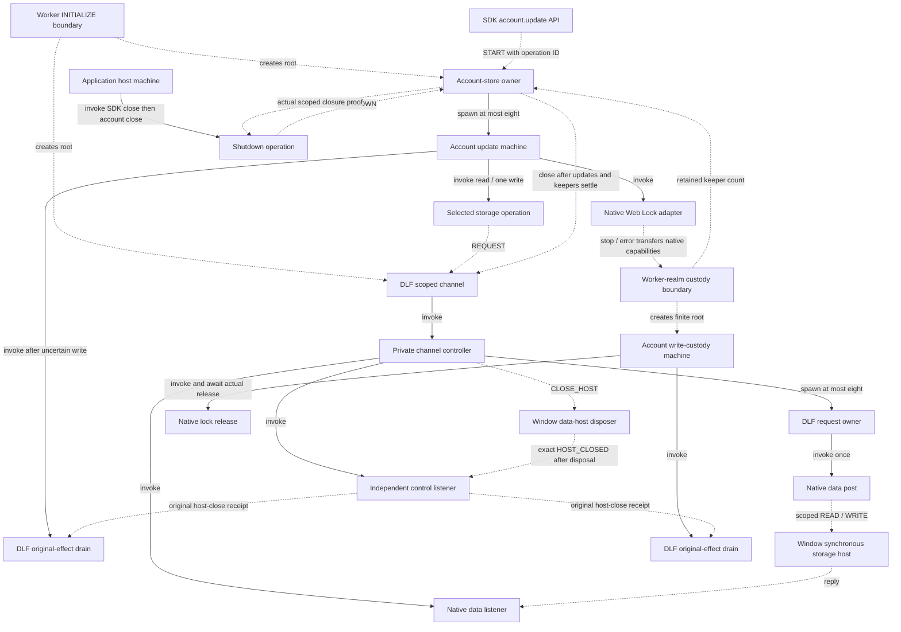
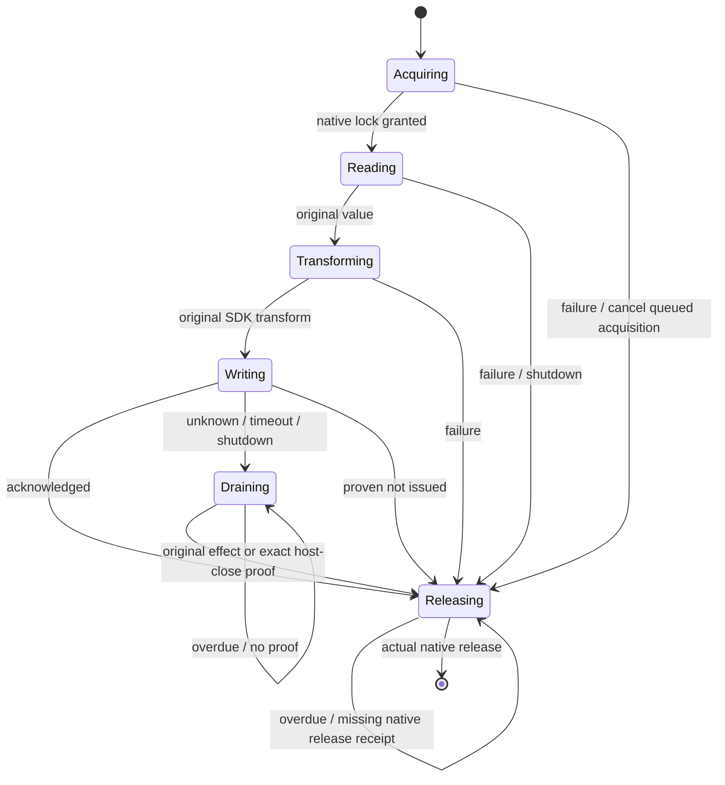

# Scoped account transport implementation

Production application account storage now uses the scoped DLF channel and a
Worker account-store owner. Broker migration remains follow-up work.

## Ownership and invocation

Solid edges describe actor ownership. Dotted edges describe API, native message or
receipt coordination. The SDK boundary and detached-custody boundary label root
creation explicitly; keeper roots deliberately survive forced account-owner stop.

The SDK promise facade starts one account root at Worker initialization. It only
allocates operation identity and settles native observers; admission, transform,
write, failure, drain and shutdown decisions live in charts. The channel root is
also created once, never from an individual read/write leaf. Detached keeper roots
start only on native custody handoff, with result/error observation attached.
They cannot be children of the stopped account owner because their lifetime must
continue. A keeper retains the original operation/scope and native receipts;
it cannot read another account, transform data or issue another write.

## Account update and shutdown

Unknown output settles the SDK observer once and retains custody. Late proof
permits release but never changes that failed result or replays the transform.
A known write acknowledgement stays acknowledged if release becomes overdue.
Before-write failures remain not-issued. Success requires the native lock request
promise to settle after release, rather than merely calling a release function.
The owner rejects new updates after shutdown and waits for both update children
and detached keepers before requesting exact channel/host closure. The application
host awaits SDK closure and this account-store closure before emitting `CLOSED`.

Deadlines are named, injectable chart policies: the account owner defaults to
10 seconds per lock/read/write/release wait; the scoped channel retains its
10-second request/close policy. These bound local native/IPC feedback, not remote
synchronization. They report overdue and retain issued-effect custody. No timeout
claims rejection, safe replay, successful shutdown or native release.

## Native state outside charts

The Window host validates strict bounded wire schemas, immutable scope and exact
FIFO sequence before synchronous `getItem`/`setItem` at the selected existing key.
Its close-control listener exists before key binding; close-before-binding prevents
later resurrection. Data handlers are disposed before a host-close receipt.
Post failure disposes the data host without replaying the primitive.

Native disposed flags, sequence counters, MessagePorts, promise resolvers,
subscription collections and Web Lock release gates remain adapter resources.
The native write ledger records only original receipts, outcomes and custody
handoff. It registers before issuing the write, revokes late orphaned I/O and
permits only one handoff. Immutable machine context holds workflow facts.
Native bookkeeping does not choose a storage namespace, SDK transform, retry or
account transition. All domain and Jazz work remains in the Worker.

Forced `dispose()` fails pending observers and rejects clean closure. It does not
stop detached keepers or treat actor termination as proof. Window hard teardown
disposes its native data hosts before terminating the Worker. An unobservable
receipt or failed keeper remains blocked; no synthetic completion clears custody.

## Qualification and remaining work

Native tests cover actual Web Lock serialization, queued cancellation, capacity,
read/transform failures, not-issued writes, dropped acknowledgement, late proof,
release failure/timeout, forced stop, child failure, revoked late I/O and reentrant
stop during posting. Chromium tests combine the real account facade, Workers,
MessageChannels, localStorage and Web Locks: a dropped WRITE reply retains the
lock past timeout and a competing operation stays blocked until matching closure
proof. Wrong close IDs cannot release it. The forced-owner-stop variant proves
custody survives independently without claiming clean owner closure.

See the [checkpoint record](workflow-hardening-progress.md#checkpoint-qualification)
for final regression counts and archive provenance. Both consumers use DLF source
`1571ba2`; all native alpha.60 module bytes and existing patches are preserved.
Web v2 and extension v1 keys/locks remain unchanged.

Broker routing is unchanged. Its scoped-channel migration, transferred-port cases,
Finance adoption and the rest of change sets C–G remain open. The legacy account
owner remains for compatibility fixtures and must not be supplied the new scoped
transport: its old write-error release path does not implement this custody contract.
