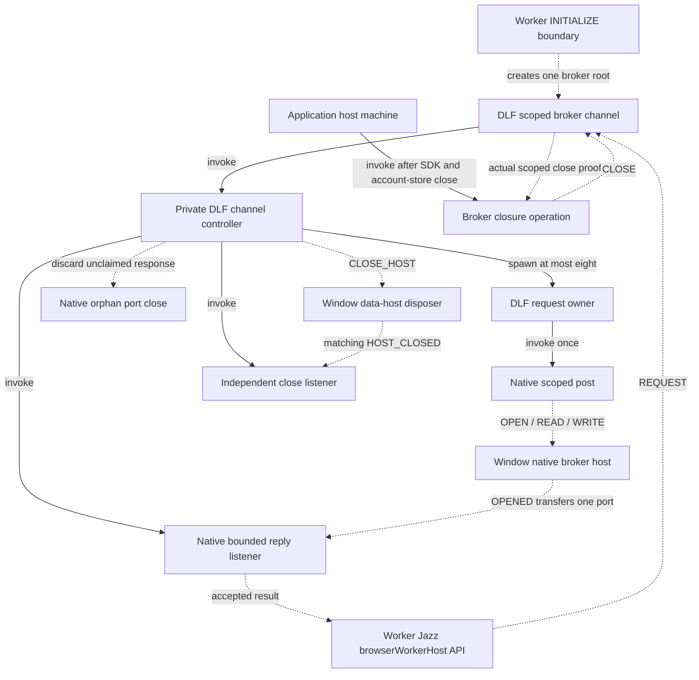

# Scoped broker transport

Change set B now uses the same shared DLF request/channel owners for production
account storage and broker traffic. `broker-channel.ts` implements the native
Window boundary and the Worker SDK promise facade. It contains no second request
map, deadline timer, replay loop or copied lifecycle machine.

## Invocation and ownership

Solid edges describe actor ownership; dotted edges describe native/API
coordination. The channel root is created once at the Worker initialization
boundary, rather than inside an individual SDK operation.

The SDK owns a successfully delivered broker port. Closing the transport removes
Window listeners and prevents future host operations; it does not close ports
already transferred to the SDK or claim the persistent SharedWorker has terminated.
Unexpected, stale, duplicate, wrong-kind or malformed transfers are closed. A
failed native reply post closes any acquired port that was not transferred.
There is no automatic retry of OPEN or generation WRITE.

## Protocol and native boundaries

Each initialization receives fresh data/control ports and an immutable UUID scope.
Requests carry version, scope, request ID and monotonic sequence. Validation occurs
before channel admission. The Window host consumes exact FIFO sequence before a
fallible primitive, preventing duplicate execution. It refuses foreign origins
and credential-bearing URLs before SharedWorker construction; the SDK still owns
resolved URL/name selection and generation policy. The native host bounds retained
broker error-listener handles at 32, following the pinned Finance requirement.

Generation keys retain `jazz:shared-worker-generation:jazz-runtime:` and their
original SDK-selected suffix. Reads return the raw bounded stored representation;
parsing/fallback remains with Jazz. Writes validate safe nonnegative generation
representations without changing the selected key or value. Account selection
continues using the existing web v2 and extension v1 keys and locks.

Replies use strict composed schemas and OPENED must carry exactly its one declared
MessagePort. Payload, unknown/extra fields and extra transfers cannot bypass
cleanup. Native errors produce sanitized bounded facts; raw values, native
exceptions and private configuration are not emitted as diagnostics.

The DLF channel defaults to eight pending requests and ten-second request/close
feedback deadlines, both injectable for qualification. An expired posted OPEN or
WRITE is unknown. Close timeout or control error reports overdue while retaining
the independent receipt listener. Only the exact original scope and close request
ID complete closure. Actor disposal rejects closure observation; it does not
manufacture a receipt. Window hard teardown disposes data handlers before Worker
termination.

Application shutdown is explicitly ordered: domain drain and actual SDK close,
account-store updates/custody and host close, then broker-host close. The Worker
emits CLOSED/navigation only after these operations complete. Broader account
binding and session-close recovery work remains in C.

## Consumer comparison

The extraction comparison remains pinned to Finance
`1125c5f1dc3d99c484988b6c4053e5d25526a45a` and Clipper's pre-extraction
`71cdd08008cc0f79bbe1f94d67d94ad401f8fbb5`. Clipper's final B implementation
uses DLF source `1571ba2` through the existing qualified compatible artifact.

| Guarantee                                                     | Shared contract and Clipper evidence                                                                          | Finance-specific boundary                                                         |
| ------------------------------------------------------------- | ------------------------------------------------------------------------------------------------------------- | --------------------------------------------------------------------------------- |
| Eight concurrent requests; scope/request/sequence correlation | Shared channel; native out-of-order/capacity/stale/duplicate tests                                            | Finance wire operation names remain local.                                        |
| FIFO effects and native post refusal                          | Validate before allocation; refused post closes scope; native effects consume sequence once                   | Finance's fixed account/broker binding stays in its adapter.                      |
| Native port custody                                           | Strict transfer validation, discard unclaimed replies, failed-post cleanup; actual SharedWorker browser tests | Exact broker URL/base-name/generation-suffix binding remains Finance-owned.       |
| Lost WRITE and late host closure                              | Original result stays unknown; independent exact receipt; real account-store Web Lock retained until proof    | Inventory, earlier-key selection and migration remain Finance-owned.              |
| Queued lock cancellation and actual release                   | Scoped account update/keeper native tests                                                                     | Finance's account-selection policy is not extracted.                              |
| A → B → A isolation                                           | Actual scoped broker adapter rejects delayed old-scope results/effects; account namespace is unchanged        | Before any Finance adoption, repeat against its actual adapter and account owner. |

SHARE-3 and REC-3 are qualified for Clipper's production composition. DLF-3's
consumer comparison and Clipper adapter evidence are recorded here. Finance has
not adopted these exports; its actual-adapter adoption gate remains mandatory
before such a future change. No Finance source or dependency is modified by B.

## Qualification

Native scenarios cover healthy SDK calls, exact generation keys/raw reads,
pre-admission bounds, out-of-order concurrent replies, capacity refusal, stale
scope/sequence/IDs, duplicate effects, foreign origin, malformed/extra transfers,
wrong response kind, post/constructor/port/worker failures, lost WRITE replies,
late OPENED, forced disposal, native listener bounds and A → B → A isolation.
The independent resource ledger generates 120 campaigns with up to 12 commands,
seed `20261115`, with complete contract-model state/event/transition coverage.
It observes one outcome, no replay and disposal of every unclaimed native port.

Two Chromium cases use actual dedicated Workers, SharedWorkers, MessageChannels
and localStorage: successful SDK port ownership after transport close, and a late
OPENED after timeout followed by overdue/wrong/matching close receipts. The latter
observes exactly one native broker construction and one orphan close. Host tests
separately prove SDK → account store → broker closure ordering and refusal of clean
closure on broker close failure.

The extension harness permits isolated test authorities; its default URLs and
all capture, identity and reader assertions are preserved.

See [the implementation checkpoint](workflow-hardening-progress.md#checkpoint-qualification)
for final full regression results. These are bounded scheduling qualifications;
they do not claim exhaustive schedules or completion of C–G.
