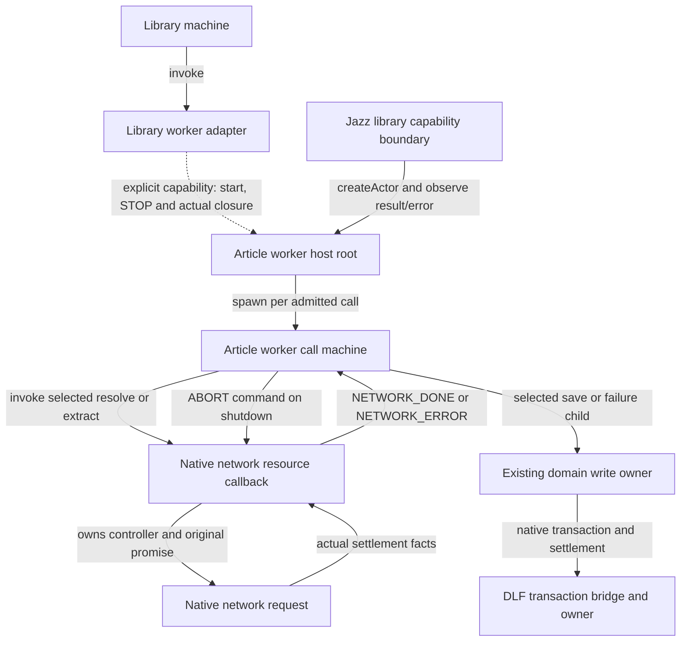

# V6 contracts and calculation cleanup

Change set G finishes the remaining ownership and authoring work against the
installed, unpatched `xstate@6.0.0-beta.1`. It preserves the A–F drain, account,
write-settlement and deadline contracts. No new workflow framework, dependency,
schema migration or catalog wording is introduced.

## Network resource ownership

The article-call chart now invokes a native network resource. Only that admitted
callback allocates its AbortController and starts the selected request. Transition
calculation, initial-transition exploration and `.can()` do neither. Shutdown
sends `ABORT` once and retains the same invocation until the original promise
settles. The chart suppresses late/stale results after drain. Stopping an observer
is never a network-settlement receipt.

The host root already exists at `backend/jazz/library.ts`; G adds no independent
root. Its capability adapter supervises STOP and actual completion. The call's
native resource remains a child of the call chart. Lookup and write paths retain
their existing owners and interruption policy.

## Private coordination and explicit state contracts

| Contract                | Implementation                                                                                                                                                                                                                                              |
| ----------------------- | ----------------------------------------------------------------------------------------------------------------------------------------------------------------------------------------------------------------------------------------------------------- |
| Library refresh         | `CAPTURE_UPDATED` is private; real collection, worker, child and subscription reports remain public.                                                                                                                                                        |
| Reader sync refresh     | `REFRESH_SYNC` is private and removed from the image queue's unrelated public protocol.                                                                                                                                                                     |
| Shell attempt/deadline  | `ATTEMPT_SETTLED` and `TIMED_OUT` are private; native `STATUS` remains deliverable.                                                                                                                                                                         |
| Domain staging          | Only `STAGE` is public. The selected queued mutation precedes `enq.sendTo(self, STAGED)`. A throw prevents acknowledgement, receipt and commit. Every production user of the common domain model uses this delivery, including the compatibility consumers. |
| Save and call input     | Prepared record data has state context refinements; selected call/save payloads use typed state input.                                                                                                                                                      |
| Image input and reports | Processing bytes have the processing state's lifetime. Asset loading requires an admitted asset ID; URL ownership/availability refine context. An explicit recipient accepts only `ImageViewReport`.                                                        |
| Reader write            | Selected change, operation ID and observed rows enter the writing state together. Original issued identities and receipts remain owned through drain.                                                                                                       |
| Sign-in confirmation    | Each confirmation entry supplies the selected account ID, including Retry. The original ID remains available for observation matching.                                                                                                                      |

State contracts declare concrete IDs matching the previous derived IDs. This
lets the beta check existing absolute targets and entry requirements without
casts, assertions or changing the runtime state graph. Type-only schemas do not
replace canonical runtime Zod validation at untrusted boundaries.

DLF's `TransactionDomainChild` previously required the private `STAGED` command.
Source `9c13e3f` corrects that public contract to `STAGE`. Its package consumer
uses a private acknowledgement, checks forbidden external delivery at compile
time, and executes the real bridge. Clipper adopts
`delightful-local-first-auth-lifecycle-9c13e3f-alpha60.tgz`, SHA-256
`8812fc4825b6b0f53ca199c84dc41b328cf7edb2c0163db425b6651c25a028ee`.
Compared with the prior qualified artifact, exactly one declaration file changes;
all runtime bytes and exports are unchanged. The provenance records the exact
committed source and hashes of the 12 added source modules.

## Calculations and smaller reuse

The library defines its event union once. Its row update calculates the patch
once, sends the resulting rows to search, then schedules capture/reader refresh.
Child spawning and completion subscriptions retain their order and typed reports.

Readiness retry/re-observation calculates the new attempt number once and uses
that same number in the command and returned patch. Restoration clears the phrase
through the same named calculation on each terminal path. Library-drain reason
selection uses a named predicate; literal destinations remain in the chart.
Closing retains the original binding and release-before-shutdown effect order.

The sync owner keeps one observer per current document revision. Replacement
retires only the prior observer; it never cancels or repeats a write. Completion
looks up the owning watch once, reports only an admitted settlement, and removes
that watch through a pure calculation. Late replaced outcomes cannot report for
the new observer.

Gzip, Brotli and deflate select a validated format and share one decoding state.
Identity/empty encoding still uses the original bytes; unsupported encoding still
maps to `unsupportedMedia`, and decoder failure/size refusal still maps to
`sourceTooLarge`. Organization charts still explicitly select tag versus property
history sources and share their typed completion configuration. Pure local-receipt
collection is reused by record/article saves without changing local, remote or
unknown settlement distinctions. Empty leaf/callback protocols replace `UNUSED`.

## Rejected deliveries and qualification

Production root options now observe rejected deliveries separately from inspection.
Diagnostics are enabled by the existing debug policy. They record an allowlisted
lifecycle event name, bounded reason, origin and static sender machine name.
They exclude payloads, dynamic actor IDs, schema issues, errors, credentials,
phrases, URLs and context. Diagnostic failure cannot affect actor delivery.

A repeated external command to an already closed actor and a late native result
after its observer was deliberately retired can produce benign stopped deliveries.
They do not reopen work or acknowledge settlement. Required actor-origin shutdown
commands and completion/report recipients must still be live; tests check those
separately rather than treating every dead letter as a failure.

Behavioral evidence includes:

- Repeated initial-transition, transition and `.can()` probing allocates nothing;
  the live network actor allocates once, aborts once and waits for real settlement.
- Forged private events are rejected while native reports and successful private
  staging still arrive. A thrown native mutation produces neither acknowledgement
  nor receipt/commit. The full suite identified all remaining common-domain
  consumers; their delivery was corrected without changing their product behavior.
- An independent receipt ledger runs 120 generated schedules, up to 14 commands,
  seed `20261120`, with complete reachable contract-model state/event/transition
  coverage. It covers replacement, old/new settlement, rejection and shutdown,
  and requires live actor-origin shutdown/report recipients.
- Existing account replacement, unknown-write, offline, packaged extension and
  native policy regressions remain the integration gates. Incompatible image
  recipients and external private commands fail compile-time checks.
- DLF passes its 14 transaction regressions, library checks with zero Svelte
  errors/warnings, strict package publint and the public consumer checks/builds.

These are bounded behavioral qualifications, not exhaustive scheduling proofs.
The [PR checkpoint](workflow-hardening-progress.md) records the final Clipper
checks and retains the separate Finance and hosted-provider qualification limits.
