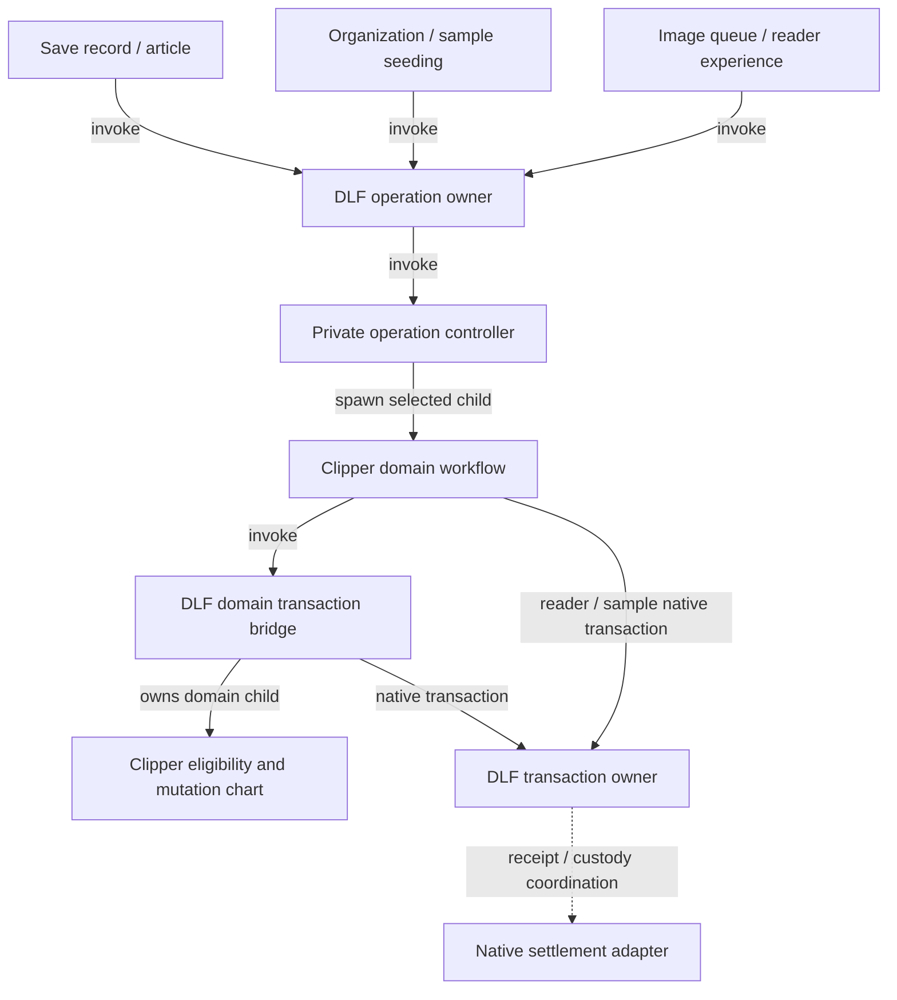

# Workflow hardening PR checkpoint

This checkpoint completes change sets A–G for Clipper. Finance adoption retains
its separate actual-adapter gate; hosted-provider runtime/release qualification
remains separate. The
[implementation specification](../../specs/001-jazz-clipper/workflow-ownership-hardening.md)
remains authoritative; this PR does not complete the whole specification.

## Branches and source provenance

- Clipper: `feat/workflow-hardening`, rebased onto merged PR34 at `e0856c6`.
- DLF: `feat/domain-transaction-workflow`, based on `9d2b0f6`; current qualified source `9c13e3f` (D's sign-out source remains `5bb6605`).
- Finance comparison: clean worker-runtime revision
  `1125c5f1dc3d99c484988b6c4053e5d25526a45a`. Finance was reviewed, not modified
  or migrated.

Both Clipper consumers pin
`vendor/delightful-local-first-auth-lifecycle-9c13e3f-alpha60.tgz`, SHA-256
`8812fc4825b6b0f53ca199c84dc41b328cf7edb2c0163db425b6651c25a028ee`.
The deterministic builder and `vendor/auth-lifecycle-provenance.json` record 12
DLF source modules and their hashes. All 258 baseline payload files remain
byte-identical to alpha.60; only package metadata changes, with 24 JS/declaration
files and public exports added. The prior worker-transport archive's payload is
also byte-identical, with four additional sign-out files. The separately qualified
A/B archives and their provenance are preserved. Native Jazz adapters and the
separate recovery/view patch are retained.

## A consumer migration and qualification

DLF `9b3f094` adds the generic domain-transaction bridge and operation supervisor.
Clipper adopts the bridge and migrates all ten supervision sites.
DLF owns acquisition, commit, rollback and native settlement. Clipper retains
eligibility, mutation selection and existing caller failure mapping.

| Clipper owner     | Shared supervisor invocations | Interruption policy                                                |
| ----------------- | ----------------------------- | ------------------------------------------------------------------ |
| Save record       | Intent, publication           | Forward `SHUTDOWN` once; await settlement.                         |
| Save article      | Ensure, attach, content       | Forward supported `SHUTDOWN`; retain local duplicate/reread rules. |
| Organization      | Write                         | Forward `SHUTDOWN`; await settlement.                              |
| Image queue       | Ready, failure write          | Drain without commanding the child.                                |
| Reader experience | Write                         | Drain without commanding the child.                                |
| Sample seeding    | Seed write                    | Forward `SHUTDOWN`; await settlement.                              |

Each edge below describes an invocation per operation, rather than one global
supervisor instance.

SHARE-1/2 and A's DLF acceptance evidence are covered. The initial migrated consumer
passed 673 unit/native tests, six worker browser cases, 12 packaged-extension
cases and eight production-offline cases. Current checkpoint results below
supersede those counts.

## B shared transport, account storage and broker

DLF commits `c4a4992`, `b0059fe`, `5bda676` and `1571ba2` supply scoped requests,
bounded concurrent channels, independent host closure and original-effect drain.
The channel admits at most eight requests, allocates monotonic sequences and
correlates exact scope/request/sequence. Native FIFO post refusal closes a broken
scope; a healthy posted peer rejection preserves sequence continuity.

Clipper's production Worker now creates `createScopedAccountStorage` and
`createScopedWorkerAccountStore`. The account owner spawns bounded update children;
each owns native Web Lock acquisition, read, the original SDK transform, one write
and acknowledged release. The Window adapter performs only synchronous storage
primitives at the existing key. The close-control listener starts before namespace
selection, so an early close cannot resurrect a later storage host.

A lost write acknowledgement reports the original operation as unknown once, keeps
its lock and drains the original receipt or exact scoped host-close proof. A late
receipt permits release without upgrading the failed observer or replaying the
transform/write. Success waits for actual native lock release. Missing release
acknowledgement reports overdue while ownership continues. Queued acquisition is
aborted and any late grant is safely released.

Forced owner stop or child failure hands native receipt/release capabilities to a
Worker-realm custody recipient before dropping ownership. That boundary starts
finite keeper roots which invoke the shared effect-drain chart; they outlive the
stopped owner. They have no transform, account value or write capability. Stopping
an actor never stands in for native settlement. Normal shutdown waits for active
operations, keepers and exact host closure before the application emits `CLOSED`.
Disruptive disposal rejects clean closure and leaves necessary custody alive.

Broker traffic now uses the same shared scoped channel at Worker initialization.
OPEN transfers exactly one validated port; stale, duplicate, malformed, late and
unclaimed ports are closed. Native failed-post cleanup retains no untransferred
port. Generation keys and SDK URL/name selection are preserved. Independent broker
host closure follows SDK and account-store closure before CLOSED/navigation.

See [scoped account transport](scoped-account-transport.md) and
[scoped broker transport](scoped-broker-transport.md) for invocation/coordination
graphs, deadline policies, native boundaries and the pinned Finance comparison.

## C account binding and realm lifecycle

The Jazz adapter now emits opaque account/client/DB/preparation facts. Application
readiness selects reuse, retirement, candidate construction and adoption. Native
binding custody covers failed/superseded adoption and forced owner stop without
retargeting issued writes. Repeated facts retain the library actor; same-account
client/DB replacement is explicit. Failed construction/preparation does not retry
from duplicate facts; explicit retry or a different native binding is required.

The host consumes scoped observations, owns attachment retirement and rotates UI
scope only after resource cleanup. Its publisher now projects/delivers views rather
than choosing bindings or scanning reader children. Each transferred reader port
has an owned lease through final-position/write/fullscreen retirement and actual
Window cleanup acknowledgement. Replacement attachments remain pending while the
old viewport invocation closes. Native subscriptions and releases are idempotent.

Application drain, late acquisition, SDK close, surface cleanup and client closure
have injectable feedback deadlines that retain original owners and receipts.
Actual late completion remains valid; timers never claim clean closure/navigation.
The existing scoped account-store/broker shutdown order is preserved.
See [account binding lifecycle](account-binding-lifecycle.md) for the ownership
graph, root invocation boundaries, policies and acceptance evidence.

## D authentication and ordered sign-out

A request-scoped server actor now owns auth admission, validated receipts,
selected session reads, callback confirmation and terminal responses. Invalid
method/origin/receipt is refused before private lookup. Delegated response bodies
remain owned through an explicit transfer acknowledgement; disconnect cancels
supported work and disposes untransferred or late bodies. Better Auth's server
session lookup has no abort contract, so its late result is suppressed rather
than described as cancelled. Provider cookies, response bytes and sanitized error
DTOs are preserved; signed cookies do not claim atomic single use.

OAuth authorization/completion bounds include headers and body decoding, with
native monotonic elapsed facts guarding against delayed timer delivery. Uncertain
completion retains the original attempt and never automatically replays or
manufactures confirmation. Existing approved failure/reload presentation is reused.

Clipper invokes DLF's ordered sign-out owner after domain drain. Provider and
native stages retain their original invocation after deadline feedback. Native
facts are observed before logout: already signed-out completes without logging
out a new local identity, while replacement/unavailable facts refuse mutation.
The selected native logout also enforces original account/client/DB admission.
Terminal settlement refreshes facts before retry, and C's host retains ownership
through shutdown. See [the auth ownership protocol](auth-request-lifecycle.md).

## E reader and search resource lifetimes

Viewport open/detach replies are scoped to the original attachment and bounded by
an injectable ten-second feedback policy. Actual native settlement distinguishes
successful and failed cleanup; stop/error cannot fabricate closure. Overdue or
failed peers retain their invocation, original surface and confirmed position.
Late cleanup releases resources without reviving the failed operation or issuing
a new final-position write. Issued writes and fullscreen work retain C's ownership.

Search load/index/query feedback limits are independently configured at 30/15/5
seconds. Monotonic completion facts reject expired results even before timer
callbacks run. Stalled/noncancellable corpus reads remain observed through
cancellation and account shutdown; retry cannot overlap them. Derived workers
can be retired/recreated, with generation/query checks and disposed-callback
suppression. Library admission explicitly distinguishes supported and unsupported
search, preserving extension restoration without waiting for unadmitted work.

See [reader/search lifetimes](reader-search-lifetimes.md) for invocation diagrams,
policy rationale and native recovery boundaries. The independent reader receipt
campaign runs 120 schedules of up to 12 commands, seed `20261118`, with full
contract-model state/event/transition coverage. Native browser cases hold actual
Window receipts through expiry and replacement, then require actual lease cleanup
before reopening the replacement account.

## F shared browser worker jobs

Extension extraction and web image processing now invoke a shared typed,
Clipper-local browser job child. Its native adapter owns construction, posting,
reply decoding, abort listeners and exactly-once termination. Canonical reply
schemas bound the protocol. The old extraction promise wrapper and image
queue's Worker handle/post callback are removed.

Parents retain their 15-second extraction and 20-second image deadlines and
fallback/write policies. Expiry cancels the child and awaits cleanup. Monotonic
elapsed facts reject exact-deadline results before delayed timers run. Shutdown
prevents new save/write admission; issued transactions retain their existing
owners. Failed cleanup remains blocked without a false terminal acknowledgement.
Browser termination is a synchronous native-call contract; the Node parser still
waits for its actual native exit receipt.

See [browser worker job ownership](browser-worker-jobs.md) for connected invocation
and state diagrams. Four independent resource-ledger campaigns run 120 schedules
each, up to 12 commands, seed `20261119`, with full contract-model coverage.
Native browser cases run both real production Workers and inject actual
uncloneable-post failures and cancellation. Parent regressions cover failure
mapping, exact deadlines, stale results, shutdown and cleanup refusal.

## G v6 contracts and calculation cleanup

Article network cancellation now has an invoked native owner; pure transition
exploration allocates nothing and shutdown drains the original request. Library,
reader, shell and domain staging coordination is private, with mutation before
native self-delivery. Every production common-domain consumer uses the protocol.
DLF's public child command is narrowed to `STAGE`; the only artifact difference
from the prior qualified pin is `dist/contracts/domain-transaction.d.ts`. Runtime
bytes, native adapters, exports and the existing Jazz/recovery patches are unchanged.

Typed state inputs/refinements cover selected calls, prepared record data, image
processing/asset/URL data, reader writes and confirmation IDs. Image reports have
an explicit narrow recipient. Library event types, readiness patch sequencing,
receipt observer replacement, shared decoder/history completion and pure receipt
collection are simplified. Empty protocols replace migration placeholders.
Production roots observe sanitized rejected deliveries; tests distinguish required
recipients from documented harmless stopped deliveries.

See [v6 contract cleanup](v6-contract-cleanup.md) for the ownership graph, exact
contracts and evidence. V6-1–7 and SHARE-5/6 are covered. The independent receipt
ledger runs 120 schedules, up to 14 commands, seed `20261120`, with full reachable
contract-model state/event/transition coverage. DLF additionally passes 14 domain
transaction regressions, zero-error/warning library checks, strict package publint
and all public consumer declarations/fixtures/builds, including its updated
private-acknowledgement consumer.

## Checkpoint qualification

The A/B DLF source at `1571ba2` passed 356 selected lifecycle/workspace/scoped-form
regressions in 15 files, strict TypeScript, library checks with zero Svelte errors
or warnings, strict package publint and all public consumer declarations,
fixtures and builds. Independent generated campaigns cover request/channel/drain
contracts; actual MessageChannels and native Web Locks cover dropped replies,
late scoped closure and blocked competing access. These are bounded qualifications,
not exhaustive scheduling proofs or Finance adoption evidence.

D's DLF source at `5bb6605` additionally passed 191 sign-out/session/lifecycle/
transaction regressions in 11 files, strict sign-out test types, zero-error/warning
library checks, strict package publint and all public consumer declarations,
fixtures and builds. Its independent sign-out contract campaign ran 120 schedules
of up to 12 commands, seed `20261117`, with full state/event/transition coverage.

Final Clipper checkpoint checks passed:

- `pnpm verify`: installed vendor integrity/import checks, repository formatting
  and lint, strict types, web/extension Svelte checks with zero errors/warnings,
  **899 unit/native tests in 130 files**, and the production Netlify build.
- `pnpm test:worker`: **32 browser cases**, including A → B → A restoration with an attached reader,
  account custody with dropped WRITE acknowledgement and delayed closure, plus real
  SharedWorker port ownership and late-port disposal. Both real image/extraction jobs, native post failure/cancellation and PR34's attached-reader
  shutdown and forced root stop without clean closure are also covered.
- `pnpm test:extension`: **12 packaged-extension cases**, including restoration,
  offline saves, browser restart and repeated settings teardown.
- `pnpm test:offline`: **eight production cases**, including linked, existing and
  expired-credential accounts across complete offline browser restarts, persisted
  edits, reconnection, cold reader reopening with both servers stopped and shell
  update failure/recovery. Both production Netlify fixtures built successfully.

- Prior PR34 rebase checkpoint: `pnpm test:schema` passed **eight Chromium/Firefox schema-upgrade cases**. E–G introduce no schema change.

This checkpoint incorporates merged PR34 at `e0856c6`, against the final production
account-storage/broker integration and the frozen archive above, using Clipper's
managed Node `24.22.2`. Main's proof-renewal, session-lifecycle and cold-reader connection fixes are preserved.
Browser fixtures use its account settings page and article action popovers. Extension
qualification ran on macOS; main's documented temporary Linux exclusions remain. They do not
establish Finance adoption or hosted-provider release qualification.

An initial F extension probe hit three sign-in/settings failures before extraction.
All three passed on an unchanged focused rerun and then in the final full
12-case run. No timeout or assertion was relaxed; the transient cause was not
established. The existing toolbar/source-message regression assertions pass on
the rebuilt current branch.

The [PR34 integration and XState review](pr34-workflow-integration.md) records the
rebase and the targeted completion/outcome corrections. Native observer completion
alone no longer acknowledges clean host or viewport closure; the chart must
select and return successful completion.

The focused lifecycle regressions include independent generated custody and
realm-close campaigns (120 runs each,
seeds `20261115` and `20261116`, full contract-model coverage).
They cover dropped WRITE replies, wrong/delayed host-close receipts, actual
competing Web Locks, forced owner stop, child failure, queued cancellation,
reentrant disposal, missing release acknowledgement and native broker port custody.
Strict targeted TypeScript and web/extension checks pass with zero Svelte
errors/warnings. Chromium tests use actual Workers, SharedWorkers, MessageChannels,
localStorage and account-store factories.

The extension harness accepts explicit web/core origins and a native source port
so qualification can avoid other running servers. Default authorities remain
unchanged. This run uses `CLIPPER_TEST_WEB_URL=http://127.0.0.1:5482`,
`CLIPPER_TEST_CORE_URL=http://127.0.0.1:5483` and
`CLIPPER_TEST_SOURCE_PORT=0` with `pnpm test:extension`; source URLs/assertions use
the actual assigned port. Earlier attempts were blocked before test execution by
occupied default ports; no unidentified process was stopped. Cold Worker startup
now prebundles the adopted DLF lifecycle exports, preventing an initial dependency
optimizer reload. All 32 Worker cases passed with source frozen. No assertions or
product behavior were weakened.

## Follow-up boundary

- B is complete for Clipper: SHARE-3/REC-3 and the Clipper adapter/comparison
  evidence for DLF-3 are covered. Before Finance adopts the shared runtime, qualify
  its actual adapter/account owner; that consumer migration is not included here.
- C is complete: HOST/BIND and the host/acquisition/session-close portion of
  REC-6 are covered. E supplies search/viewport failure recovery beyond the host
  cleanup protocol.
- D is complete: AUTH-1–5, REC-7 and the provider/native sign-out portion of REC-6
  are covered, including the composed C shutdown graph. Native HTTP tests cover
  stalled headers/bodies, abort delivery, delayed timers and late results.
- E is complete: REC-4/5 cover scoped reader acknowledgement/cleanup, final-position
  uncertainty, bounded search waits and original-read custody through account shutdown.
- F is complete: EXT-1–3, SHARE-4 and REC-8 cover shared browser jobs, native cleanup and unchanged deadline/fallback contracts.
- G is complete: V6-1–7 and SHARE-5/6 cover pure resource admission, private/native delivery, state contracts, observed facts, calculation order, narrow protocols and smaller reuse.
- Finance actual-adapter adoption and hosted-provider runtime/release qualification remain separate; this checkpoint does not claim those external gates.

The legacy account-store/storage fixtures and SDK compatibility worker remain for
existing compatibility coverage; production application storage uses the scoped
owner. Production broker routing uses the shared scoped channel. No storage namespace,
identity, schema or Finance policy is migrated: web v2 and extension v1 keys and
lock names are preserved. No new dependency or user-visible copy is introduced.
