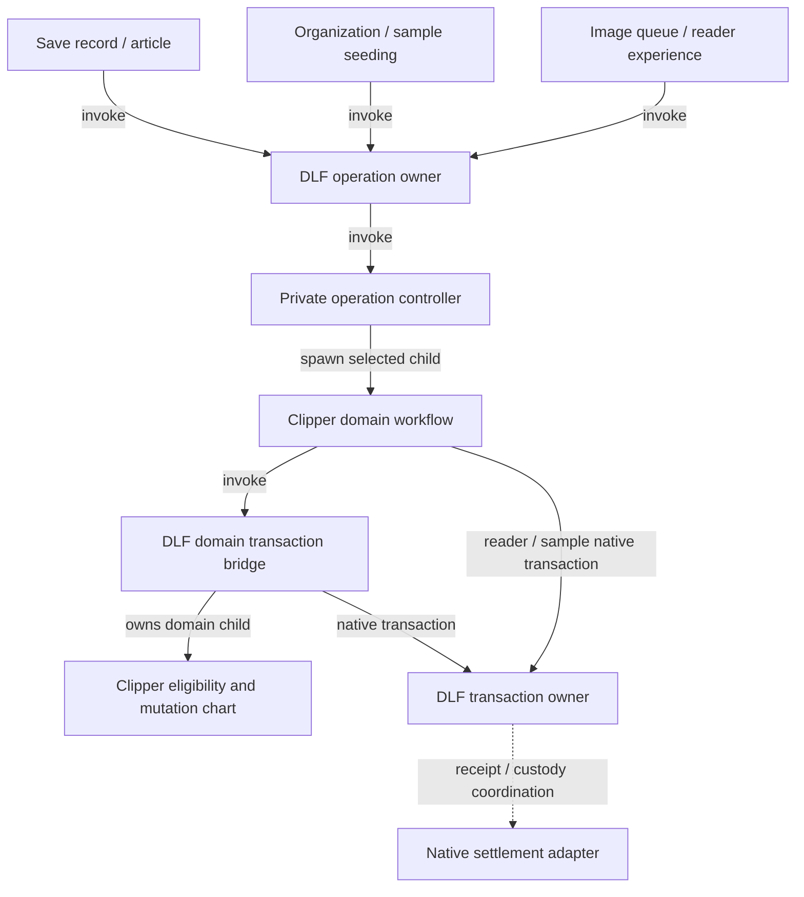

# Workflow hardening PR checkpoint

This checkpoint completes change sets A, B and C for Clipper. D–G remain separate
work. Finance adoption retains its separate actual-adapter qualification gate. The
[implementation specification](../../specs/001-jazz-clipper/workflow-ownership-hardening.md)
remains authoritative; this PR does not complete the whole specification.

## Branches and source provenance

- Clipper: `feat/workflow-hardening`, based on PR #20 merge `168cd0b`.
- DLF: `feat/domain-transaction-workflow`, based on `9d2b0f6`; source HEAD `1571ba2`.
- Finance comparison: clean worker-runtime revision
  `1125c5f1dc3d99c484988b6c4053e5d25526a45a`. Finance was reviewed, not modified
  or migrated.

Both Clipper consumers pin
`vendor/delightful-local-first-worker-transport-1571ba2-alpha60.tgz`, SHA-256
`1ffa8d8490915da61fb7dc9a600733eed00dcce33cdc772ca0a12d1bbf0d95b1`.
The deterministic builder and `vendor/worker-transport-provenance.json` record ten
DLF source modules and their hashes. All 258 baseline files except package metadata
remain byte-identical to alpha.60; 20 JS/declaration files and public exports are
added. Existing native Jazz adapters and recovery/view patches are unchanged.
The separately qualified A archive and its provenance are preserved.

## A consumer migration and qualification

DLF `9b3f094` adds the generic domain-transaction bridge and operation supervisor.
Clipper `5e16cec` adopts the bridge; `71cdd08` migrates all ten supervision sites.
DLF owns acquisition, commit, rollback and native settlement. Clipper retains
eligibility, mutation selection and existing caller failure mapping.

| Clipper owner     | Shared supervisor invocations | Interruption policy                                                |
| ----------------- | ----------------------------- | ------------------------------------------------------------------ |
| Save record       | Intent, publication           | Forward `SHUTDOWN` once; await settlement.                         |
| Save article      | Ensure, attach, content       | Forward supported `SHUTDOWN`; retain local duplicate/reread rules. |
| Organization      | Write                         | Forward `SHUTDOWN`; await settlement.                              |
| Image queue       | Ready, failure write          | Drain without commanding the child.                                |
| Reader experience | Write                         | Drain without commanding the child.                                |
| Sample seeding    | Seed write                    | Forward `SHUTDOWN`; await settlement.                              |

Each edge below describes an invocation per operation, rather than one global
supervisor instance.

SHARE-1/2 and A's DLF acceptance evidence are covered. The initial migrated consumer
passed 673 unit/native tests, six worker browser cases, 12 packaged-extension
cases and eight production-offline cases. Current checkpoint results below
supersede those counts.

## B shared transport, account storage and broker

DLF commits `c4a4992`, `b0059fe`, `5bda676` and `1571ba2` supply scoped requests,
bounded concurrent channels, independent host closure and original-effect drain.
The channel admits at most eight requests, allocates monotonic sequences and
correlates exact scope/request/sequence. Native FIFO post refusal closes a broken
scope; a healthy posted peer rejection preserves sequence continuity.

Clipper's production Worker now creates `createScopedAccountStorage` and
`createScopedWorkerAccountStore`. The account owner spawns bounded update children;
each owns native Web Lock acquisition, read, the original SDK transform, one write
and acknowledged release. The Window adapter performs only synchronous storage
primitives at the existing key. The close-control listener starts before namespace
selection, so an early close cannot resurrect a later storage host.

A lost write acknowledgement reports the original operation as unknown once, keeps
its lock and drains the original receipt or exact scoped host-close proof. A late
receipt permits release without upgrading the failed observer or replaying the
transform/write. Success waits for actual native lock release. Missing release
acknowledgement reports overdue while ownership continues. Queued acquisition is
aborted and any late grant is safely released.

Forced owner stop or child failure hands native receipt/release capabilities to a
Worker-realm custody recipient before dropping ownership. That boundary starts
finite keeper roots which invoke the shared effect-drain chart; they outlive the
stopped owner. They have no transform, account value or write capability. Stopping
an actor never stands in for native settlement. Normal shutdown waits for active
operations, keepers and exact host closure before the application emits `CLOSED`.
Disruptive disposal rejects clean closure and leaves necessary custody alive.

Broker traffic now uses the same shared scoped channel at Worker initialization.
OPEN transfers exactly one validated port; stale, duplicate, malformed, late and
unclaimed ports are closed. Native failed-post cleanup retains no untransferred
port. Generation keys and SDK URL/name selection are preserved. Independent broker
host closure follows SDK and account-store closure before CLOSED/navigation.

See [scoped account transport](scoped-account-transport.md) and
[scoped broker transport](scoped-broker-transport.md) for invocation/coordination
graphs, deadline policies, native boundaries and the pinned Finance comparison.

## C account binding and realm lifecycle

The Jazz adapter now emits opaque account/client/DB/preparation facts. Application
readiness selects reuse, retirement, candidate construction and adoption. Native
binding custody covers failed/superseded adoption and forced owner stop without
retargeting issued writes. Repeated facts retain the library actor; same-account
client/DB replacement is explicit. Failed construction/preparation does not retry
from duplicate facts; explicit retry or a different native binding is required.

The host consumes scoped observations, owns attachment retirement and rotates UI
scope only after resource cleanup. Its publisher now projects/delivers views rather
than choosing bindings or scanning reader children. Each transferred reader port
has an owned lease through final-position/write/fullscreen retirement and actual
Window cleanup acknowledgement. Replacement attachments remain pending while the
old viewport invocation closes. Native subscriptions and releases are idempotent.

Application drain, late acquisition, SDK close, surface cleanup and client closure
have injectable feedback deadlines that retain original owners and receipts.
Actual late completion remains valid; timers never claim clean closure/navigation.
The existing scoped account-store/broker shutdown order is preserved.
See [account binding lifecycle](account-binding-lifecycle.md) for the ownership
graph, root invocation boundaries, policies and acceptance evidence.

## Checkpoint qualification

The DLF source at `1571ba2` passed 356 selected lifecycle/workspace/scoped-form
regressions in 15 files, strict TypeScript, library checks with zero Svelte errors
or warnings, strict package publint and all public consumer declarations,
fixtures and builds. Independent generated campaigns cover request/channel/drain
contracts; actual MessageChannels and native Web Locks cover dropped replies,
late scoped closure and blocked competing access. These are bounded qualifications,
not exhaustive scheduling proofs or Finance adoption evidence.

Final Clipper checkpoint checks passed:

- `pnpm verify`: installed vendor integrity/import checks, repository formatting
  and lint, strict types, web/extension Svelte checks with zero errors/warnings,
  **760 unit/native tests in 115 files**, and the production Netlify build.
- `pnpm test:worker`: **12 browser cases**, including A → B → A restoration with an attached reader,
  account custody with dropped WRITE acknowledgement and delayed closure, plus real
  SharedWorker port ownership and late-port disposal.
- `pnpm test:extension`: **12 packaged-extension cases**, including restoration,
  offline saves, browser restart and repeated settings teardown.
- `pnpm test:offline`: **eight production cases**, including linked, existing and
  expired-credential accounts across complete offline browser restarts, persisted
  edits, reconnection, cold reader reopening with both servers stopped and shell
  update failure/recovery. Both production Netlify fixtures built successfully.

These checks ran against the final production account-storage/broker integration and
the frozen archive above, using Clipper's managed Node `24.22.2`. They do not
establish Finance adoption or completion of D–G.

The focused lifecycle selection passes 156 native/unit cases in 17 files. It
includes independent generated custody and realm-close campaigns (120 runs each,
seeds `20261115` and `20261116`, full contract-model coverage).
They cover dropped WRITE replies, wrong/delayed host-close receipts, actual
competing Web Locks, forced owner stop, child failure, queued cancellation,
reentrant disposal, missing release acknowledgement and native broker port custody.
Strict targeted TypeScript and web/extension checks pass with zero Svelte
errors/warnings. Chromium tests use actual Workers, SharedWorkers, MessageChannels,
localStorage and account-store factories.

The extension harness accepts explicit web/core origins and a native source port
so qualification can avoid other running servers. Default authorities remain
unchanged. This run uses `CLIPPER_TEST_WEB_URL=http://127.0.0.1:5482`,
`CLIPPER_TEST_CORE_URL=http://127.0.0.1:5483` and
`CLIPPER_TEST_SOURCE_PORT=0` with `pnpm test:extension`; source URLs/assertions use
the actual assigned port. Earlier attempts were blocked before test execution by
occupied default ports; no unidentified process was stopped. Cold Worker startup
now prebundles the adopted DLF lifecycle exports, preventing an initial dependency
optimizer reload. All 12 Worker cases passed with source frozen. No assertions or
product behavior were weakened.

## Follow-up boundary

- B is complete for Clipper: SHARE-3/REC-3 and the Clipper adapter/comparison
  evidence for DLF-3 are covered. Before Finance adopts the shared runtime, qualify
  its actual adapter/account owner; that consumer migration is not included here.
- C is complete: HOST/BIND and the host/acquisition/session-close portion of
  REC-6 are covered. Provider/native sign-out deadlines remain in D, and E retains
  search/viewport failure recovery beyond the host cleanup protocol.
- D–G: implement the remaining session, reader, authentication, root ownership and
  v6 cleanup requirements in specification dependency order.

The legacy account-store/storage fixtures and SDK compatibility worker remain for
existing compatibility coverage; production application storage uses the scoped
owner. Production broker routing uses the shared scoped channel. No storage namespace,
identity, schema or Finance policy is migrated: web v2 and extension v1 keys and
lock names are preserved. No new dependency or user-visible copy is introduced.
