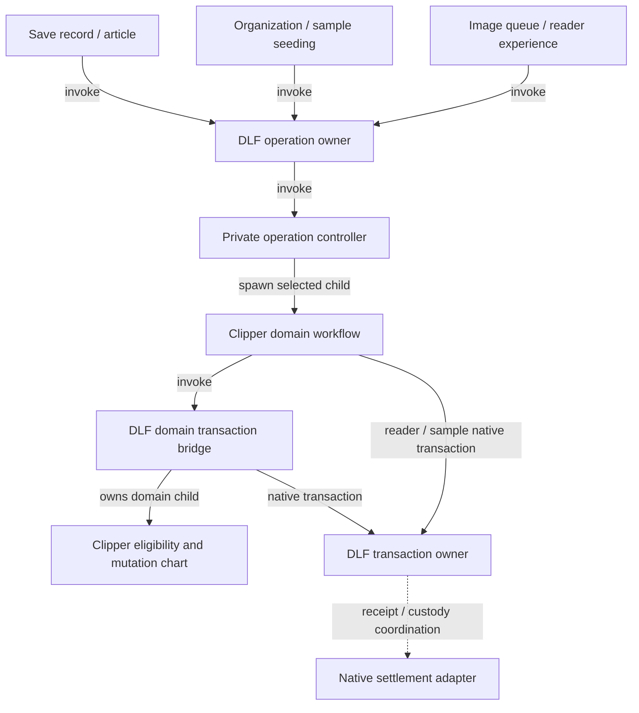

# Workflow hardening PR checkpoint

This checkpoint completes change set A and the production account-storage portion
of B. Broker migration and C–G remain separate work. The
[implementation specification](../../specs/001-jazz-clipper/workflow-ownership-hardening.md)
remains authoritative; this PR does not complete the whole specification.

## Branches and source provenance

- Clipper: `feat/workflow-hardening`, based on PR #20 merge `168cd0b`.
- DLF: `feat/domain-transaction-workflow`, based on `9d2b0f6`; source HEAD `1571ba2`.
- Finance comparison: clean worker-runtime revision
  `1125c5f1dc3d99c484988b6c4053e5d25526a45a`. Finance was reviewed, not modified
  or migrated.

Both Clipper consumers pin
`vendor/delightful-local-first-worker-transport-1571ba2-alpha60.tgz`, SHA-256
`1ffa8d8490915da61fb7dc9a600733eed00dcce33cdc772ca0a12d1bbf0d95b1`.
The deterministic builder and `vendor/worker-transport-provenance.json` record ten
DLF source modules and their hashes. All 258 baseline files except package metadata
remain byte-identical to alpha.60; 20 JS/declaration files and public exports are
added. Existing native Jazz adapters and recovery/view patches are unchanged.
The separately qualified A archive and its provenance are preserved.

## A consumer migration and qualification

DLF `9b3f094` adds the generic domain-transaction bridge and operation supervisor.
Clipper `5e16cec` adopts the bridge; `71cdd08` migrates all ten supervision sites.
DLF owns acquisition, commit, rollback and native settlement. Clipper retains
eligibility, mutation selection and existing caller failure mapping.

| Clipper owner     | Shared supervisor invocations | Interruption policy                                                |
| ----------------- | ----------------------------- | ------------------------------------------------------------------ |
| Save record       | Intent, publication           | Forward `SHUTDOWN` once; await settlement.                         |
| Save article      | Ensure, attach, content       | Forward supported `SHUTDOWN`; retain local duplicate/reread rules. |
| Organization      | Write                         | Forward `SHUTDOWN`; await settlement.                              |
| Image queue       | Ready, failure write          | Drain without commanding the child.                                |
| Reader experience | Write                         | Drain without commanding the child.                                |
| Sample seeding    | Seed write                    | Forward `SHUTDOWN`; await settlement.                              |

Each edge below describes an invocation per operation, rather than one global
supervisor instance.

SHARE-1/2 and A's DLF acceptance evidence are covered. The initial migrated consumer
passed 673 unit/native tests, six worker browser cases, 12 packaged-extension
cases and eight production-offline cases. Current checkpoint results below
supersede those counts.

## B shared transport and production account storage

DLF commits `c4a4992`, `b0059fe`, `5bda676` and `1571ba2` supply scoped requests,
bounded concurrent channels, independent host closure and original-effect drain.
The channel admits at most eight requests, allocates monotonic sequences and
correlates exact scope/request/sequence. Native FIFO post refusal closes a broken
scope; a healthy posted peer rejection preserves sequence continuity.

Clipper's production Worker now creates `createScopedAccountStorage` and
`createScopedWorkerAccountStore`. The account owner spawns bounded update children;
each owns native Web Lock acquisition, read, the original SDK transform, one write
and acknowledged release. The Window adapter performs only synchronous storage
primitives at the existing key. The close-control listener starts before namespace
selection, so an early close cannot resurrect a later storage host.

A lost write acknowledgement reports the original operation as unknown once, keeps
its lock and drains the original receipt or exact scoped host-close proof. A late
receipt permits release without upgrading the failed observer or replaying the
transform/write. Success waits for actual native lock release. Missing release
acknowledgement reports overdue while ownership continues. Queued acquisition is
aborted and any late grant is safely released.

Forced owner stop or child failure hands native receipt/release capabilities to a
Worker-realm custody recipient before dropping ownership. That boundary starts
finite keeper roots which invoke the shared effect-drain chart; they outlive the
stopped owner. They have no transform, account value or write capability. Stopping
an actor never stands in for native settlement. Normal shutdown waits for active
operations, keepers and exact host closure before the application emits `CLOSED`.
Disruptive disposal rejects clean closure and leaves necessary custody alive.

See [scoped account transport](scoped-account-transport.md) for the invocation and
coordination graph, deadline policy and native adapter boundaries.

## Checkpoint qualification

The DLF source at `1571ba2` passed 356 selected lifecycle/workspace/scoped-form
regressions in 15 files, strict TypeScript, library checks with zero Svelte errors
or warnings, strict package publint and all public consumer declarations,
fixtures and builds. Independent generated campaigns cover request/channel/drain
contracts; actual MessageChannels and native Web Locks cover dropped replies,
late scoped closure and blocked competing access. These are bounded qualifications,
not exhaustive scheduling proofs or Finance adoption evidence.

Final Clipper checkpoint checks passed:

- `pnpm verify`: installed vendor integrity/import checks, repository formatting
  and lint, strict types, web/extension Svelte checks with zero errors/warnings,
  **712 unit/native tests in 110 files**, and the production Netlify build.
- `pnpm test:worker`: **nine browser cases**, including normal and forced-stop
  account custody with dropped WRITE acknowledgement and delayed host closure.
- `pnpm test:extension`: **12 packaged-extension cases**, including restoration,
  offline saves, browser restart and repeated settings teardown.
- `pnpm test:offline`: **eight production cases**, including linked, existing and
  expired-credential accounts across complete offline browser restarts, persisted
  edits, reconnection, cold reader reopening with both servers stopped and shell
  update failure/recovery. Both production Netlify fixtures built successfully.

These checks ran against the final production account-storage integration and
the frozen archive above, using Clipper's managed Node `24.22.2`. They do not
establish the deferred broker or Finance adoption criteria.

The focused account-storage selection already passes 56 native/unit cases in ten
files and nine Worker browser cases. These include dropped WRITE replies, wrong
and delayed host-close receipts, actual competing Web Locks, forced owner stop,
child failure, queued cancellation, reentrant disposal and missing native release
acknowledgement. Strict targeted TypeScript and web/extension checks pass with zero
Svelte errors/warnings. Browser tests use the actual SDK account-store facade,
Window localStorage and Worker factories. Each fault case observes one original
transform/write and retains the original operation identity.

## Follow-up boundary

- B: migrate and qualify the broker channel, including transferred-port custody;
  reconcile shared account integration with Finance's actual adapter before any
  Finance adoption. SHARE-3 and DLF-3 remain open for those compositions. REC-3's
  Clipper account-storage lost/late-write scenarios are covered here.
- C: complete account binding and realm lifecycle work beyond the account-store
  closure ordering introduced here.
- D–G: implement the remaining session, reader, authentication, root ownership and
  v6 cleanup requirements in specification dependency order.

The legacy account-store/storage fixtures and SDK compatibility worker remain for
existing compatibility coverage; production application storage uses the scoped
owner. Broker routing still uses its existing owner. No storage namespace,
identity, schema or Finance policy is migrated: web v2 and extension v1 keys and
lock names are preserved. No new dependency or user-visible copy is introduced.
