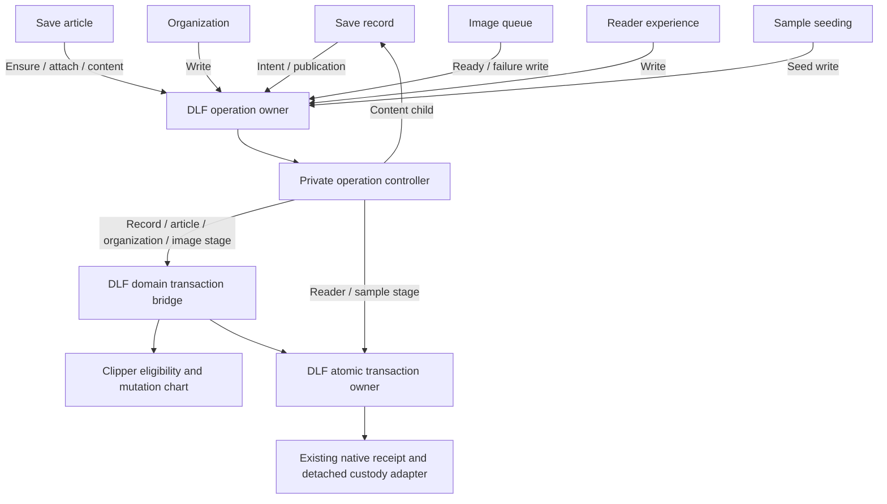

# Workflow hardening implementation progress

## Worktrees and baselines

- Clipper: `/Users/matt/Projects/worktrees/delightful-clipper/workflow-hardening`, branch `feat/workflow-hardening`, based on main `168cd0b` (PR #20 merged).
- DLF: `/Users/matt/Projects/worktrees/delightful-local-first/domain-transaction-workflow`, branch `feat/domain-transaction-workflow`, based on main `9d2b0f6`.
- Specification: [workflow ownership hardening](../../specs/001-jazz-clipper/workflow-ownership-hardening.md), copied from documentation branch `cd85d97`; its implementation map and all acceptance criteria remain authoritative.

## Qualified transaction bridge

Change set A has started with extraction of the generic domain transaction bridge
into DLF. The DLF worktree contains:

- `src/lib/contracts/domain-transaction.ts`: generic attempt, assessment, result,
  resource lifecycle and typed domain spawn contracts.
- `src/lib/machines/workspaces/domain-transaction.ts`: extracted private controller
  and public lifecycle wrapper over the existing DLF transaction owner.
- New `transactions/contracts` and `transactions/workflow` package exports.
- `docs/domain-transaction.md` and its consumer-guide link: ownership protocol,
  existing API compatibility and behavioral qualification requirements.

The extracted chart preserves the original bridge sequencing. Resource and
receipt types are generic; it has no Clipper or concrete Jazz imports. Existing
workspace APIs are unchanged. The public actor accepts only cancellation/shutdown;
the controller owns the domain child through processing and releases its reference
on exit. The native transaction owner continues through settlement.

The user reviewed the bridge implementation and approved continuing. The
domain-free tests and public package-consumer fixture are now implemented.
Clipper's 358-line local bridge is replaced by a 34-line typed adapter preserving
its native resource, write and receipt defaults.

The initial bridge cutover used the same alpha.60 archive in web and extension. It added the two shared
modules and public exports; the existing pnpm recovery-view patch applies
separately during installation. A byte-level comparison verifies all baseline
module files are unchanged. The reproducible
builder is `tooling/build-domain-transaction-vendor.py`; exact source hashes and
baseline/archive hashes are recorded in `vendor/domain-transaction-provenance.json`.
The rebuilt archive hash is
`388faab60b1c2848b16e03f29d4038f30c5ff75874f58c4f08da73c01e22569b`.

## Validation

- DLF workspace transaction and scoped-form selection: **247 tests passed in ten
  files**, including the new protocol scenarios and independently modeled
  interruption campaign (seed `20261110`, 150 runs).
- DLF `check:library`, `package` with strict publint, and the full `check:consumer`
  command passed, including the new public runtime/type fixture.
- Clipper `pnpm check`: web and extension checks passed with zero Svelte errors
  or warnings.
- Clipper `pnpm test:unit`: **663 tests passed in 106 files**, including native
  listener tests run through the local terminal.
- Clipper production build passed using a synthetic Vercel preview environment.
- Clipper worker browser suite: **six tests passed**, including worker-only domain
  saves, identity reuse, shutdown drain and stale-intent refusal.
- Clipper packaged extension suite: **12 tests passed**, including offline save,
  browser restart, restoration and sign-in cancellation.
- Clipper production offline suite: **eight tests passed**, including linked,
  existing and expired-credential accounts across two complete offline browser
  restarts, persisted offline edits, reconnection, cold reader reopen with both
  servers stopped, and shell update failure/recovery. Both Netlify fixture builds
  passed; the separate Vercel preview build passed as recorded above.
- Vendor integrity/import checks, lint, changed-source formatting and whitespace
  checks passed in their respective repositories. Rebuilding the archive yields
  the same hash.

Clipper's pnpm commands use the repository-managed Node `24.22.2` (verified with
`pnpm exec node --version`), even though the interactive shell uses Node 25.
A clean offline installation verifies package/lockfile compatibility, bridge
module bytes and recovery-view patch application in both consumers. The first
worker run was interrupted after Vite
refused dependency assets symlinked from another worktree; a private dependency
tree now replaces those temporary setup links. Unit/native tests run without
deployment flags; synthetic Vercel flags apply only to the production build.

## Qualified operation supervisor

DLF now has `contracts/owned-operation.ts` and
`machines/lifecycle/owned-operation.ts`, with `lifecycle/operation/contracts` and
`lifecycle/operation/workflow` exports. The public owner invokes a private
controller around one typed spawn capability. Its active/draining states retain
the same child and lifecycle subscription; normal settlement stops both and
clears their references. Completion preserves the child's exact output and
operation identity; failure preserves facts for the parent's existing uncertainty
policy. No retry, transaction or remote-acceptance policy moves into this owner.

`DRAIN` waits without commanding the child. `INTERRUPT` forwards one supported
typed command and waits. The first request wins. Save/organization/sample callers
forward shutdown; image and reader writes retain their wait-only
policy. Child reports remain private to the controller. DLF's
`docs/owned-operation.md` records the architecture, all ten caller mappings and
the required qualification campaign.

After the user approved testing, **32 supervisor tests passed**. Together with
existing workspace/domain-transaction/scoped-form regressions, **279 tests pass
in 12 files**. The independent generated campaign uses seed `20261111`, 300 runs
and at most 12 commands per run, with full model event/state/transition coverage.
Targeted tests cover startup and subscription failures, synchronous/undefined
output, request races, pure `can()` calculation, wrong-child reports, reference
release, actual unsubscribe/disposal and pre-start/forced-stop behavior.

Composed tests use the actual DLF transaction owner with controlled native leaves
to verify custody transfer during acquisition/read/stage/commit/local persistence,
cancelled local settlement, drain-only completion, unknown outcomes and no replay
or remote-acceptance wait. Strict test TypeScript, `check:library` (zero Svelte
errors/warnings), packaging with strict publint, lint, formatting and whitespace
checks pass. The full DLF `check:consumer` passes, including public protocol types
and A → B → A parent invocations that verify exact child input/generation and
receipt identity. No production correction was required.

## A consumer migration and qualification

All ten supervision sites now invoke the qualified shared owner:

| Clipper file                       | Invocations                     | Interruption policy                                                               |
| ---------------------------------- | ------------------------------- | --------------------------------------------------------------------------------- |
| `machines/storage/save.ts`         | Intent and publication          | Forward `SHUTDOWN` once and await settlement.                                     |
| `machines/storage/save-article.ts` | Ensure, attach and content save | Forward only supported `SHUTDOWN`; keep duplicate/reread/content decisions local. |
| `machines/storage/organize.ts`     | Organization write              | Forward `SHUTDOWN`; retain history and scope decisions.                           |
| `images/queue-machine.ts`          | Ready and failure writes        | `DRAIN`, with no child cancellation; retain retry/uncertainty/receipt policy.     |
| `machines/reader/experience.ts`    | Reader write                    | `DRAIN`; retain accepted queued edits and local/remote receipt handling.          |
| `samples/machine.ts`               | Seed write                      | Forward `SHUTDOWN`; retain the seeded/skipped/unknown/closed decision.            |

Parent-side actor refs, subscriptions and manufactured completion/error events
are removed at those sites. Named invocation outcomes now provide correlation;
the supervisor owns child/subscription cleanup. Unexpected invocation failures
follow each parent's existing unknown/uncertain policy. No new strings,
dependencies or native transaction owners were introduced.

Reader identity completion now selects the issued change and removes it from
the pending queue before entering the invoking state. Tests check the exact
change, unique operation ID and observed rows received by each native child while
queued edits and repeated shutdown are processed. Content supervision correlates
with the content request's operation ID while the article parent retains its
own article-result identity.

Each arrow below represents a separate operation invocation, not one global actor.

Both consumers now pin
`vendor/delightful-local-first-workflow-hardening-alpha60.tgz`, built from DLF
source `9b3f094`. Its reproducible SHA-256 is
`aaf16fe628393537aed32ba487d141d8cb7bc47b3000eff35556ff04a8b11fb7`;
`vendor/workflow-hardening-provenance.json` records all four source module hashes.
Archive comparison confirms eight added JS/declaration files and public exports;
all baseline module bytes remain identical. The existing recovery-view patch is
applied separately during installation. Offline installation, frozen-lockfile
validation and both installed supervisor modules were checked.

The migrated graph passes:

- **673 unit/native tests in 107 files**, including ten new tests for actual
  child input, sequential receipt propagation and forced save-parent custody.
- **Six worker browser tests**, **12 packaged-extension tests**, and **eight
  production offline tests**, including linked/existing/expired credentials,
  complete browser restarts, persisted offline edits and reconciliation.
- Web/extension type checks with zero Svelte errors/warnings, formatting, lint,
  vendor integrity/import checks, Vercel preview build and both production
  Netlify offline fixture builds. Clipper uses managed Node `24.22.2`.

This completes A's extraction and ten caller migrations. SHARE-1/2 and the A
evidence for DLF-1/2/4/5/6 are satisfied. Cross-cutting criteria remain applicable
to later change sets; these results do not close B–G or their failure/deadline
findings. Earlier generic DLF tests supplement, rather than replace, the actual
consumer results above.

## B started: scoped request owner

The prerequisite comparison pins clean Finance worker-runtime source
`1125c5f1dc3d99c484988b6c4053e5d25526a45a` and Clipper
`71cdd08008cc0f79bbe1f94d67d94ad401f8fbb5`. Finance already has request bounds,
scope/request/sequence correlation and an independent late host-close receipt;
Clipper's raw data-port protocol cannot safely release an uncertain write's lock
on timeout. Finance account-selection/inventory/legacy cleanup policy stays local.

DLF's first B unit is `contracts/worker-request.ts` and
`machines/lifecycle/worker-request.ts`, exported through `worker/request/contracts`
and `worker/request/workflow`. The chart posts one selected native operation,
accepts matching replies during posting or waiting, bounds both phases, separates
definite not-issued evidence from unknown effects, and clears the request payload
and post capability at completion. It owns no channel, account key, lock, retry,
identity selection or host-closure receipt. No consumer/pinned archive uses it yet.

The user approved testing this unit with “Continue” after implementation review.
DLF commit `c4a4992f24514b2938aa92eed31313785206bdf0` contains the qualified request
machine, public contracts/exports, tests, packaged consumer fixture and guide:

- 33 request tests pass, including replies during posting, native posting failures,
  not-issued/unknown classifications, exact correlation, stale scopes, timer bounds,
  both deadline-race orders, duplicate/late reports, output identity, immutable
  snapshots, payload clearing and forced stop without a fabricated receipt.
- An independent external request ledger runs 300 generated campaigns with up to
  16 commands, seed 20261112, against the real actor and virtual clock. It achieves
  full contract-model event/state/transition coverage; this is bounded sampled
  evidence, not exhaustive native scheduling qualification.
- 312 lifecycle/workspace/scoped-form-binding tests in 13 files pass. Strict test
  TypeScript, `check:library` (zero Svelte errors/warnings), packaging with strict
  publint, formatting, lint and whitespace checks pass.
- `check:consumer` passes all existing declarations/fixtures/builds and the new
  public request parent invocation across A → B → A scopes. It checks exact
  payload delivery, response typing, stale-scope rejection and output identity.

No request-machine behavioral fixes were needed. The public consumer fixture uses
one immutable context record for the beta's context compatibility rules. Clipper's
qualified A archive remains pinned to DLF `9b3f094`; no request/channel adoption or
new browser/native qualification is claimed by these library tests.

DLF's `docs/worker-request.md` specifies the closure handshake before adoption:
retain an uncertain write's lock; close the old Window data handlers over an
independent scoped control capability; release custody only after the actual
matching host-close receipt; keep late receipt handling after close timeout.
The channel owner, concurrent routing, native adapter changes and account-owner
integration remain subsequent work. SHARE-3, REC-3 and DLF-3 remain open.

## B channel, native control and effect-drain qualification

The user authorized continued implementation and tests while away, overriding the
per-unit source-review/test gate for this work. The same consumer pins apply.

DLF `b0059fe` adds the bounded channel owner and public contracts. It registers
requests before posting, admits at most eight, assigns monotonic sequences,
correlates out-of-order replies and disposes unclaimed transferred resources.
Native observer/resource custody also handles forced stop and callback failures.
Only REQUEST/CLOSE are public; native and child reports remain private. One close
request uses an independent control listener, which remains alive after deadline
or control failure until the exact original scope and close ID acknowledge closure.
28 targeted tests and 400 generated sequences (seed 20261113, maximum 24 commands)
pass, with full contract-model event/state/transition coverage.

DLF `5bda676` adds the effect-drain chart: await actual quiescence of the original
native effect or the exact scoped host-close receipt. An uncertain/rejected observer
or deadline cannot release custody, replay the write or change the original unknown
result. Its 16 tests and 300 generated sequences (seed 20261114, maximum 16 commands)
pass. A public-import parent holding an actual native Web Lock proves that a waiting
competitor remains blocked past the deadline and enters only after matching closure
proof and real native release. Forced-stop tests reobserve the original receipts
without a write capability or replay.

The current DLF regression selection passes 356 tests in 15 files, plus strict
TypeScript, zero-error/warning library checks, strict package publint, all public
consumer declarations/fixtures/builds, format, lint and whitespace checks. The real
MessageChannel consumer fixture separately proves orphaned-port closure, a lost
write acknowledgement, conservative unknown output and late receipt handling.
These bounded/generated/native fixtures do not substitute for consumer adoption.

Clipper `host-close-channel.ts` supplies the native independent control boundary.
Window calls the synchronous data-host disposer before acknowledging; failed native
close produces no receipt. Strict schemas reject foreign scopes/versions/extra
fields and close malformed transfers. Worker control errors retain the late receipt
listener. There is no SDK/domain work, timer or retry in this native adapter.
Seven new native tests pass; the complete Clipper selection passes 680 tests in
108 files, and all seven worker browser cases pass. The new actual Window case
observes native transfer disposal and proves no storage effects run after the
receipt, including after a control error. Web/extension checks report zero Svelte
errors/warnings; changed-source format/lint/strict TypeScript pass.

The native adapter is prepared separately from the production account transport.
The qualified A archive and existing production storage namespaces remain unchanged.
Next, integrate the account owner and detached native lock custody before cutting
storage/broker traffic over to the scoped channel. SHARE-3, REC-3 and DLF-3 remain
open until that composed adapter and unknown-write recovery qualification passes.

## B scoped storage transport and compatible artifact

`scoped-storage-channel.ts` composes the shared request/channel owners with the
native control adapter. It creates one Worker transport root at startup; SDK
reads/writes send requests to that root. Strict bounded schemas derive from shared
host scope/identity/version schemas and canonical account-value schemas. Window
executes only the selected synchronous storage primitive at its fixed existing key;
exact FIFO scope/sequence validation precedes effects. Worker validation happens
before sequence allocation. Native reply-post failure disposes the data host and
cannot throw a private error into the event loop or replay the write.

Eleven new native tests cover correlated/out-of-order replies, bounds before
sequence allocation, stale scope/sequence, native failures, dropped WRITE replies,
late/wrong closure receipts, malformed transfer cleanup, post/port failure and
forced disposal without false closure. The dropped-reply test compares the exact
issued scope/request ID/sequence, observes one genuine native write, keeps closure
observation unresolved past its deadline, then accepts only the matching late
receipt. The scoped facade exposes that real host receipt for the upcoming account
owner; the legacy account owner is not cut over to it.

The compatible B artifact is pinned to DLF `1571ba2` (following `b0059fe` and
`5bda676`). Its native post contract requires unavailable/not-issued on post refusal:
validate before admission, close a broken FIFO scope, and preserve healthy posted
peer rejection. The public package fixture rejects a contradictory native receipt.
DLF library/package/public-consumer checks and the channel campaign pass that
contract refinement.

Both app manifests and the lockfile now pin
`delightful-local-first-worker-transport-1571ba2-alpha60.tgz`, SHA-256
`1ffa8d8490915da61fb7dc9a600733eed00dcce33cdc772ca0a12d1bbf0d95b1`.
The deterministic builder supports an explicit worker-transport profile and records
ten source modules/hashes in `vendor/worker-transport-provenance.json`.
Rebuilding produces identical bytes. All 258 baseline files except package metadata
remain byte-identical; 20 lifecycle JS/declaration files and public exports are
added. The A archive and provenance remain available. Existing native Jazz alpha.60
adapters/patches are unchanged; app/DLF imports resolve the same installed SDK.

Qualification passes full `pnpm verify`, including vendor/format/lint/types, all 691
unit/native tests in 109 files and the production Netlify build. All seven worker
browser cases, 12 packaged-extension cases and eight production-offline cases pass.
The final shared-schema/issued-identity refinements pass strict TypeScript, all
native/unit tests and the worker browser suite. These browser results qualify the
compatible artifact with existing production routing, not the pending account-owner
cutover. See [scoped account transport](scoped-account-transport.md) for the ownership
graph and precise integration boundary.

Next, integrate the account owner's uncertain-write retention and detached native
lease custody, then adopt both scoped storage and broker channels with root shutdown
waiting for actual settlement. No storage namespaces/identities are migrated, and
no acknowledgement loss permits replay or early lock release. SHARE-3, REC-3 and
DLF-3 remain open until those actual consumer compositions pass.

## Remaining implementation

Continue with B's shared account transport, then the dependency-ordered
implementation map. The consumer comparison is pinned above; preserve it when extracting concurrent
routing, lock and issued-write settlement contracts.
The full specification and its runtime/offline/extension acceptance criteria
remain authoritative.

The user authorized committing this qualified work. DLF source and tests are
committed as `9b3f094` on `feat/domain-transaction-workflow`. The compatible archive
records that exact source revision alongside its source hashes. Clipper's
qualified bridge integration is committed as `5e16cec`, and all ten caller
migrations are committed as `71cdd08`. DLF records the adoption in `561699d`.
Neither branch has been published. DLF's AGENTS.md retains its implementation
review and test gates for subsequent library changes. No unidentified server was
stopped or unrelated source worktree modified.
