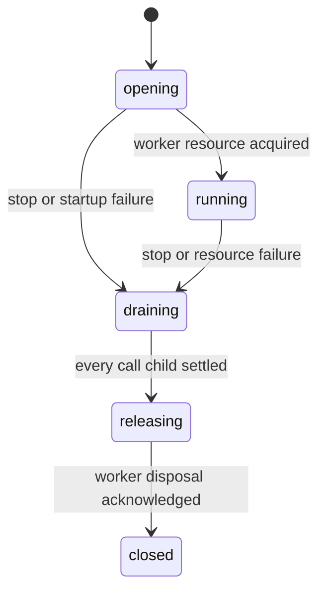

# URL-first articles and background content processing

The accepted interaction is simple: Add Link saves an article object containing the submitted URL immediately. The same save operation optionally accepts content, so a future browser clipper can supply extracted content without a second intake API. There is no separate intake graph or custom IndexedDB journal.

## Data and publication

Native Jazz `articles` rows contain libraryId, URL, originalSavedAt and optional contentId, operationId and failure. A URL-only save has no fabricated snapshot, storage intent or content receipt. It is locally saved only after its native local receipt; remote acceptance remains separate.

Readable content uses the existing immutable documents/snapshots/assets/source graph. Article identity follows the submitted URL; verified final-destination identity determines content reuse. Completing or retrying an article preserves its ID and original save time. Existing readable content is reused rather than overwritten. Legacy document-only readers remain supported.

Content publication binds the article to its native storage operation in the same transaction that inserts the intent. Publication atomically attaches immutable content. A bound operation without published content is uncertain and must not be blindly replayed. Owner policies reject foreign references and updates to completed content pointers.

## State and resource ownership

The layout owns the foreground article-save actor and the background worker resource. The foreground save only persists the article; network extraction does not disable further URL submissions. Library rows expose pending/failure status, the original URL and Retry, while completed rows use normal dedicated reader links.

A separate XState machine runs inside a dedicated module Web Worker. It observes article objects without content and processes one at a time: resolve, verify identity, check existing content/intent, extract, validate, and invoke the common save operation. Browser-supplied content uses that same operation directly. JSON parsing and processing orchestration run in the worker.

A narrow main-thread host owns the trusted Jazz session, authenticated network request leaves and native transaction actors. Bearers and account handles never cross into the worker. Abort cancels network requests. Shutdown drains issued native writes before terminating the worker or releasing the session. Stale account bindings cannot update another library.

The main-thread host is itself an XState machine (`createArticleWorkerHostMachine`). Its states are:

The host owns a child machine per RPC or Retry metadata write. Network cancellation aborts its controller but keeps the child invoked until response cleanup settles. Lookup reads are drained. Native save/failure children receive SHUTDOWN and retain ownership until local settlement; shutdown never waits for remote acceptance. The host rejects new calls while draining, ignores late account-scoped outcomes, then explicitly disposes the worker resource before notifying the library that it is closed. Terminal request/controller references and owner call maps are cleared. Browser construction, event listeners/subscription handles and bounded response-byte reading remain I/O leaves. The repository's `QueueOpen` adapter only starts the machine and exposes send/completion; it carries no closing flag, task set or write lifecycle. Capture sequencing remains in the dedicated worker.

Web Locks serialize workers for the same library across same-origin tabs in a browser profile. They are not global cross-device locks. Independent profiles can contend; native intent reconciliation and immutable publication remain necessary. Workers run while the application is open; a service worker does not run the capture queue after the browser closes. Pending URL rows resume on reopening.

## Failure and retry

A failed fetch retains the same URL article and a bounded failure code. Retry processes the same object. Permanent gateway failures are distinguished from connectivity failures. The worker makes at most one attempt per eligible article per wake; explicit Retry or an offline-to-online transition can wake eligible work. Full exponential-backoff scheduling remains future work. Cancellation retains the article. Unknown writes retain their operation barrier and are never retried as fresh publications.

Messages reuse approved catalog copy and are prepared by their owning machines. No new catalog strings, inline fallback copy or dependencies are introduced.

## Evidence and remaining scope

Native-authority tests cover URL-only persistence, supplied content, immutable completion, content reuse, foreign access denial and unknown-write non-replay. Worker unit tests cover serialization, retry and intent reconciliation. Chromium application tests cover actual worker execution, two-tab serialization, URL persistence before content, supplied-content bypass and process-restart recovery. Upstream extraction in restart/browser fixtures is simulated; account, persistence, browser-process and synchronization boundaries are real.

Images, annotations, extension packaging, complete retry/backoff behavior, retained redirect evidence after every failed fetch, broader browser/mobile qualification and deployed-authority migration remain separate work. This batch does not complete the entire product spec.

## Remaining lifecycle owners

The worker runtime machine owns waiting for the library Web Lock, the active queue and stopping. It retains the latest subscription rows and pending controls while waiting. An account/library-scoped BroadcastChannel routes controls to the active lock holder and acknowledges delivery; unacknowledged controls remain in memory for lock acquisition. This is not a durable journal. STOP cancels a queued lock request and stops queue work, while an acquired lock remains held until the host has drained native calls and terminates the worker. This prevents another tab from taking ownership during write cleanup.

The HTTP request machine owns authorization, admission, bounded input reading, the gateway child, response encoding and permit release. Its deadline and client cancellation abort the shared signal without discarding active body/parser cleanup. Admission is released only after that invocation settles. Input/response limits and existing private response/error policies remain unchanged. Synchronous quota accounting and bounded body I/O remain capability leaves.

Preview tooling uses a process machine for running, SIGTERM, five-second escalation to SIGKILL and physical close. Repeated cancellation cannot restart escalation, and a signal/error event does not substitute for process close. The subprocess adapter owns spawning, bounded diagnostic buffering and process-group signals; terminal machine context clears environment references.
