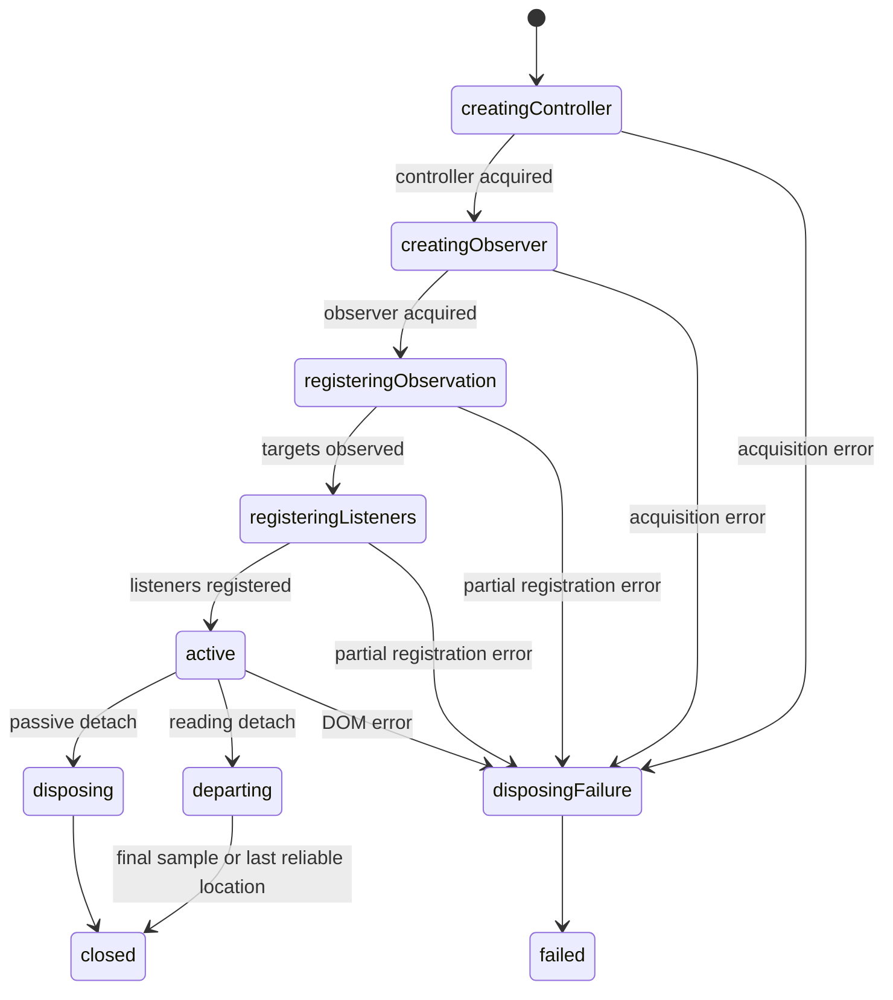
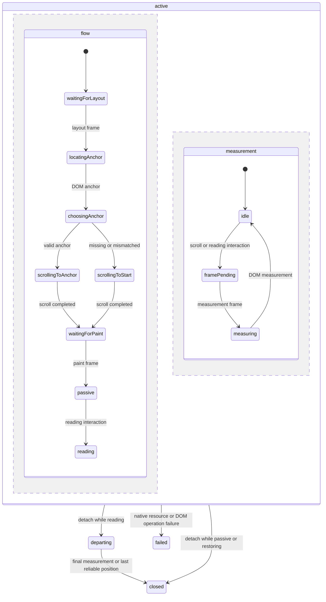

# Reader experience

This authorized batch follows merged Clipper PR #16 (`b21691f`). It adds positions/progress, shared theme/typography, contents, footnote popovers, distraction-free reading and explicit end-of-article Archive. Images and annotations remain excluded. The user approved the first 17 proposed reader labels/errors; those entries are now in the catalog. The user then explicitly approved the revised generic failure template, Sync action label and actionable unconfirmed-save message with “add them”; those shared entries are also in the catalog.

## Inspected reusable presentation

Pinned DUI provides InputRange, Select, RadioGroup/RadioItem, Button, Dialog, Popover, Heading, StatusMessage and theme.css. Its `data-dui-theme` root attribute selects light/dark; absence follows the system live. No new palette or font download is needed. The approved SVG build dependency described below follows Finance's DUI consumer configuration. Controlled FontSettings, ThemeSettings, ReadingProgress, ContentsNavigation, ReaderActions and ReaderToolbar compose a ReaderView; Reader integration passes rendered DOM elements to the owning actor. SavedContent remains the sole sanitized-content renderer. DOM measurement/anchor helpers are separate from presentation.

## State and resource ownership before async implementation

The library invokes a reader-experience child for its full lifetime. It owns a local-first native subscription, desired-value write queue, DLF transaction children, remote receipts, focus mode and the attached viewport states. Library shutdown joins its closure with existing save/worker drains. Account replacement cannot release the old binding until issued reader writes settle. Uncertain writes are not replayed. Pending unissued desired values are coalesced by field/document; accepted final positions flush on departure/shutdown while the current owner remains valid.

The child models observing, subscription failure, idle/debouncing/writing, local failure, uncertainty, remote rejection, active/closing and attached/detached viewport states explicitly. Storage callbacks only issue defined queries/writes or translate results. Validation uses shared named Zod schemas/predicates. Native transactions inspect the current library/document parents and stage one immutable operation. Like existing organization actions, each write carries the causal frontier from the owning machine's validated native observation; it does not claim to have observed concurrent unseen writes. Source snapshots are unchanged. Preferences are independent fields and use causal heads plus deterministic IDs. Positions use causal heads, interaction time and ID; clock skew remains a limitation. Progress is the maximum observed fraction, separate from last location.

The viewport region owns listeners, ResizeObserver and scheduled restoration. It waits for local reading data and rendered content before applying the initial position once. It stores a normalized code-point offset and quote/context tied to the immutable snapshot. Typography/viewport changes reanchor the current location. A mismatched anchor opens at the beginning and does not overwrite evidence until user interaction. Later remote records update available state without scrolling an attached reader. Scroll observation is debounced one second for storage; departure flushes the last observation. Transient popovers retain native dismissal/focus behavior. Focus mode hides shell panels/ordinary controls and always retains an accessible Show controls exit; there is no automatic focus-sensitive hiding timer.

## DOM ownership and default DUI caret

The user clarified that the viewport machine should work directly with the DOM. Reader passes root/scroller elements to the library-owned reader experience, which invokes one viewport machine. That machine owns the nodes, text index, size snapshots, listeners, ResizeObserver, animation frames, DOM reads and scroll writes. The ReadingViewport method object and separate observation/restoration wrappers are removed.

The resource lifecycle models controller acquisition → observer acquisition → observation registration → listener registration → active explicitly. Nested ownership scopes retain the controller and observer independently; leaving either scope releases its single resource, including forced actor stop and partial setup failure. Normal and failed disposal have explicit transitions before closed/failed. Native creation callbacks only acquire/report one resource and return its disposal operation. These small leases remain necessary because stopping an actor does not execute its machine's ordinary exit transitions; invoking scopes ensure native cleanup on stop as well as normal transitions. Registration leaves perform one registration step. There is no combined setup/disposal try/catch block.

Resize callbacks emit raw RESIZE. A separate measuringSizes → comparingSizes region reads geometry, and a named guard decides whether to update the baseline and reflow. Fullscreen callbacks also report every native change; support, confirmation of actual fullscreen, inactive events and exit admission belong to named guards/states in the reader experience. The reader owns the Document directly instead of a method object containing those decisions. Native observation must register successfully before requesting fullscreen; registration failure falls back without starting an unowned request. Existing pending-entry/exit drain behavior remains. The related reader subscription, frame and single DOM-operation leaves were inspected; pure anchor/interaction validation and calculations remain functions. No package, schema or copy change is required.

Ownership-scope exit disconnects the observer and aborts listeners before departure sampling or failure feedback. Twelve direct DOM regressions cover the lifecycle, including observer-construction failure, partial listener registration and resize-measurement failure. Fifteen parent tests cover persistence/scope behavior plus guarded unsupported/unconfirmed fullscreen, raw native changes, missing fullscreen at exit and listener-startup failure. All 53 web cases pass in one full run, all five production offline cases pass, and actual network Stately testing retains 39% progress/location through native fullscreen. Shared servers were preserved and temporary harnesses removed.

The state/resource plan is implemented directly in viewport.ts. Parallel flow and measurement regions coordinate restoration and reading. Named guards decide interaction eligibility, actual size changes, anchor validity and changed positions. Invoked leaves perform individual native operations; their errors enter the failed state and release active resources. They do not choose the next workflow. Restoration waits for layout, locates the anchor, explicitly selects an anchor or beginning scroll, and waits for paint before admitting ordinary scroll measurements. User interaction cancels restoration. Reflow restarts it with the current location. Remote positions never scroll the open reader.

Departure releases event resources and cancels pending frames before sampling the DOM once more. If that final sample is unavailable or fails, the last reliable position remains available. The parent retains native persistence, receipts, furthest progress and scope admission; it joins viewport closure before finishing shutdown and never replays an uncertain write. Direct DOM unit fixtures cover restoration, mismatched anchors, excluded controls, frame coalescing, actual size changes, disposal, final sampling and native failures; parent tests also use DOM elements instead of mocked viewport methods.

ContentsNavigation uses DUI Details' default caret. The explicitly approved @poppanator/sveltekit-svg 7.0.1 development dependency and DUI prebundle exclusion follow Finance's Vite configuration, including the network frontend. The alternative was precompiling SVG imports in DUI, a broader package change. No additional package, copy or schema change is needed for direct DOM ownership.

Current lifecycle validation passes pnpm verify (560 unit/native tests, one platform skip, 81 files, strict types, formatting/lint/vendor checks and production build), all 53 web cases in one run and all five production offline cases. Real network testing also confirms Stately progress and fullscreen location retention. Earlier rebuilt extension/sample-data evidence is recorded below; these suites were not rerun for this internal viewport contract refactor. Shared servers were preserved and temporary harnesses removed.

## Native schema

An additive readerOperations table stores libraryId, nullable documentId, field, JSON desired value and causal parents. Preferences belong to the library (null document); positions reference a same-library immutable document/snapshot. Owner-only policies deny history edits/deletion and foreign document references. Existing roots/content/operations are preserved by the additive migration. History compaction is future work; no large-library performance claim is made.

### Live progress correction

The user reported that the percentage indicator still did not work on the network frontend. The reader selector used only persisted history while scroll writes debounce for one second; continuous scrolling therefore left the visible percentage unchanged until scrolling stopped. Coalescing also discarded a higher unsaved percentage if the user scrolled back before that save.

The reader machine now accumulates furthest observed progress per document immediately on admitted viewport measurements and merges it monotonically with native observations. The UI projects that live progress, while native writes keep their existing debounce and receipt ownership. Each queued/final position carries the furthest observed percentage independently of its current text anchor, so quick backwards navigation cannot lose progress. Closed or expired scopes hide/clear the accumulated projection; it does not assert storage durability and does not replay uncertain writes. No schema, catalog or dependency change is involved.

The production restart proof now leaves and reopens the reader to flush the debounce before checking reload/cold restart. The live percentage itself is not a persistence receipt. Abrupt process termination before an unissued debounced observation is flushed can still lose that observation; normal reader departure flushes it. The native database assertion in the new live-progress browser test independently proves persistence after the timer is released.

A new actor regression fails before the change because progress is absent before persistence. It now verifies immediate display, coalesced backwards scrolling, persistence of the furthest percentage and scope expiry. A real-browser regression pauses the save timer, uses native wheel scrolling, verifies visible progress while native history remains empty, scrolls backwards, then releases the timer and verifies native persistence. Network testing also saved the actual Stately Invoke page and observed about 39% read plus actual fullscreen entry/exit with reading location retained. Native fullscreen was already implemented in PR #17; this follow-up changes the progress projection.

Follow-up validation passes pnpm verify (545 unit/native tests plus one platform skip, all strict types, lint/format/vendor checks and production build), all 53 web browser cases in one full run, and all five production offline cases. Shared authorities were preserved and temporary harnesses removed. The initial reader batch's eleven rebuilt extension and two sample-data cases remain recorded below; those suites were not repeated for this projection-only follow-up.

### Reading progress and fullscreen follow-up

The user requested working reading status and native browser fullscreen. The reader's focus region now explicitly models fullscreen admission, pending entry, cancellation, active fullscreen, denied/unavailable fallback and exit. The reader owns the native Document; its invocation handles single browser API calls and raw fullscreenchange observation, while named guards decide support and exit. Show controls exits fullscreen; a native exit (including Escape) restores app controls. Shutdown waits for pending entry and exit rather than leaving an unowned request. Unsupported or declined fullscreen retains the ordinary distraction-free view. No new dependency or copy is needed.

Browser qualification found that controls/modal interactions could overwrite reading location, removed DOM could measure as the end of the article, and a post-restart transactional history query could remain pending. Reading interaction now excludes form/dialog/popover controls, measures reading gestures even when a short article cannot scroll, and ignores detached/hidden content during final measurement. Resize observation compares actual dimensions so its initial notification does not reanchor the reader. Native history now follows the existing organization convention of passing observed causal heads to the write; parent existence and staging stay under the transaction owner. This removes the problematic transactional history query without adding a cache or replacing Jazz. Open library/original remain in the sticky toolbar so normal navigation does not require scrolling to the top.

Five reader browser cases pass for actual native fullscreen entry/exit with the same paragraph retained, controls/contents/footnote focus, typography and viewport reanchoring, backwards navigation with retained furthest progress, independent client preferences/positions, short articles without scroll overflow, and a complete offline browser restart followed by synchronization. Focus restoration uses preventScroll and focus/fullscreen transitions enter the viewport restoration state before layout changes; further resizes restart pending restoration. Fourteen focused reader state/native tests pass, including declined fullscreen and draining pending entry/exit during shutdown. A disposable browser on the network frontend also verified 35% native progress, actual fullscreen entry/exit and retained scroll location. Exact approval and implementation of the shared catalog entries are recorded below.

## Qualification

Unit/native coverage must include input bounds, quote/context restoration, causal/concurrent preference and position resolution, furthest progress, parent permissions, scope change, subscription disposal, debounce/coalescing, issued-write drain, unknown outcomes, stale callbacks and remote positions not moving an open reader. Browser coverage exercises actual DUI controls, keyboard/focus/contents/popovers, resize/typography reanchoring, route return, cross-client sync and full offline restart. Existing capture, reader, recovery, migration, extension and production shell checks remain required. Use isolated authorities; preserve shared development servers.

### Validation and copy approval

After final copy approval, pnpm verify passes formatting (including Svelte), lint, vendor integrity, strict root/web/service-worker/extension types, 544 unit/native tests across 80 files with one platform-specific skip and the production build. Tests include the additive migration from persisted pre-reader data, independent/causal settings and positions, private immutable policies, invalid batches, quote/context validation, one-second coalescing, native-write drain, rejection precedence, uncertain-write non-replay and stale/disposed viewport reports. All 52 web cases are qualified: the full run passed 51 and found an original-link assertion still scoped to the article after that link moved into the sticky toolbar; the corrected case passes separately. The five reader cases pass again after final fullscreen location fixes. All five final production offline, eleven rebuilt extension and two sample-data cases pass. Production cold reader startup with both servers stopped and HTTP cache cleared measured about 1.05 seconds in this local run; it is not a performance guarantee. Temporary isolated test harnesses were removed and shared servers were preserved. The host runs Node 25.2.1; the pinned CI Node 24.22.2 is not installed locally and was not installed for this batch.

The initial strict Svelte check reported only references to the 19 proposed reader catalog entries (24 usage sites). The user subsequently approved the first 17 entries and requested more generic wording for the last two status messages. Existing Clipper uncertainty mentions saved articles; its sync errors describe the library or server rejection. Finance's `forms.unknown` is generic but longer, and its mutation-rejection text asserts a known outcome. The user rejected "Save outcome is uncertain." as meaningless and requested a reusable subject-failed template instead of a dedicated Sync failed entry. Revised proposals are `status.failed_subject` ("{{subject}} failed."), composed with `actions.sync` ("Sync"), and `status.save_unknown` ("We couldn’t confirm whether your changes were saved. Check them before trying again."). Only failed_subject interpolates subject; no plural or context forms are needed. Neither a generic failure template nor a standalone Sync action label exists in the current catalog. The user explicitly approved these exact revised entries with “add them”. All three shared entries are added, and the reader machine composes status.failed_subject with the localized actions.sync label. Strict web and extension checks now pass without weakening MessageKey typing or adding fallbacks. No unapproved wording was added.

### Live capture qualification follow-up

The user reported failures for Stately's `/docs/invoke` page and a Men’s Journal article through the Tailscale frontend. Exact authenticated reproduction found Stately resolve 200/extract 415 (`unsupportedMedia`) and Men’s Journal resolve/extract 502 (`sourceUnavailable`). Stately returned `text/markdown` when HTML and plain text had equal Accept preference; explicitly weighting HTML higher returns HTML with Clipper's existing identifying user agent. The transport now requests `text/html,application/xhtml+xml;q=0.9,text/plain;q=0.5`. Native HTTP/worker regressions cover negotiated HTML and retained plain-text support. No new parser/dependency, media-type relaxation, identity or transport-boundary change is introduced.

Real Tailscale Add Link now resolves/extracts Stately with HTTP 200, saves its native article as “Invoke” and opens its saved reader (about 22,000 text characters). That proof also found a reader-only `CaretIcon_1 is not a function` error in the packaged DUI Details default SVG import. That temporary custom-caret workaround has been replaced by the approved SVG loader and default DUI caret described above. The two existing capture/structured-reader/duplicate and direct/new-tab/missing-reader browser regressions pass on isolated ports 5194/5195. The full unit/native suite passes 542 tests plus one platform skip, with formatting/lint passing on changed files. Subsequent full reader/copy/UI qualification is recorded above.

Men’s Journal returns HTTP 403 with a DataDome JavaScript challenge to the server fetch. Its failed capture retains the URL and Retry; it is not falsely saved as readable challenge content. Rendered-page extension capture is the existing route when the user can read the page in their browser; no headless challenge bypass or arbitrary source-page script execution is added to the gateway. Original tracking/source provenance is unchanged.
