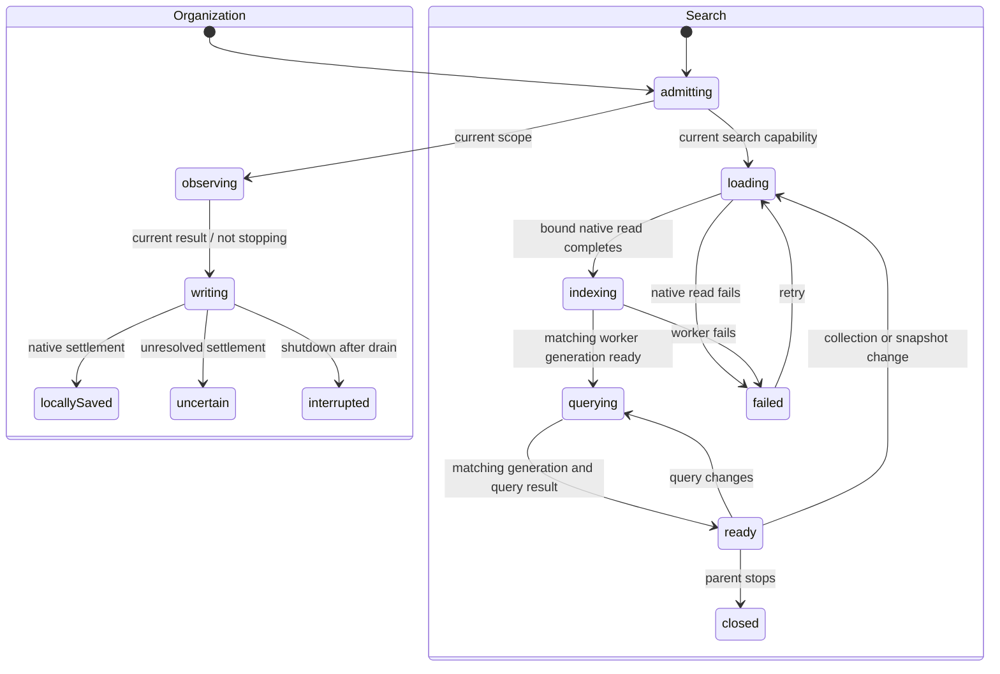

# Search, article tags and Trash/restore

Authorized together in one feature PR, based on merged PR #15 (`72b6fc9`). The user requested all testing in the same session. The user revised and approved the labels/error approach during review: compose Search articles and Move to Trash from reusable actions/nouns, omit preparation feedback, use the shorter search error and a generic Enter-subject field error. The original six-string proposal is superseded below.

## Scope and data

- Search title, URL, tag names and locally available saved article text. Require every keyword, allow bounded fuzzy matching for terms of at least four characters (20% edit distance, capped at two edits), keep shorter terms exact, boost titles, use stable original-date/ID ties, combine status/favorite/selected-tag filters with AND. Default results exclude Trash; Trash is explicit. The worker owns tokenization/indexing/ranking and an account-keyed, disposable IndexedDB cache. Jazz records remain authoritative; a missing/corrupt cache rebuilds from them. No server search or primary-data journal.
- Tags apply to articles only. Trim/NFC display spelling, version full Unicode default case folding for keys, reject empty or >64 code-point names. Immutable assignment operations store desired membership, independent per normalized key. Concurrent spellings of a key share vocabulary and reconcile assignments deterministically. Vocabulary derives from history and survives unassignment/Trash. Vocabulary rename/delete, annotation tags and bulk actions are future batches.
- Trash is an independent causal scalar, retaining status/favorite/tags/content. Restore changes only that scalar. Re-clipping cannot restore implicitly or replace content. No permanent deletion or purge is authorized here.
- Existing schemas are inspected before extension. Add native tag-assignment history and owner/parent policies with a typed additive migration; extend the existing organization operation/policy for the trash scalar. No identity/recovery changes.

## MiniSearch dependency review — pending user review

This comparison was added after the user questioned the dependency installation. The original plan/research named MiniSearch and described a worker-owned disposable index, but did not adequately compare alternatives. It is not evidence of a completed pre-install comparison or explicit user approval. Installing the package without discussing it was a process error; listing it in the plan did not supply approval.

The product needs offline keyword search over saved title, URL, body and assigned tag names, with all query terms required, title weighting, deterministic ties and now bounded typo tolerance. Those requirements do not mandate MiniSearch. Jazz remains the authoritative store; the search engine can be replaced without migrating article/tag records.

MiniSearch 7.2.0 supplies a local in-memory full-text index, AND queries, relevance scores, field boosts, configurable edit-distance matching and JSON index serialization. Its installed manifest has no runtime dependencies. These features fit an ordinary module worker controlled by the existing XState resource owner; Clipper persists its serialized index only as an account-scoped rebuildable cache. The rationale for retaining it is the direct fit of these APIs and avoiding application-owned implementations of indexing, fuzzy matching and ranking. This is a feature/integration rationale, not a measured performance advantage. [Pinned MiniSearch source and documentation](https://github.com/lucaong/minisearch/tree/v7.2.0), [API and serialization](https://lucaong.github.io/minisearch/classes/MiniSearch.MiniSearch.html).

| Alternative | What it offers | Tradeoff for Clipper |
| --- | --- | --- |
| Scan saved text in the existing worker, with no new package | Straightforward literal/keyword search and no additional search index dependency | A credible choice for small libraries. Each query examines the searchable corpus; application code would also need to implement and maintain fuzzy matching and ranking to preserve the current behavior. No local benchmark establishes when this becomes insufficient. |
| Fuse.js | Browser-side fuzzy search, weighted fields, and current documented token/logical search options | A credible alternative, particularly for fuzzy record lookup. Long-article matching and all-word semantics would need qualification against the same fixtures. No head-to-head Clipper measurements establish inferiority. [Official documentation](https://www.fusejs.io/). |
| FlexSearch | Local full-text search, document fields, worker support and persistent-index options | A credible alternative, particularly if larger-corpus measurements justify its indexing/storage options. Choosing its encoders, matching and persistence model would need a separate integration evaluation. MiniSearch's directly configurable edit distance and JSON cache fit the current implementation; this does not prove it simpler or faster in every workload. [Official source/documentation](https://github.com/nextapps-de/flexsearch). |
| A hosted search service | A remotely managed index and query execution | It cannot be the sole search path because the accepted product must search offline. It would add remote data handling, credentials and another index lifecycle; retaining offline behavior would still require a local implementation. No hosted service is installed or required. |

Jazz/ecosystem evidence checked on 2026-11-05: the installed Jazz 2.0.0-alpha.59 public declarations and current official Jazz 2 documentation did not identify a full-text/fuzzy search engine integration or an officially recommended third-party engine. Jazz documents string `contains` and reactive queries; these are not documented ranked/fuzzy full-text search APIs. This is a bounded research finding, not a claim about private roadmap plans or every community discussion. [Jazz queries](https://jazz.tools/docs/reading/queries), [WHERE operators](https://jazz.tools/docs/reference/where-operators).

Concrete local-first ecosystem examples provide adoption evidence, not a popularity ranking or a universal recommendation:

- RxDB's official full-text search plugin uses FlexSearch and reactive incremental indexing; that wrapper is RxDB Premium and is not a Jazz integration. This makes FlexSearch a particularly relevant browser-side comparison candidate. [RxDB documentation](https://rxdb.info/fulltext-search.html).
- PowerSync documents client-side SQLite FTS5 with triggers maintaining derived FTS tables. Joplin documents SQLite FTS4. These are examples of using the local database's search facilities, but neither grants Clipper a supported FTS interface through Jazz. Introducing a separate SQLite/WASM search store would require evaluation and user approval. [PowerSync FTS](https://docs.powersync.com/client-sdks/full-text-search), [Joplin search](https://joplinapp.org/help/apps/search/).
- MindooDB documents a MiniSearch-powered local full-text index fed from its changefeed. This establishes another local-first project's use, not broad community popularity. [MindooDB full-text search](https://github.com/klehmann/MindooDB#full-text-search).

Limitations: the searchable index must fit in browser memory. Current Clipper code reloads/rebuilds the dataset on relevant article/tag/snapshot changes rather than using incremental index updates, even though MiniSearch offers update/removal APIs. Correctness and offline restart are covered; representative large-library memory, cold-build time and query latency have not been measured against alternatives. There is no evidence-based claim that MiniSearch is the fastest, smallest overall, or necessary for a small library. Approval of retaining/replacing the dependency remains for the user; this record does not authorize adding an alternative.

## Unicode case-folding dependency review — pending user review

The installed `unicode-case-folding` 1.1.2 package is used in two places: `capture/tags.ts` produces durable tag membership keys, and `search/engine.ts` normalizes both indexed terms and queries. Tag names are trimmed and NFC-normalized, folded, then NFC-normalized again for keys; the display name is retained separately. Search folds NFC-normalized tokens. The package contains a generated lookup table and mapping functions, with no runtime dependencies.

The purpose is Unicode default full case-insensitive matching: `Straße` and `STRASSE` share a key, and Greek `Σ`, `σ` and `ς` fold together. Native lowercasing leaves `straße` and `strasse` different, and leaves `σ` and `ς` different. Existing domain tests cover sharp-S, sigma, canonical accent spellings and preservation of accent/punctuation distinctions. Folding is not translation, stemming, typo correction, accent removal or locale-specific Turkish casing. [Unicode case-mapping FAQ](https://www.unicode.org/faq/casemap_charprop.html), [package source](https://github.com/avivkeller/unicode-case-folding).

| Alternative | Benefit | Tradeoff for Clipper |
| --- | --- | --- |
| Native `normalize('NFC').toLowerCase()` | No dependency or bundled folding table; sufficient if the chosen equality policy is ordinary lowercase equality | Does not implement full case folding, including sharp-S expansion and sigma equivalence. A valid simpler product policy, but it changes current tag equivalence/search behavior. |
| Native `toLocaleLowerCase()` | Supports locale-specific lowercase rules | Still not full folding; keys must not depend on different devices' default locales. Choosing a fixed locale would need an explicit equality policy. |
| Native `Intl.Collator` / `localeCompare` | Language-sensitive comparison without shipping a separate Unicode table | Returns comparison results, not a canonical string key for concurrent tag operations or token indexing. Locale/sensitivity also changes which strings compare equal. Appropriate for user-facing ordering/comparison, not a drop-in replacement for the stored keys. [MDN](https://developer.mozilla.org/en-US/docs/Web/JavaScript/Reference/Global_Objects/Intl/Collator). |
| Generate and vendor a full-fold table from a fixed Unicode release | Same algorithm without an npm runtime dependency; direct control of provenance and updates | Clipper owns the generator, attribution, table updates and conformance testing; it still ships table bytes. This is the closest behavior-preserving alternative. |
| Another Unicode/ICU library | Can provide full folding plus other Unicode facilities | Requires approval and qualification of its API, Unicode version, browser compatibility and actual bundle/memory costs. No comparison establishes this package as the best-maintained or smallest choice. |

The rationale for the chosen package was its narrow full-fold API and fixed data artifact, avoiding a Clipper-maintained Unicode table. The specs already recorded full-fold semantics, but did not adequately document this package comparison or obtain installation approval. Full folding itself is a product policy choice; a simpler lowercase policy could avoid the dependency if the user accepts its different equivalences. Unicode specifies the algorithm, not a recommendation to use this npm package.

Evidence limits: the package's generated header and current upstream generator refer to the Unicode `latest` data URL rather than identifying a fixed UCD release. Pinning package 1.1.2 and its lockfile integrity fixes the installed table bytes; the exact source Unicode release and exhaustive conformance have not been independently established. Current tests are targeted examples, not full Unicode conformance or a browser bundle/performance comparison. [Upstream generator](https://github.com/avivkeller/unicode-case-folding/blob/main/src/build.js).

Tag keys already persisted in immutable operations include the `cf-1.1.2:` prefix and are validated against the fold function. Changing the algorithm/table requires a deliberate compatibility/migration strategy for existing memberships; it must not simply invalidate retained history or strand assignments. An equivalent vendored implementation must reproduce current keys. Search-only normalization changes require rebuilding the disposable index. Retaining/replacing the package remains pending user review; this record makes no dependency change.

## State/resource ownership before async work

Organization retains the existing observation/admission/transaction/receipt machines. Tag/scalar table choice and article/document reference choice are explicit synchronous mutation-chart branches under the transaction owner. Checks and writes share that owner; immutable causal history is observed before opening the transaction, matching the established SDK boundary.

The layout-owned library owns a search child and forwards collection/query updates. A resource actor owns the physical worker and snapshot subscription; I/O leaves only load native records, post messages or dispose their fixed resource. Generations reject stale dataset replies; query identity rejects stale query replies. Query changes during loading are remembered without restarting issued native reads. Collection changes may cancel read observation; bound reads never switch DB/account. Worker cache restore/build/persist/query decisions live in explicit states, with cache persistence failure degrading to a rebuildable in-memory index. Parent shutdown stops callbacks and terminates the worker; no search callback can authorize or write article data.

UI composes existing DUI inputs, radio groups, checkboxes, dialogs and buttons. Error feedback uses readable localized `meta.name`; components project it. Search loading/indexing/querying remain silent, as requested. No new inline per-item status text. Existing approved action/noun combinations cover tags and Restore article. Search and Move to labels compose the approved shared templates with plural-aware nouns; Trash is a mass noun. Copy approval is recorded below.

## Qualification

Domain/actor tests: tag normalization and concurrent membership, independent Trash/scalars, query AND/ranking, stale result/account isolation, cache rebuild/failure, resource shutdown and issued-write drain. Native tests: private owner policies, immutable histories, parent checks, local/remote receipts and migration of populated persisted libraries. Real browser: tag assignment/removal and combined filters, title/URL/body search, remote arrival, Trash/restore and duplicate capture, complete offline restart/cache rebuild/reconnection. Preserve existing web/reader/recovery/extension suites. Run final source/build, web, offline and packaged extension checks in this session; leave one PR unmerged.

## Approved copy and presentation

The user explicitly requested the following revisions to the earlier proposal. Search and Move to are shared action templates; no standalone search-label or move-label entry is introduced. The existing action helper supplies the localized noun/count. Trash uses identical one/other forms as a mass noun. There are no context variants.

| Key | English template/text | Usage and variables |
| --- | --- | --- |
| `actions.search_subject` | Search {{subject}} | Search input label; `subject` is the approved article noun with count 2 |
| `actions.move_to_subject` | Move to {{subject}} | Per-article action; `subject` is the approved Trash noun |
| `nouns.trash_one`, `nouns.trash_other` | Trash | Radio label and action subject |
| `library.search_failed` | search is unavailable. | Search machine failed-state name, with existing Retry action |
| `forms.enter_subject` | Enter {{subject}} | Generic field feedback; `subject` uses the existing localized tag noun, rendered by DUI TagInput |

The user rejected Preparing search as unnecessary. Loading/indexing/querying states have no visible message, and no preparation catalog entry is added. The initial Check-the-form generic sentence was also rejected; the user clarified Finance’s `forms.enter_subject` template. It produces “Enter tag” using the existing noun, with no new noun, punctuation or tag-specific length message. This shared error replaces the proposed tag-specific length sentence. Existing Add tag, Restore article and Retry labels are reused. Clipper’s catalog/action/noun search found no existing correct equivalents for these additions.

The actual DUI search field, all five radios and per-row Move to Trash/Restore are exposed. DUI TagInput owns chips, draft input, suggestions, keyboard entry and announcements. A small synchronous machine validates SELECT events, computes at most one canonical membership change, delegates through XState sendTo, and clears feedback on input/reset. Native writes, local/global receipts and draining remain library/storage-owned. Components project the error name and field validity, connect it with aria-describedby, and add no English fallback. Removing/restoring a row returns focus to its next surviving sibling, previous sibling, or library heading; the native tag dialog retains its separate removed-trigger fallback.

Real-browser coverage now exercises those controls rather than treating worker/native fixture coverage as search-input/Trash-action coverage. Both styles of coverage remain useful: actual input/filter/retry/validation interactions plus native fault/offline/cache/scope boundaries. Production shell qualification deletes the derived search cache before closing the browser, then uses search, retained tags and Trash/restore after a cold restart with both servers stopped and HTTP cache cleared.

## Approved DUI TagInput templates

The user explicitly approved reusing these four Finance templates for TagInput's required remove label and announcements. `name` is the literal tag name; `subject` reuses noun('tag'). No plural or context variants are needed. The selected-list label reuses noun('tag', 2); Add tag and the generic forms.enter_subject error remain unchanged.

| Key | Text |
| --- | --- |
| `actions.remove_name` | Remove {{name}} |
| `status.selected_subject_name` | {{subject}} {{name}} selected. |
| `status.removed_subject_name` | {{subject}} {{name}} removed. |
| `errors.already_selected_subject_name` | {{subject}} {{name}} is already selected. |

TagInput's full selection is validated through the existing normalized name schema and full-fold keys. Equivalent spellings do not create another native assignment. A single addition/removal becomes one desired-value organization request; multiple simultaneous differences are rejected rather than overwriting concurrent metadata. The library remains the sole asynchronous mutation/receipt owner. Native membership drives the widget value; readonly preserves input focus during native settlement. No custom chip styles, bespoke suggestions or local persistence are added.
