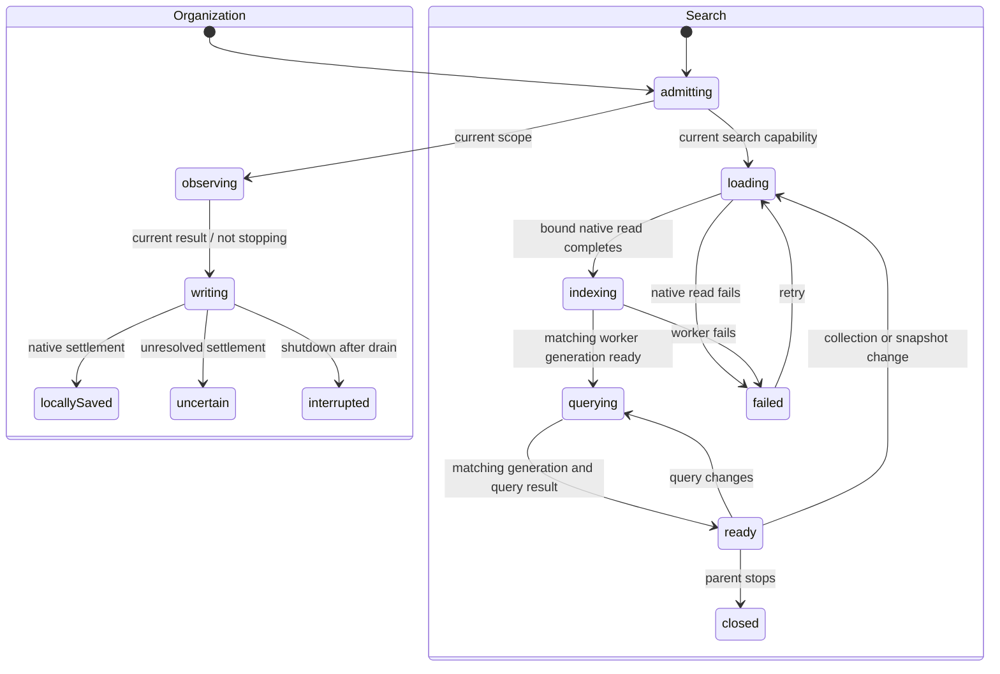

# Search, article tags and Trash/restore

Authorized together in one feature PR, based on merged PR #15 (`72b6fc9`). The user requested all testing in the same session. The user revised and approved the labels/error approach during review: compose Search articles and Move to Trash from reusable actions/nouns, omit preparation feedback, use the shorter search error and a generic Enter-subject field error. The original six-string proposal is superseded below.

## Scope and data

- Search title, URL and locally available saved article text. Require every keyword, boost titles, use stable original-date/ID ties, combine status/favorite/selected-tag filters with AND. Default results exclude Trash; Trash is explicit. The worker owns tokenization/indexing/ranking and an account-keyed, disposable IndexedDB cache. Jazz records remain authoritative; a missing/corrupt cache rebuilds from them. No server search or primary-data journal.
- Tags apply to articles only. Trim/NFC display spelling, version full Unicode default case folding for keys, reject empty or >64 code-point names. Immutable assignment operations store desired membership, independent per normalized key. Concurrent spellings of a key share vocabulary and reconcile assignments deterministically. Vocabulary derives from history and survives unassignment/Trash. Vocabulary rename/delete, annotation tags and bulk actions are future batches.
- Trash is an independent causal scalar, retaining status/favorite/tags/content. Restore changes only that scalar. Re-clipping cannot restore implicitly or replace content. No permanent deletion or purge is authorized here.
- Existing schemas are inspected before extension. Add native tag-assignment history and owner/parent policies with a typed additive migration; extend the existing organization operation/policy for the trash scalar. No identity/recovery changes.

## State/resource ownership before async work

Organization retains the existing observation/admission/transaction/receipt machines. Tag/scalar table choice and article/document reference choice are explicit synchronous mutation-chart branches under the transaction owner. Checks and writes share that owner; immutable causal history is observed before opening the transaction, matching the established SDK boundary.

The layout-owned library owns a search child and forwards collection/query updates. A resource actor owns the physical worker and snapshot subscription; I/O leaves only load native records, post messages or dispose their fixed resource. Generations reject stale dataset replies; query identity rejects stale query replies. Query changes during loading are remembered without restarting issued native reads. Collection changes may cancel read observation; bound reads never switch DB/account. Worker cache restore/build/persist/query decisions live in explicit states, with cache persistence failure degrading to a rebuildable in-memory index. Parent shutdown stops callbacks and terminates the worker; no search callback can authorize or write article data.

UI composes existing DUI inputs, radio groups, checkboxes, dialogs and buttons. Error feedback uses readable localized `meta.name`; components project it. Search loading/indexing/querying remain silent, as requested. No new inline per-item status text. Existing approved action/noun combinations cover tags and Restore article. Search and Move to labels compose the approved shared templates with plural-aware nouns; Trash is a mass noun. Copy approval is recorded below.

## Qualification

Domain/actor tests: tag normalization and concurrent membership, independent Trash/scalars, query AND/ranking, stale result/account isolation, cache rebuild/failure, resource shutdown and issued-write drain. Native tests: private owner policies, immutable histories, parent checks, local/remote receipts and migration of populated persisted libraries. Real browser: tag assignment/removal and combined filters, title/URL/body search, remote arrival, Trash/restore and duplicate capture, complete offline restart/cache rebuild/reconnection. Preserve existing web/reader/recovery/extension suites. Run final source/build, web, offline and packaged extension checks in this session; leave one PR unmerged.

## Approved copy and presentation

The user explicitly requested the following revisions to the earlier proposal. Search and Move to are shared action templates; no standalone search-label or move-label entry is introduced. The existing action helper supplies the localized noun/count. Trash uses identical one/other forms as a mass noun. There are no context variants.

| Key | English template/text | Usage and variables |
| --- | --- | --- |
| `actions.search_subject` | Search {{subject}} | Search input label; `subject` is the approved article noun with count 2 |
| `actions.move_to_subject` | Move to {{subject}} | Per-article action; `subject` is the approved Trash noun |
| `nouns.trash_one`, `nouns.trash_other` | Trash | Radio label and action subject |
| `library.search_failed` | search is unavailable. | Search machine failed-state name, with existing Retry action |
| `forms.enter_subject` | Enter {{subject}} | Generic field feedback; `subject` uses the existing localized tag noun, rendered by DUI TagInput |

The user rejected Preparing search as unnecessary. Loading/indexing/querying states have no visible message, and no preparation catalog entry is added. The initial Check-the-form generic sentence was also rejected; the user clarified Finance’s `forms.enter_subject` template. It produces “Enter tag” using the existing noun, with no new noun, punctuation or tag-specific length message. This shared error replaces the proposed tag-specific length sentence. Existing Add tag, Restore article and Retry labels are reused. Clipper’s catalog/action/noun search found no existing correct equivalents for these additions.

The actual DUI search field, all five radios and per-row Move to Trash/Restore are exposed. DUI TagInput owns chips, draft input, suggestions, keyboard entry and announcements. A small synchronous machine validates SELECT events, computes at most one canonical membership change, delegates through XState sendTo, and clears feedback on input/reset. Native writes, local/global receipts and draining remain library/storage-owned. Components project the error name and field validity, connect it with aria-describedby, and add no English fallback. Removing/restoring a row returns focus to its next surviving sibling, previous sibling, or library heading; the native tag dialog retains its separate removed-trigger fallback.

Real-browser coverage now exercises those controls rather than treating worker/native fixture coverage as search-input/Trash-action coverage. Both styles of coverage remain useful: actual input/filter/retry/validation interactions plus native fault/offline/cache/scope boundaries. Production shell qualification deletes the derived search cache before closing the browser, then uses search, retained tags and Trash/restore after a cold restart with both servers stopped and HTTP cache cleared.

## Approved DUI TagInput templates

The user explicitly approved reusing these four Finance templates for TagInput's required remove label and announcements. `name` is the literal tag name; `subject` reuses noun('tag'). No plural or context variants are needed. The selected-list label reuses noun('tag', 2); Add tag and the generic forms.enter_subject error remain unchanged.

| Key | Text |
| --- | --- |
| `actions.remove_name` | Remove {{name}} |
| `status.selected_subject_name` | {{subject}} {{name}} selected. |
| `status.removed_subject_name` | {{subject}} {{name}} removed. |
| `errors.already_selected_subject_name` | {{subject}} {{name}} is already selected. |

TagInput's full selection is validated through the existing normalized name schema and full-fold keys. Equivalent spellings do not create another native assignment. A single addition/removal becomes one desired-value organization request; multiple simultaneous differences are rejected rather than overwriting concurrent metadata. The library remains the sole asynchronous mutation/receipt owner. Native membership drives the widget value; readonly preserves input focus during native settlement. No custom chip styles, bespoke suggestions or local persistence are added.
