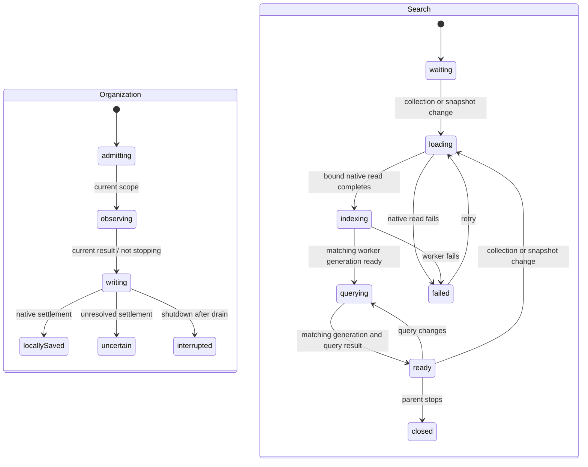

# Search, article tags and Trash/restore

Authorized together in one feature PR, based on merged PR #15 (`72b6fc9`). The user requested all testing in the same session. Existing copy approval rules still apply; six exact catalog additions were proposed asynchronously before implementation and remain pending until an explicit response.

## Scope and data

- Search title, URL and locally available saved article text. Require every keyword, boost titles, use stable original-date/ID ties, combine status/favorite/selected-tag filters with AND. Default results exclude Trash; Trash is explicit. The worker owns tokenization/indexing/ranking and an account-keyed, disposable IndexedDB cache. Jazz records remain authoritative; a missing/corrupt cache rebuilds from them. No server search or primary-data journal.
- Tags apply to articles only. Trim/NFC display spelling, version full Unicode default case folding for keys, reject empty or >64 code-point names. Immutable assignment operations store desired membership, independent per normalized key. Concurrent spellings of a key share vocabulary and reconcile assignments deterministically. Vocabulary derives from history and survives unassignment/Trash. Vocabulary rename/delete, annotation tags and bulk actions are future batches.
- Trash is an independent causal scalar, retaining status/favorite/tags/content. Restore changes only that scalar. Re-clipping cannot restore implicitly or replace content. No permanent deletion or purge is authorized here.
- Existing schemas are inspected before extension. Add native tag-assignment history and owner/parent policies with a typed additive migration; extend the existing organization operation/policy for the trash scalar. No identity/recovery changes.

## State/resource ownership before async work

Organization retains the existing observation/admission/transaction/receipt machines. Tag/scalar table choice and article/document reference choice are explicit synchronous mutation-chart branches under the transaction owner. Checks and writes share that owner; immutable causal history is observed before opening the transaction, matching the established SDK boundary.

The layout-owned library owns a search child and forwards collection/query updates. A resource actor owns the physical worker and snapshot subscription; I/O leaves only load native records, post messages or dispose their fixed resource. Generations reject stale dataset replies; query identity rejects stale query replies. Query changes during loading are remembered without restarting issued native reads. Collection changes may cancel read observation; bound reads never switch DB/account. Worker cache restore/build/persist/query decisions live in explicit states, with cache persistence failure degrading to a rebuildable in-memory index. Parent shutdown stops callbacks and terminates the worker; no search callback can authorize or write article data.

UI composes existing DUI inputs, radio groups, checkboxes, dialogs and buttons. New workflow feedback uses readable localized `meta.name`; components project it. No new inline per-item status text. Existing approved action/noun combinations cover tags and Restore article. New wording is gated on explicit approval, not inferred from feature authorization or absence.

## Qualification

Domain/actor tests: tag normalization and concurrent membership, independent Trash/scalars, query AND/ranking, stale result/account isolation, cache rebuild/failure, resource shutdown and issued-write drain. Native tests: private owner policies, immutable histories, parent checks, local/remote receipts and migration of populated persisted libraries. Real browser: tag assignment/removal and combined filters, title/URL/body search, remote arrival, Trash/restore and duplicate capture, complete offline restart/cache rebuild/reconnection. Preserve existing web/reader/recovery/extension suites. Run final source/build, web, offline and packaged extension checks in this session; leave one PR unmerged.

## Pending exact-copy proposal

No interpolation variables, plural forms or context variants are needed for these six entries. Existing action/noun combinations correctly cover Tags, Add tag and Restore article. Existing library status labels do not name search or Trash; generic capture failure/pending messages would misdescribe a disposable search index; no existing noun/action expresses moving to Trash or the tag-length constraint. These proposed entries have not been added or approved:

| Key | Exact English | Usage |
| --- | --- | --- |
| `library.search_label` | Search saved articles | DUI search input label |
| `library.views.trash` | Trash | Explicit library scope radio |
| `library.move_to_trash` | Move to Trash | Per-article action |
| `library.search_preparing` | Preparing search… | Indexing/querying state name |
| `library.search_failed` | Search is unavailable on this device. Retry to rebuild it. | Search failure state name |
| `library.tag_invalid` | Enter a tag with 1–64 characters. | Invalid tag feedback |

Until approval, tag input uses normalized validation to disable invalid submission, and production omits the new search/Trash controls. Search cache corruption/missing data, scope disposal and offline queries are exercised through real worker/native fixture drivers rather than an unapproved product input.
