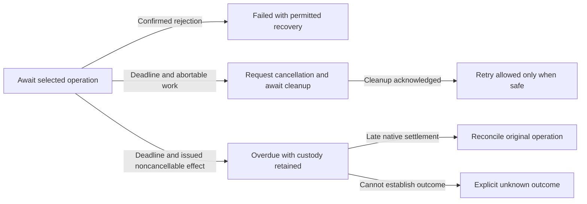
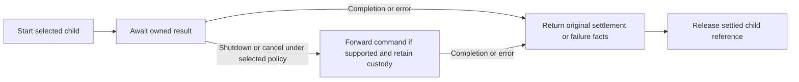
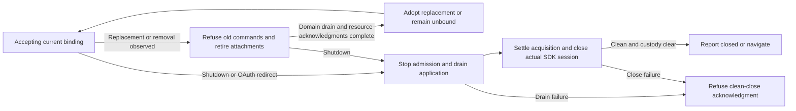
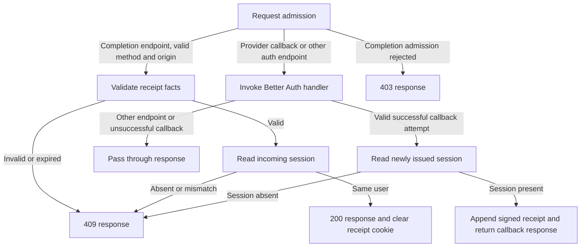
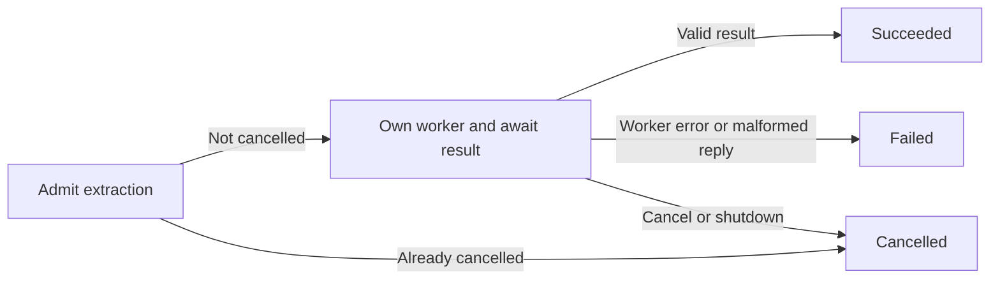

# Workflow ownership hardening specification

**Status:** Partially implemented: A and B are complete for Clipper. C–G remain open; Finance adoption retains its separate actual-adapter qualification gate. See the [PR checkpoint and qualification record](../../docs/reviews/workflow-hardening-progress.md). **Source baseline:** PR #20, `b33a22d426cfc40d71d265fc824ad4b4950e2fdc`; implementation starts from its merged equivalent.

Move the remaining authentication and runtime lifecycle decisions into their owning charts. A reader must be able to identify admission, replacement, operation order, completion, failure and cancellation from the statecharts and their typed protocols. Preserve established product and persistence semantics while making resource ownership explicit and adding recoverable outcomes for stalled operations.

Follow [XState memory](../../docs/memory/xstate.md), [worker runtime boundaries](../../docs/memory/worker-runtime.md), [the v6 specification](xstate-v6-migration.md), [the product specification](spec.md), [design decisions](design-decisions.md) and [implementation handoff](implementation-handoff.md). This specification narrows the next refactor; it does not reopen accepted product scope cuts.

## Implementation map

Implement by module ownership and dependencies, using the change sets below as review boundaries. Design account transport, binding replacement and realm closure together before changing either side of their protocol. Ship contracts with their owner, native adapter and focused regressions. Apply the v6 rules while editing each module; the final cleanup change set is not permission to defer correctness.

| Change set | Primary files or modules | Depends on | Deliverable and acceptance |
| --- | --- | --- | --- |
| A Shared persistence composition | DLF transaction/lifecycle exports; Clipper `machines/storage/domain-transaction.ts`, save/organization/image/reader/sample callers | Contract and artifact design below | Qualified generic bridge/supervisor and migrated consumers; SHARE-1/2, DLF-1/2. |
| B Shared account transport | DLF Jazz worker/account-store modules; Clipper `runtime/worker/account-store.ts`, `storage-channel.ts`, `broker-channel.ts` | A's ownership contracts; pin both consumer baselines | Scoped RPC and lock/write settlement; SHARE-3, REC-3, DLF-3. |
| C Account binding and realm lifecycle | DLF session contracts; Clipper `backend/jazz/account.ts`, `application-readiness.ts`, worker host/client/publication | A and B; design C/B protocol together | One binding authority, supervised attachments and honest closure; HOST, BIND, host portion of REC-6. |
| D Authentication | DLF injected sign-out workflow; Clipper server auth handler/completion, `runtime/atproto.ts`, `runtime/sign-out.ts` | C drain contract; PR #20 or equivalent; server chart can be developed independently | Explicit server outcomes, bounded OAuth requests and ordered logout; AUTH, REC-7, sign-out portion of REC-6. |
| E Reader and search resources | Clipper `reader/surface-viewport.ts`, `surface-host.ts`, `machines/reader/experience.ts`, search coordinator/worker | C attachment/closure protocol; A for reader write supervision | Acknowledged detach and recoverable stalled search; REC-4/5. |
| F Browser worker jobs | Clipper shared browser-job child, extension `worker.ts`/`clip-machine.ts`, image queue/worker | Shared lifecycle contracts; independent of auth-server work | Reused native worker lifecycle with preserved fallbacks; EXT, SHARE-4, REC-8. |
| G Remaining v6 and calculation cleanup | Files identified in the v6 checklist; decode/history/receipt helpers | Fold correctness changes into A–F; finish remaining isolated cleanup afterward | No hidden effects, tighter protocols and readable charts; V6, SHARE-5/6. |
| Final qualification | Both repositories' package/consumer gates and Clipper production flows | All applicable change sets and compatible artifact adoption | ROOT, REC-1/2, DLF-4/5/6 and all module criteria. |

A change set may use multiple PRs when public contracts and consumer migration require separate repositories. Establish candidate export names/signatures before implementation; names for new DLF modules below describe responsibility, not existing exports. Publish and qualify the corresponding DLF artifact before each dependent Clipper cutover. Do not wait for every DLF extraction to finish before qualifying an independently deliverable module, and do not combine unrelated domain behavior into a helper.

No new third-party dependency, schema migration, unapproved catalog wording or AT publication feature is required. Existing product scope and local-first behavior remain binding. This is an implementation-ready specification; it does not itself execute, merge or publish implementation work.

## Contracts and prerequisites

Clipper file paths below are relative to `apps/web/src/lib/` unless prefixed with `apps/extension/`; DLF paths are relative to its `src/lib/`. New shared modules require explicit public exports. Existing source links pin the reviewed code; they are evidence, not a requirement to retain obsolete file placement.

Before implementation, resolve four contract decisions in the owning change set: the compatible DLF artifact/export contract (A and every later DLF cutover), the storage settlement handshake (B), concrete named deadline durations and exact-boundary precedence (B–E), and binding/reader-close acknowledgment ownership (C/E). Record the chosen contracts beside their code and tests. These decisions cannot be deferred to an adapter's hidden control flow.

### Reviewed source and repository rules

The following links pin the reviewed implementation rather than a moving branch:

- [Server completion orchestration](https://github.com/delightful-labs/delightful-clipper/blob/b33a22d/apps/web/src/lib/server/auth/completion-handler.ts): endpoint branching, session lookup and completion-cookie effects are sequenced in `handleConfiguredAuth`.
- [Application worker boundary](https://github.com/delightful-labs/delightful-clipper/blob/b33a22d/apps/web/src/lib/runtime/worker/application.worker.ts): callback-local references, subscription maps, binding comparisons, reader revision tracking and surface retirement coordinate actor resources.
- [Worker host](https://github.com/delightful-labs/delightful-clipper/blob/b33a22d/apps/web/src/lib/runtime/worker/host-machine.ts): already owns application drain, recovery and tag actors, scope admission and SDK close. Extend this ownership rather than duplicating it.
- [Account adapter](https://github.com/delightful-labs/delightful-clipper/blob/b33a22d/apps/web/src/lib/backend/jazz/account.ts): `bindHost` caches the current client and observation, rebuilds account capabilities and releases recovery/restoration bindings.
- [Extension extraction adapter](https://github.com/delightful-labs/delightful-clipper/blob/b33a22d/apps/extension/src/worker.ts): `extractSource` sequences worker creation, message/error/abort settlement and termination in a promise closure.

Re-read these paths against the implementation branch before coding. Later fixes must be preserved; this baseline is not an instruction to revert newer behavior. Existing PR #20 extension and hosted-provider qualification gaps remain separate release gates.

The shared-library review uses latest merged DLF `main` at [`9d2b0f6ae10d6a19f4dfa3cf7d606edbe4554e50`](https://github.com/delightful-labs/delightful-local-first/commit/9d2b0f6ae10d6a19f4dfa3cf7d606edbe4554e50), verified on 2026-11-10, rather than the older default local checkout. Recheck newer merged changes before implementation. DLF already targets XState `6.0.0-beta.1` and owns session acquisition/readiness, restoration, transaction settlement and detached custody.

The following placement decisions refine the shared-helper requirements above. Move reusable lifecycle mechanics through explicit DLF public contracts; Clipper continues to own its domain facts, mutation eligibility, operation selection, native schema and product feedback. Do not copy Clipper domain models or introduce a second owner for behavior DLF already provides.

| Responsibility | Required placement | Consumer boundary |
| --- | --- | --- |
| Generic domain transaction bridge | DLF, beside its transaction workflow | Accept typed domain spawn/read/stage contracts. Clipper supplies domain charts and native transaction capabilities. Remove Clipper imports and concrete Jazz resource types from the generic composition. |
| Owned-operation supervisor | DLF lifecycle primitive, where direct invocation alone is insufficient | Parent selects the child and interprets output; helper owns correlation, supported interruption forwarding and drain. Preserve concrete result/command types and existing native custody transfer. |
| Account-store update and worker bridge | DLF Jazz integration | Share SDK read/transform/write, Web Lock lifetime, request acknowledgments, uncertain settlement and host closure. Inject app scope/configuration; keep app commands and data outside the transport. |
| Session binding replacement and closure | Extend existing DLF session workflows | DLF owns native acquisition, binding generations, invalidation and session close. Clipper owns library/reader/capture drain and reports its actual completion before identity replacement or close proceeds. |
| Ordered sign-out | DLF workflow with injected capabilities | Provider sign-out precedes native logout; share interruption/overdue/settlement handling. App integration supplies provider endpoint/configuration and product feedback. |
| Correlated RPC lifecycle | DLF worker/Jazz boundary | Share correlation, protocol failure and transferred-resource cleanup needed by the identity host. Do not expand the library into an unrelated general RPC framework. |
| One-shot browser worker job | Clipper-local shared helper initially | Image/extraction payloads and fallbacks remain local. A future DLF need requires a separate justified public contract; current DLF accepts platform image-processing capabilities. |
| Capture, search, reader, images and organization policy | Clipper | Product-specific statecharts, schemas, eligibility, feedback and result interpretation remain app-owned. |
| Provider callback cookies and auth completion HTTP workflow | Clipper auth integration for this delivery | DLF currently exposes no provider-server workflow that replaces this endpoint logic. Broader shared authentication requires an agreed contract; extracting ordered sign-out does not implicitly move the auth server. |

### Ownership allocation

Continue composing DLF session acquisition/startup/readiness, recovery/restoration, transaction commit/rollback/local settlement, detached custody and `stopAfterShutdown`. Do not duplicate them under new helper names. Existing scoped form write/readiness workflows are reusable within their form contract, but must not be forced onto background operations simply to avoid introducing an appropriately narrow lifecycle primitive.

The transaction bridge is the first extraction. DLF's generic transaction lifetime currently lives under workspace-creation terminology, while Clipper adds a controller that connects that lifetime to domain children. Introduce a domain-neutral composition/export alongside the existing API, retaining compatible workspace consumers. Preserve a single native transaction and original attempt/settlement; do not rename or break public workspace contracts incidentally.

Sources: [DLF transaction lifecycle](https://github.com/delightful-labs/delightful-local-first/blob/9d2b0f6/src/lib/machines/workspaces/creation-transaction.ts), [transaction custody](https://github.com/delightful-labs/delightful-local-first/blob/9d2b0f6/src/lib/machines/workspaces/transaction-custody.ts), [session exports](https://github.com/delightful-labs/delightful-local-first/blob/9d2b0f6/src/lib/session.ts), [root attachment lifecycle](https://github.com/delightful-labs/delightful-local-first/blob/9d2b0f6/src/lib/machines/forms/lifecycle.ts), [form writer](https://github.com/delightful-labs/delightful-local-first/blob/9d2b0f6/src/lib/machines/forms/write.ts), [integration guidance](https://github.com/delightful-labs/delightful-local-first/blob/9d2b0f6/docs/next-app.md) and [Clipper bridge](https://github.com/delightful-labs/delightful-clipper/blob/1e6cf92/apps/web/src/lib/machines/storage/domain-transaction.ts).

### Dependency compatibility and invocation inputs

DLF's reviewed merged package declares Jazz `2.0.0-alpha.59`, whereas Clipper consumes an adapted `delightful-local-first-dbc452e-xstate-v6-jazz-alpha60.tgz` with Jazz `2.0.0-alpha.60`. This extraction requires a compatible, qualified DLF artifact rather than a direct dependency substitution. Record DLF source, adapter baseline, package hash, dependency versions and supported exports. Preserve Clipper's approved native/presentation adaptations until their upstream replacements are qualified. No new dependency or unreviewed patch is implied by this specification.

The latest DLF [invocation binding qualification](https://github.com/delightful-labs/delightful-local-first/blob/9d2b0f6/specs/003-verified-backup/xstate-v6-invoke-bindings.md) establishes that invocation input sees context before the owning state's entry patch on the installed v6 beta. Establish generation, binding and operation inputs in initial context or the incoming transition before entering the invoking state. Never rely on a same-state entry increment/capture to bind the child correctly. Preserve the corrected form-readiness and workspace-initialization behavior.

### Shared lifecycle invariants

1. Use the installed published XState v6 APIs. Review installed mechanism guides before chart changes; do not copy v5 examples or add dependency patches.
2. Return facts from reads and native observations. Named synchronous guards select operations; invoked actors perform selected asynchronous work. Calculation functions return immutable context patches and enqueue effects through the v6 enqueuer.
3. Keep native Worker, MessagePort, subscription, SDK, response-body and transaction handles in adapters. Keep binding identity, generation, admitted work and lifecycle decisions in chart state/context. Resource handles may not serve as mutable domain-fact side channels.
4. Start roots only at real boundaries such as HTTP requests or worker initialization. Invoke owned child workflows directly from their parent, rather than hiding `createActor` inside a leaf callback.
5. Accept scoped events only for the active binding and generation. Discard stale results; never retarget them at a replacement account.
6. Shutdown must stop admission, settle or drain issued work, release resources and acknowledge completion in that order. Stopping a promise actor does not cancel an issued SDK or storage effect.
7. Preserve local, remote and unknown write outcomes. Never replay an uncertain mutation as part of replacement or retry.
8. Domain work stays in workers. Window adapters retain only DOM and genuinely Window-only native effects. No credentials or native SDK handles enter render DTOs or diagnostics.

### External invocation boundaries

Audit the implemented workflows. An actor without an incoming ownership edge is not automatically defective: a real external event or public integration API can start a root. Do not attach every root to the main application machine merely to make the diagram connected.

| Implemented actor boundary | Legitimate invocation trigger | Ownership requirement |
| --- | --- | --- |
| Service-worker cache and read actors | Browser install, activate and intercepted fetch events | Event handler starts the actor, attaches completion/error handling and retains the browser event lifetime through settlement. |
| Capture and auth HTTP actors | Incoming HTTP request | Request adapter owns response/error delivery, cancellation and resource cleanup. |
| Extension launch and message actors | Toolbar click, popup/component mount or validated browser message | Native entry point starts a root; its adapter owns result delivery, shutdown and cleanup. Related ongoing work remains supervised by the owning extension chart. |
| Window application client | Application component mount | UI resource boundary owns the port/worker attachment and respects the host's drain/close acknowledgment. |
| Window reader viewport | Admitted `VIEWPORT_OPEN` for a live DOM lease | Native surface boundary owns layout resources; worker reader lifecycle supervises it through the explicit message/acknowledgment protocol. |
| Account-store update actor | SDK account-storage update API | Public API starts the operation actor and consumes its result; the actor owns lock acquisition, update settlement and release. |
| Dedicated article, search and image worker roots | Worker initialization, module load or validated processing request | Worker entry point owns root startup; the creating resource owner supervises worker messages, errors and cleanup across the realm boundary. |

A machine must invoke or explicitly spawn a workflow when it selects that work and depends on its result or must manage its lifetime. Do not hide such child creation in an invoked I/O leaf or introduce an independent root that escapes parent cancellation/drain. Cross-realm roots cannot become ordinary child actors by drawing a solid arrow: retain an explicit supervising resource owner and typed completion/error/shutdown protocol instead.

Architectural diagrams must distinguish three relationships: solid edges for actual actor ownership, labeled external triggers for root creation, and dotted edges for API/message/subscription coordination. Label every implemented root with its concrete invocation boundary. A missing label is a documentation gap; a missing invocation or lifecycle owner in an implemented flow is an implementation finding.

### Deadline and outcome contract

A rejected operation, an overdue operation and a confirmed cancellation are different outcomes. Each finite wait below must have a named deadline policy, observable overdue/failure outcome and an explicit recovery path. Idle states, intentional subscriptions, user-driven sign-in popup waits and offline remote-acceptance waits do not fail merely because time passes.

- Keep deadlines in the owning chart or its owned clock logic. Configure durations as named, injectable policies. Record the chosen production duration and rationale before implementation qualification; do not invent one universal timeout for network, lock and SDK settlement. Existing qualified limits remain unchanged unless separately justified.
- Observe elapsed time using a monotonic native clock in owned logic. Consume observed time as facts in pure guards. Check the deadline when accepting a completion, so a delayed timer callback cannot admit an already-expired result. Define and test exact-boundary precedence.
- Every timeout must say whether work was unissued, abortable, issued but still draining, or settled. Expiry alone establishes neither rollback nor failure of a remote/native write.
- A recoverable request timeout may stop user waiting and expose an existing retry/reload action. Pending irreversible effects retain operation identity and resource custody until settlement or explicit unknown-outcome handling. Do not release an account-storage lock while its issued write can still execute.
- Late results may settle the original owner's resources, but may not revive a failed UI operation, mutate a replacement binding, deliver a second result or trigger automatic replay.
- Reuse existing localized feedback/actions. If adequate wording is absent, propose the exact catalog addition under the localization approval rule before adding it. A missing string does not justify a hardcoded message.

This outline describes outcome categories, not a requirement to add each state to every chart.

Relevant reviewed sources: [OAuth](https://github.com/delightful-labs/delightful-clipper/blob/b33a22d/apps/web/src/lib/machines/runtime/atproto.ts), [account store](https://github.com/delightful-labs/delightful-clipper/blob/b33a22d/apps/web/src/lib/runtime/worker/account-store.ts), [storage RPC](https://github.com/delightful-labs/delightful-clipper/blob/b33a22d/apps/web/src/lib/runtime/worker/storage-channel.ts), [surface viewport](https://github.com/delightful-labs/delightful-clipper/blob/b33a22d/apps/web/src/lib/reader/surface-viewport.ts), [reader experience](https://github.com/delightful-labs/delightful-clipper/blob/b33a22d/apps/web/src/lib/machines/reader/experience.ts), [search](https://github.com/delightful-labs/delightful-clipper/blob/b33a22d/apps/web/src/lib/search/machine.ts), [sign-out](https://github.com/delightful-labs/delightful-clipper/blob/b33a22d/apps/web/src/lib/machines/runtime/sign-out.ts), [host](https://github.com/delightful-labs/delightful-clipper/blob/b33a22d/apps/web/src/lib/runtime/worker/host-machine.ts) and [client](https://github.com/delightful-labs/delightful-clipper/blob/b33a22d/apps/web/src/lib/runtime/worker/client.ts).

### Existing bounds and legitimate ongoing waits

The reviewed baseline already bounds extension extraction at 15 seconds with link-only fallback, extension account authorization at 15 seconds with unavailable output, image fetch at 25 seconds, image processing at 20 seconds, capture requests at a default 20 seconds and parser execution at 10 seconds before termination handling. These are not missing-timeout findings. Preserve them and verify subsequent cleanup and acknowledgment; the parser deadline, for example, does not itself prove that worker exit will be acknowledged.

Remote sync may remain pending offline. Transaction drain may remain unresolved when the SDK cannot confirm an issued effect. Those conditions need honest status and custody, not a timeout that invents a rejected write or a successful shutdown.

### State outside charts

Simple drawer/input/footnote/focus presentation state, pure parsing/projection, stream buffers, native handles and RPC reply maps may remain ordinary code. Their enclosing resource lifetime must be owned and tested. Do not turn each calculation or database primitive into a state, and extend the existing account-store owner for its deadline gaps rather than replace its locking protocol. Preserve existing transaction and sync ownership.

Incomplete notes and drafts are excluded from this implemented-workflow audit and its acceptance findings.

## A Shared persistence composition

Implementation: the generic transaction bridge and owned-operation supervisor
are committed in DLF as `9b3f094`; all ten Clipper caller sites use the compatible
alpha.60 artifact. See the [implementation and qualification record](../../docs/reviews/workflow-hardening-progress.md#a-consumer-migration-and-qualification)
for the current ownership diagram, source provenance and consumer evidence.
The review findings below retain their original source baseline.

**Files and owners:** DLF `machines/workspaces/creation-transaction.ts`, transaction custody and new domain-neutral lifecycle exports; Clipper `machines/storage/domain-transaction.ts`, `domain-model.ts`, `save.ts`, `save-article.ts`, `organize.ts`, image queue, reader experience and sample-data machine.

**Prerequisites:** Agree typed spawn/result/interruption contracts and the compatible package path. Retain existing workspace/form APIs.

Consolidate repeated lifecycle mechanics into typed child machines while leaving domain decisions in their owning charts. This review covers committed PR #20 code at `1e6cf9281b9d80577adc3299982e621ed4b7e279`; recheck call sites against the implementation branch before extraction. Uncommitted runtime work is not the baseline for these findings.

### Shared operation ownership

Ten child-supervision blocks repeat across six machine files: save-record intent/publication; save-article ensure/attachment/content-save; organization writing; image success/failure writes; reader writing; and sample-data staging. They repeat spawning a capability-provided child, subscribing to completion/error, retaining its reference, forwarding shutdown where supported and releasing the reference after settlement. Individual cancellation/drain policies differ and must remain explicit.

Sources: [save record](https://github.com/delightful-labs/delightful-clipper/blob/1e6cf92/apps/web/src/lib/machines/storage/save.ts), [save article](https://github.com/delightful-labs/delightful-clipper/blob/1e6cf92/apps/web/src/lib/machines/storage/save-article.ts), [organization](https://github.com/delightful-labs/delightful-clipper/blob/1e6cf92/apps/web/src/lib/machines/storage/organize.ts), [image queue](https://github.com/delightful-labs/delightful-clipper/blob/1e6cf92/apps/web/src/lib/images/queue-machine.ts), [reader](https://github.com/delightful-labs/delightful-clipper/blob/1e6cf92/apps/web/src/lib/machines/reader/experience.ts) and [sample data](https://github.com/delightful-labs/delightful-clipper/blob/1e6cf92/apps/web/src/lib/samples/machine.ts).

The parent invokes a supervisor with the selected typed spawn capability and immutable operation input. The supervisor owns that child through completion/error and returns its typed result or explicit failure facts. For supported commands, shutdown/cancellation forwards once and enters draining; policies that require waiting without cancellation remain distinct. The supervisor does not complete merely because shutdown was requested.

This is a lifecycle outline. Native transaction acquisition, commit, rollback, local persistence and unknown-write custody remain with DLF and the existing domain transaction bridge. The helper does not create another transaction or retry it. Preserve actual v6 output/effect ordering when implementing final-state cleanup.

Keep domain interpretation in parents: a blocked article attachment may select rereading; organization and reader outcomes select their own feedback, queue progression and receipt watches. Do not normalize every non-success to failure or erase unresolved settlement, original operation identity or remote receipts. Keep scope admission and late-result consumption guards at the appropriate parent/shared transaction boundaries.

Use concrete typed child protocols and preserve source injection. No `AnyActorRef`, mode-dependent side effects or manually created root hidden in an I/O leaf. If direct typed invocation removes a repeated block without a supervisor, prefer that simpler composition; retain a supervisor where dynamic capability spawning and drain ownership require it.

### Acceptance criteria

SHARE-1: Replace the repeated operation-supervision blocks using the shared owner or simpler direct invocation with equivalent typing. Independently test completion, error, shutdown-before/after-start, supported cancellation and forced parent stop. Prove one child per admitted operation, no premature drain acknowledgment and custody transfer where required.

SHARE-2: Preserve each parent's distinct branch selection and domain result: article reread/duplicate handling, sequential intent/publication, image failure recording, reader queue progression, sample gating and local-versus-remote receipt handling. Do not unify these outcomes simply because their child plumbing matches.

DLF-1: The extracted generic transaction/supervision modules have no Clipper schema, article, reader, route, localization or concrete Jazz-resource imports. Existing workspace/form consumers retain their public behavior and one-transaction settlement guarantees.

DLF-2: Qualify shared child lifecycles with independently modeled domain-free consumers and Clipper's real call sites. Verify cancellation, failed staging, local settlement, unknown outcomes and forced-stop custody without replay or duplicate ownership.

## B Shared account transport

Implementation checkpoint: shared DLF request/channel/effect-drain contracts and
Clipper's production scoped account owner, native lock custody and shutdown
ordering are implemented, including broker migration and transferred-port custody.
[The account protocol](../../docs/reviews/scoped-account-transport.md) and
[broker protocol/comparison](../../docs/reviews/scoped-broker-transport.md) describe
actual root invocation boundaries, deadline policies and qualification. SHARE-3
and REC-3 are covered for Clipper. The pinned comparison and Clipper evidence for
DLF-3 are complete; actual-adapter qualification remains required before Finance
adoption. No Finance adoption is included in this change set.

**Files and owners:** DLF Jazz account-store/worker-host integration; Clipper `runtime/worker/account-store.ts`, `storage-channel.ts`, `broker-channel.ts` and narrow Window compatibility adapters.

**Prerequisites:** A ownership contract; pin Finance and Clipper revisions before extraction. Design the binding/host-closure handshake with C.

### RPC and channel ownership

[Account-storage](https://github.com/delightful-labs/delightful-clipper/blob/1e6cf92/apps/web/src/lib/runtime/worker/storage-channel.ts) and [broker-host](https://github.com/delightful-labs/delightful-clipper/blob/1e6cf92/apps/web/src/lib/runtime/worker/broker-channel.ts) clients duplicate request identity allocation, pending reply correlation, posting failure, port failure/closure and promise settlement.

Provide a shared typed request lifecycle under a channel owner: admit request, register identity before posting, await matching reply, classify response/transport/deadline outcome and settle once. The channel owner routes replies to concurrent requests and closes all observers/resources consistently. Native pending maps and promise resolvers may remain in the adapter; admission and lifecycle decisions must not be hidden there. A promise API is a legitimate entry boundary, not permission to hide nested roots in a storage leaf.

Inject protocol-specific schemas, selected transport operation and resource-release behavior. Keep account namespace, Web Lock ownership, SDK transform, broker generation/origin admission and transfer rules in their current owners/adapters. Broker `OPENED` replies transfer ports: orphaned or late transferred ports must be closed. Account WRITE expiry can mean an unknown executed write: do not treat loss of the observer as cancellation of the effect or release its lock before safe settlement. Do not combine either channel's credentials or replies with rendered views.

### Account storage deadlines

| Owner and affected states | Required handling | Recovery and safety boundary |
| --- | --- | --- |
| Account-store `acquiring`, `reading`, `writing`, `releasing`, `releasingFailure` in `runtime/worker/account-store.ts` | Bound lock acquisition and storage-port reply waits; handle port/message errors and missing release acknowledgment. Abort a queued lock request before granting cancellation. Correlate operation IDs and ignore stale replies. | Acquisition/read failure before a write can fail without mutation. A WRITE with lost acknowledgment is uncertain: keep the lock/custody and reconcile or drain the original request before another update. A timeout alone cannot release the lock, call the update successful, or reapply the SDK transform. |

The account-storage protocol may require a settlement query or peer-side serialization to distinguish a lost reply from an unexecuted request. Specify that handshake before coding; the current raw READ/WRITE protocol is not evidence that safe write cancellation or reconciliation exists. If settlement cannot be established, report blocked/unknown rather than release-and-retry.

### Reconcile consumer guarantees

Finance's worker-runtime worktree also implements account-store ownership, operation/lock workflows and correlated host transport. Treat this as evidence of a second consumer requirement, not as already merged or release-qualified DLF behavior. Before extracting, pin the Finance implementation revision and compare its request bounds, host drain, lock lifetime, late replies and unknown-write semantics with Clipper's requirements.

Reconcile those requirements into one DLF contract; do not promote Clipper's simpler adapter unchanged or copy Finance-specific storage selection/migration policy. Consumers retain their existing identity namespaces and persisted stores. No silent account-key migration or automatic replay is permitted. A generic helper must not erase either consumer's stronger settlement guarantees.

### Acceptance criteria

SHARE-3: Exercise concurrent RPC requests, out-of-order replies, duplicate/unknown IDs, post failure, malformed messages, port failure, deadline expiry and close. Prove exactly one observer settlement, no request replay, correct uncertain-write handling and closure of orphaned transferred ports.

REC-3: Fault-inject dropped and late storage WRITE replies. Prove no second transform/write or lock release while the original effect can still execute; eventual settlement or blocked/unknown output retains exact operation identity.

DLF-3: Before adopting shared account runtime in another app, pin and review both consumer revisions. Prove request correlation/bounds, queued lock cancellation, issued-write retention, late reply/port cleanup, host closure and A → B → A stale-generation refusal against each consumer's actual adapter. Preserve existing storage namespaces and identities.

## C Account binding and realm lifecycle

**Files and owners:** DLF session acquisition/startup/readiness contracts; Clipper `backend/jazz/account.ts`, `machines/runtime/application-readiness.ts`, `runtime/worker/host-machine.ts`, `application.worker.ts`, `client.ts`, `views.ts`, recovery owner and tag attachment.

**Prerequisites:** A/B contracts and compatible artifact. Review binding, native custody and attachment retirement as one protocol; E consumes its reader detach contract.

### Application worker attachment owner

#### Owner and protocol

Keep `workerHostMachine` as the realm owner. It owns adoption and replacement of application-derived library/recovery bindings, the tag-form actor, active reader attachments and shutdown admission. An invoked attachment owner is justified only if it owns a distinct resource lifetime and reports retirement completion; it must not independently choose the current account.

Replace binding selection hidden in the publication callback with an owned observer that emits typed facts. Include native binding identity and a monotonically scoped generation/token. Use the existing scope mechanism where sufficient. The host decides whether facts mean no change, removal or replacement. An ordinary callback may attach native listeners and execute selected subscribe/unsubscribe commands.

#### Required behavior

- A repeated observation of the same live binding does not restart recovery, tags, subscriptions or the reader.
- Replacement retires the previous binding exactly once. Reject stale library, tag, recovery and reader commands immediately, even while old work drains.
- Preserve the existing application-readiness ownership of library/transaction draining. The host waits for that owner's result; it must not independently close the library or its transactions.
- Reader attachment requires active library scope and matching document snapshot. Surface retirement follows explicit attachment/detachment facts, not a scan of child internals in the view publisher.
- Reader detach captures the final position while DOM exists; resulting writes and fullscreen exit settle before owner completion. No early worker termination substitutes for this acknowledgment.
- Subscription/native surface release is idempotent. A late surface-open request after lease release reports closure without recreating a viewport.
- View publication is a pure projection plus transport delivery. Reader revision caching may remain a transport optimization, but cannot decide binding adoption, resource admission or retirement.
- Recovery secrets use the existing separate sensitive channel and stop delivery on detach/failure. No new sensitive diagnostic snapshots.

### Account adoption and replacement

#### Authority and facts

Application readiness remains the single account lifecycle authority. Native Jazz/DLF owns session readiness and account following. The adapter translates native observations into facts including session status, account identity, client/DB identity and local-first preparation state. SDK handles stay private to the adapter behind an opaque binding capability.

Move reuse/replacement decisions out of the cached `read()` closure into the owning chart's guards. Reuse the existing bind/adopt handshake where possible. A candidate binding must be adopted before becoming the current capability; a superseded or rejected candidate must release its own resources.

#### Required behavior

- Same account/client/DB and unchanged preparation facts reuse the current binding. A preparation-state update is evaluated explicitly without manufacturing account replacement.
- Loss of native readiness or replacement revokes old command admission, then drains old library work through its owner before releasing recovery/restoration capabilities.
- Late preparation, restoration or subscription results retain their original account identity and generation. They cannot promote a replacement binding or resume an old library.
- Preserve preparation recovery's distinction between replacement accounts and repeated setup failure on the same account. Do not introduce an automatic retry loop.
- Construct a library capability only for an admitted native binding. A candidate's resource is released once on rejection, shutdown or failed adoption.
- Retain admission/commit checks at existing transaction boundaries; do not add scattered pre/post scope assertions to every repository leaf.
- No signup is required for first web use. The extension still requires confirmed existing-account access. No native identity namespace or remembered-account storage migration is introduced.

### Realm close deadlines

| Owner and affected states | Required handling | Recovery and safety boundary |
| --- | --- | --- |
| Host `draining`, `settlingAcquisition`, `closingSession`; client `draining` | Add overdue/blocked-close reporting, cause propagation and explicit recovery presentation for missing acknowledgments or unresolved close. Client and host deadlines must preserve one authoritative closure protocol. | No timer emits clean `CLOSED`, terminates the realm, navigates, or discards retained custody. SDK acquisition completing late remains owned and must be closed. Clean closure may occur only after the real drain, custody checks and close acknowledgment. A hard reload is disruptive recovery, never proof of a clean close. |

The host/acquisition/close portion of REC-6 belongs here; D owns its provider/native sign-out cases. Implement both sides before claiming the combined criterion passes.

### Acceptance criteria

HOST-1: Rapid A → B → C replacement, duplicate observations and replacement during reader attachment never expose A/B data through C's view or accept stale commands.

HOST-2: Tests record subscription and surface lifecycle effects independently and prove one release per acquired resource, with no duplicate attachment from unchanged observations.

HOST-3: Shutdown during replacement, reader detach and in-flight persistence retains the current drain/SDK-close ordering. Drain or retained-custody failure cannot emit clean closure/navigation.

HOST-4: Status-only updates preserve reader DOM and avoid retransmitting unchanged article bytes. Failure/detach suppresses render and recovery delivery.

BIND-1: Same-binding observations reuse capabilities; account, client or DB replacement retires old capabilities and adopts only the matching candidate.

BIND-2: Candidate acquisition/prepare failures, replacement during adoption and shutdown before adoption release resources without leaks or stale promotion.

BIND-3: An issued write remains attached to its original DB. Local, remote, rejected and unknown outcomes survive replacement without automatic replay.

BIND-4: Real native account following, restoration, sign-out and offline restart tests retain the saved library and locally acknowledged edits.

## D Authentication requests and sign out

**Files and owners:** Clipper `server/auth/handler.ts`, `completion-handler.ts`, `completion.ts`, `machines/runtime/atproto.ts`, `sign-out.ts`; DLF provider-injected ordered sign-out workflow, with C application-readiness integration.

**Prerequisites:** PR #20 or equivalent for auth-specific code; C drain/observation contract for logout. The request-scoped server chart can be prepared independently.

### Server request ownership and data flow

Create one auth request actor at the HTTP handler boundary. Its input contains the request and fixed auth capabilities/configuration. Endpoint classification, cookie parsing, signature/expiry checks, callback redirect decoding and response construction may remain pure helpers. They return bounded decoded facts; chart guards choose the path and permitted effects.

The thin HTTP wrapper starts the actor, consumes exactly one terminal response or mapped failure, and owns cleanup. Secrets, cookies and session identifiers stay on the server and out of actor inspection logs. Better Auth and Jazz retain their internal session/storage ownership.

This is a flow outline; routing guards belong on predecessor completions where possible, not in a state for every helper call.

### Server request behavior

- Reject invalid completion method/origin before session lookup or cookie effects. Invalid, forged or expired receipts also fail before private session lookup. The latter is an intentional tightening of the baseline, with the same 409 outcome.
- Admit callback confirmation only from a successful same-origin callback redirect carrying a valid attempt ID. Other endpoints and unsuccessful callbacks preserve delegated status, headers and body.
- Callback session lookup uses cookies from the newly issued response, never the older incoming cookie. Append the completion cookie without losing provider cookies.
- Completion requires receipt user/session equality. Clear the receipt cookie only on the selected successful completion path. Preserve current no-store behavior, cookie scope/security/expiry and response DTOs.
- Session lookup failure and provider-handler failure must select explicit failure outcomes with the existing sanitized error contract. Never emit raw errors or credentials.
- Do not add provider retries or claim exactly-once receipt consumption. The signed-cookie design does not establish server-side atomic single use.
- If the request disconnects, suppress further response delivery and cooperatively cancel supported reads. An already-issued provider operation is not undone or replayed. Preserve returned response-body ownership; actor cleanup must not cancel a body transferred to the HTTP response.

### OAuth and sign-out deadlines

| Owner and affected states | Required handling | Recovery and safety boundary |
| --- | --- | --- |
| OAuth `authorizing`, `completing` in `machines/runtime/atproto.ts` | Bound both HTTP request and response-body decoding. Abort supported work and leave busy feedback on expiry. Preserve explicit rejection handling. | Authorization restart creates a new admitted attempt. Completion recovery retains the callback attempt; a lost response may follow cookie clearing, so never assume completion can be safely replayed or mint success from an existing unrelated session. Return an explicit unavailable/uncertain result when confirmation cannot be re-established. |
| Sign-out `provider`, `session` | Bound user-facing waiting for each stage separately and model overdue settlement. Preserve parent application-readiness error handling; lack of child `onError` is not by itself an unhandled-error defect. | Provider failure/expiry never selects native logout as though provider success were confirmed. Native logout expiry cannot claim the account remains signed in or is signed out without observation. Refresh native facts and reconcile settled provider/session effects before admitting retry. Preserve provider-before-native ordering and retain active effects during shutdown. |

Keep provider callback cookie and completion HTTP policy in Clipper; inject provider operations into the DLF sign-out owner. Preserve app-owned feedback and DLF-owned native session lifecycle. REC-6 is shared with C and must be tested across the composed graph.

### Acceptance criteria

AUTH-1: Tests prove rejection before session/private effects for invalid origin, method and receipt.

AUTH-2: Callback tests distinguish incoming and newly issued sessions, preserving all provider cookies and response bytes.

AUTH-3: Missing/mismatched/expired receipt and failed session lookup never produce completion success or a success cookie effect.

AUTH-4: The chart exposes endpoint admission, provider invocation, each session read and terminal outcome. No invoked promise wraps the old full orchestration function.

AUTH-5: Existing authorization-attempt matching, native account following, local-first entry and ordered sign-out behavior pass unchanged.

REC-6: Stall provider sign-out, native logout, application drain, SDK acquisition and SDK close separately. Prove provider-before-native ordering, correct parent error recovery, retained custody, no false clean-close/navigation and eventual handling of late native completion.

REC-7: Expire authorization/completion HTTP waits during header and body reads. Prove the UI exits busy status, abort signals reach supported I/O, and retry cannot falsely establish callback confirmation or replay an uncertain effect.

## E Reader and search resource lifetimes

**Files and owners:** Clipper `reader/surface-viewport.ts`, `surface-host.ts`, `runtime/worker/reader-surface.ts`, `machines/reader/experience.ts`, `search/machine.ts`, `worker-machine.ts` and search browser adapter.

**Prerequisites:** C scoped attachment/close protocol; A migrated reader write supervision. Coordinate final-position writes with C before marking host closure complete.

### Finite acknowledgment and reply waits

| Owner and affected states | Required handling | Recovery and safety boundary |
| --- | --- | --- |
| Surface viewport `remote` and reader viewport `closing` | Distinguish a long-lived open reader from finite open/detach acknowledgments. Handle `messageerror`, explicit peer failure and missing acknowledgments. Route transport failure to the reader owner. | On overdue detach, preserve the last confirmed position and mark the final position unavailable/uncertain. Keep any already-issued reader writes under their original owner. Do not fabricate `VIEWPORT_CLOSED` or clean drain. Recover by an explicitly admitted reattachment or existing reload path after resource ownership is resolved. |
| Search `loading`, `indexing`, `querying` | Bound index/query reply waits and expose a stalled native-read outcome. Retain existing `WORKER_ERROR` and retry paths. Generation-check all results. | A silent derived-data worker may be retired/recreated before retrying. A Jazz read without cancellation support remains owned and draining; retry must not start overlapping full-library reads. Search failure must not block local library readiness or erase saved content. |

Use the shared deadline/outcome contract. An open reader or standing search subscription has no finite completion deadline by itself. Search native reads remain owned when cancellation is unavailable; new retries cannot overlap the outstanding full-library read.

Reader attachment admission, last-position acknowledgment, fullscreen exit and write-drain behavior are specified with their host owner in C. This change set implements the surface/search side of that same protocol rather than introducing another binding authority.

### Acceptance criteria

REC-4: Suppress viewport open/detach replies, fail the port and replace the account during detach. Prove final-position uncertainty is exposed, stale surfaces cannot attach and clean shutdown is not acknowledged prematurely.

REC-5: Stall search loading, indexing and queries separately. Retry recreates only safe derived resources, does not overlap noncancellable native reads, and leaves library/offline editing usable.

## F Browser worker jobs

**Files and owners:** Clipper-local typed browser-job helper; `apps/extension/src/worker.ts`, `clip-machine.ts`; web `images/queue-machine.ts`, `images/worker.ts` and processing adapter.

**Prerequisites:** Shared lifecycle contract; keep this helper local. Preserve parent-owned deadlines and resource cleanup independently of DLF auth extraction.

### Shared one-shot worker child

[Image processing supervision](https://github.com/delightful-labs/delightful-clipper/blob/1e6cf92/apps/web/src/lib/images/queue-machine.ts) and [extension extraction](https://github.com/delightful-labs/delightful-clipper/blob/1e6cf92/apps/extension/src/worker.ts) repeat worker creation, request posting, message/error handling, cancellation and termination.

Introduce a typed, parent-invoked browser worker job that owns one selected operation through native cleanup. Input supplies the worker resource factory, selected payload/transfer contract and reply decoder; output preserves a validated result or distinguishable failure/cancellation facts. Native handles remain in the adapter. Posting success is not job completion.

The parent owns domain fallback and the deadline policy. Preserve image processing's 20-second limit and extension extraction's 15-second link-only fallback without adding competing timers. Parent expiry cancels the child and waits for the applicable resource cleanup before acknowledging settlement. Fail construction, post, malformed reply, worker error and `messageerror` explicitly; ignore late/duplicate events and terminate each acquired worker once.

Do not use this one-shot abstraction for long-lived search/article workers. Do not merge Node parser termination with browser termination: the Node parser waits for real worker exit, whereas browser `Worker.terminate()` has no equivalent asynchronous exit acknowledgment. Preserve these different contracts instead of concealing them behind a generic success flag.

### Extension integration

Invoke an extraction child directly from the clip chart's existing extraction state. Keep a public promise wrapper only if another real boundary needs it; it must adapt the same workflow rather than implement another lifecycle.

The waiting state's resource adapter owns worker creation, postMessage, native callbacks, abort listeners and termination. Native resource cleanup occurs before terminal acknowledgment. Failure to construct a worker must not imply a resource was acquired.

- Decode the existing worker reply with the canonical content schema; a malformed reply selects failure rather than returning unchecked content.
- Pre-aborted admission does not create or post to a worker. Failure during construction/posting, worker error and `messageerror` all settle through the owning chart.
- The first admitted terminal event determines the outcome. Ignore late or duplicate messages/errors and cancellation after settlement. Terminate exactly once and remove listeners on every acquired-resource exit.
- Preserve the caller's cancellation/failure mapping and clip operation identity. Cancellation before save prevents save admission; it does not roll back an already-issued save.
- Reuse an existing worker-call abstraction only if it supports this lifetime and typed reply without bringing HTTP or database policy into the resource adapter. Preserve the existing parent extraction deadline of 15 seconds and its link-only fallback. The child must clean up on deadline-driven cancellation; do not introduce a competing extraction timer.

### Acceptance criteria

EXT-1: Meaningful generated schedules cover result/error/abort ordering, pre-abort, duplicate replies, malformed replies, construction failure, post failure and parent shutdown.

EXT-2: The oracle proves at most one outcome, one termination per acquired worker, no post after pre-abort, and no save after failed/cancelled extraction.

EXT-3: The rebuilt packaged extension passes the complete existing capture suite. Reproduce and resolve or separately explain PR #20's toolbar/source-message regression; do not weaken assertions or call the refactor release-qualified while it remains open.

SHARE-4: Run both image and extension worker jobs through the shared child with real browser workers, plus injected construction/post/result/error/abort races. Prove cleanup before terminal acknowledgment, unchanged parent deadlines/fallbacks and no worker or listener leaks.

REC-8: Preserve the existing bounded extraction, authorization, image, capture and parser behavior. Test post-timeout cleanup and account/shutdown races rather than asserting timer configuration text.

## G V6 contracts and calculation cleanup

**Files and owners:** Apply per-file checklist below while editing A–F; finish isolated `capture/decode-response.ts`, organization history, receipt/result helper and protocol cleanup afterward.

**Prerequisites:** Installed v6 authoring contracts; no correctness cleanup is deferred merely to keep this change set last.

Apply these requirements to implemented workflows alongside the ownership, deadline and shared-helper changes. The review baseline is committed `1e6cf9281b9d80577adc3299982e621ed4b7e279`, excluding ongoing worktree edits. Recheck findings against the implementation branch before changing newer code.

The mechanism reference is the installed `xstate@6.0.0-beta.1` documentation: `docs/agents.md`, `actions.md`, `guards.md`, `internal-events.md`, `state-input.md`, `typestates.md`, `invoke.md` and `setup-and-provide.md`. Use the installed package rather than generic v5 examples. Returned context patches, function transitions and ordinary `if`/`return` routing are valid v6 patterns. Final-state entry context patches are also valid; do not remove them merely because they resemble older code.

### File ownership checklist

| Files | Required cleanup | Implement with |
| --- | --- | --- |
| `capture/article-worker-call.ts` | Native abort-controller ownership and pure routing | A child supervision integration, then G resource regression. |
| `storage/domain-model.ts` and domain charts | Private `STAGED`, post-mutation acknowledgment and concrete generic types | A. |
| Worker host, account adapter and extension runtime | Scoped observed facts instead of coordination through child internals | B/C. |
| `runtime/atproto.ts` | State-owned localized feedback and typed temporary inputs | D. |
| Reader experience/surface and search | State input, guaranteed context, named predicates and scoped reports | E. |
| Image queue/view and extension sign-in/clip | Job input guarantees, narrow image reports and private coordination | C/F as applicable. |
| Library, application readiness and sync owner | Event unions, named calculations and preserved patch sequencing | Each touched owner in A–E; G finishes remaining handlers. |
| Offline registration and remaining leaf machines | Self-only events, supported empty protocols and contextual inference | G; preserve external callback reports. |
| Diagnostics and actor boundaries | Sanitized rejected-delivery observations and required-recipient tests | Every affected owner; final graph qualification. |

### Native resources and calculation purity

In [article worker call routing](https://github.com/delightful-labs/delightful-clipper/blob/1e6cf92/apps/web/src/lib/machines/capture/article-worker-call.ts), move `AbortController` construction from transition calculation and root context into an owned native resource actor. Return only the necessary lifecycle facts/capability through the explicit resource protocol. Route selection remains pure; cancellation is a selected command to the resource owner.

Repeated selection, `.can()` evaluation and pure transition exploration must not allocate or release resources, perform native observations, send messages, mutate external stores or invoke asynchronous operations. Keep required synchronous transaction mutation inside queued effects, and retain the existing network drain after requesting abort. Stopping the observer is not evidence that the operation settled.

### Public and private events

Move self-only coordination to `schemas.internalEvents`, including library `CAPTURE_UPDATED`, reader `REFRESH_SYNC`, shell-registration `ATTEMPT_SETTLED`/`TIMED_OUT` and transaction-domain `STAGED` where its producer remains the same actor. Check every producer before changing the schema. Child, worker, callback and subscription reports remain deliverable through `schemas.events`; making them internal would reject their actual sender.

Use native enqueued self-delivery with the intended sender identity. Domain staging must still acknowledge only after the queued mutation actually executes successfully. Do not mechanically replace post-effect self-send with an earlier `enq.raise`, or permit a thrown mutation to be followed by successful `STAGED` delivery. Keep any state needed to await this acknowledgment.

Sources: [library](https://github.com/delightful-labs/delightful-clipper/blob/1e6cf92/apps/web/src/lib/machines/capture/library.ts), [reader](https://github.com/delightful-labs/delightful-clipper/blob/1e6cf92/apps/web/src/lib/machines/reader/experience.ts), [registration](https://github.com/delightful-labs/delightful-clipper/blob/1e6cf92/apps/web/src/lib/machines/offline/registration.ts) and [domain model](https://github.com/delightful-labs/delightful-clipper/blob/1e6cf92/apps/web/src/lib/machines/storage/domain-model.ts).

### State input and guaranteed context

Use state `schemas.context` refinements for facts guaranteed by an active state and state input for validated payloads with that state's lifetime. Apply this to prepared save data, selected image jobs, reader writes and sign-in confirmation account IDs. Replace avoidable non-null assertions and generic `required()` checks with checked state-entry contracts.

Do not move receipts, operation identities or custody facts into short-lived state input if they must survive cancellation/drain. Keep runtime validation at untrusted boundaries; `types<T>()` improves inference but does not validate runtime values. Continue using canonical Zod DTO schemas where validation is required.

Sources: [save](https://github.com/delightful-labs/delightful-clipper/blob/1e6cf92/apps/web/src/lib/machines/storage/save.ts), [image queue](https://github.com/delightful-labs/delightful-clipper/blob/1e6cf92/apps/web/src/lib/images/queue-machine.ts), [reader](https://github.com/delightful-labs/delightful-clipper/blob/1e6cf92/apps/web/src/lib/machines/reader/experience.ts) and [sign-in](https://github.com/delightful-labs/delightful-clipper/blob/1e6cf92/apps/extension/src/signin-machine.ts).

### Observed facts instead of child internals

Replace host and extension-runtime coordination decisions that inspect live child snapshots/capabilities with scoped facts reported by owned observers where those decisions belong to the receiving chart. Include account/binding identity, generation, library readiness and reader attachment identity as needed. Do not duplicate the child's statechart in the parent or move native transaction admission/commit checks out of their existing owner.

This is a repository ownership and replay requirement, not a blanket XState prohibition on `getSnapshot()`. Snapshot reads remain appropriate for UI projection, diagnostics and legitimate boundary adapters. Synchronous guards must remain free of side effects, and observations used for coordinated state changes should arrive through explicit events.

Sources: [host](https://github.com/delightful-labs/delightful-clipper/blob/1e6cf92/apps/web/src/lib/runtime/worker/host-machine.ts) and [extension runtime](https://github.com/delightful-labs/delightful-clipper/blob/1e6cf92/apps/extension/src/runtime-machine.ts).

### Readable calculations and event contracts

Remove migration scaffolding in library, application-readiness and sync-owner handlers: nested immediately invoked functions, redundant `pendingContext`/`patch`/`contextBefore` variables, repeated context reconstruction and repeated large event unions. Extract small named, concretely typed calculation functions returning immutable patches and define each machine's event union once.

Preserve sequential dependencies: a later calculation that intentionally consumes an earlier patch must receive the resulting context. Do not flatten into independent calculations that all observe old context. Keep target literals and domain branch selection visible in parent charts and preserve source injection; helper extraction must not conceal outcome selection.

Register descriptive predicates for image, reader and library conditions that combine scope, lifecycle, operation ownership and eligibility. Compose shallow checks using v6 JavaScript boolean operators. Keep ordinary validation and projection as functions; do not create a state per calculation.

Sources: [library](https://github.com/delightful-labs/delightful-clipper/blob/1e6cf92/apps/web/src/lib/machines/capture/library.ts), [application readiness](https://github.com/delightful-labs/delightful-clipper/blob/1e6cf92/apps/web/src/lib/machines/runtime/application-readiness.ts), [sync owner](https://github.com/delightful-labs/delightful-clipper/blob/1e6cf92/apps/web/src/lib/machines/storage/sync-owner.ts), [image queue](https://github.com/delightful-labs/delightful-clipper/blob/1e6cf92/apps/web/src/lib/images/queue-machine.ts) and [reader](https://github.com/delightful-labs/delightful-clipper/blob/1e6cf92/apps/web/src/lib/machines/reader/experience.ts).

### Narrow protocols and rejected deliveries

Replace the `AnyActorRef` report-recipient annotation in [image view](https://github.com/delightful-labs/delightful-clipper/blob/1e6cf92/apps/web/src/lib/images/view-machine.ts) with the actual `ImageViewReport` protocol. Keep helper input/output and command types concrete; avoid broad casts that hide incompatible children.

Add sanitized development/test rejected-event observation for lifecycle messages. XState v6 may report a missing target as a dead letter rather than error the sending actor. Test that required shutdown, completion and attachment acknowledgments have live recipients; explicitly document benign late deliveries instead of failing on every dead letter indiscriminately. Never log raw rejected payloads, credentials, recovery phrases or sensitive snapshots.

Remove placeholder `UNUSED` event declarations where a genuinely empty protocol is supported by installed v6 inference. Remove redundant annotations and literal assertions only where contextual inference retains the exact checked contract. Preserve legitimate literal tuples and explicit protocol return checks.

### State owned OAuth feedback

Move [OAuth feedback](https://github.com/delightful-labs/delightful-clipper/blob/1e6cf92/apps/web/src/lib/machines/runtime/atproto.ts) out of selector reconstruction from `failed`/`busy` flags into state metadata or another explicit state-owned ready-to-render contract. The selector projects active feedback. Reuse existing localized wording and preserve severity; new strings still require the established localization approval.

This follows Clipper's stricter feedback convention, not an XState library restriction. The shared operation/RPC/worker helper changes and decode/history/receipt simplifications are specified in A, B, F and this change set and satisfy the remaining duplication findings; do not add a second generic abstraction layer here.

### Smaller reuse without another machine

- In `capture/decode-response.ts`, gzip, Brotli and deflate duplicate the same decode invocation and result/error handling. Select the supported format in explicit routing, then invoke one decoding state with validated format input. Preserve identity-body and unsupported-encoding behavior and current size/error mapping.
- In `storage/organize.ts`, tag/property history reads duplicate completion handling. Share typed transition/calculation helpers or configuration where useful; keep selection of the history operation explicit in the chart.
- Extract receipt collection and repeated result construction as pure typed functions where semantics match. These functions must not select the parent's next operation or discard settlement distinctions.
- Reuse the existing transaction-domain model, domain transaction bridge, identity logic and sync-owner machine. Do not add another generic transaction or receipt owner to wrap behavior already shared.

### Acceptance criteria

V6-1: Repeated selection/probing and pure transition evaluation issue no native effects or resource allocations. The actual actor allocates its admitted resource once, forwards cancellation and retains ownership through settlement.

V6-2: External delivery of self-only coordination is rejected, while actual callback/worker/child reports still arrive. A failed staging mutation emits no successful acknowledgment or receipt; successful staging is acknowledged only after mutation. Test effect order and sender identity against the installed runtime.

V6-3: Strict types enforce state-entry payloads and guaranteed context without new broad casts or non-null assertions replacing missing contracts. Runtime-invalid boundary DTOs remain rejected. Cancellation/drain retains original receipts, identities and custody facts.

V6-4: Account replacement and stale-result schedules use explicit observed facts and cannot act on a replacement binding. Existing transaction scope checks and parent/child ownership continue to pass their behavioral tests.

V6-5: Calculation cleanup preserves mutation order, context sequencing, branch selection and feedback in existing behavioral campaigns. Named predicates and concrete event contracts remain reviewable; no test merely asserts source formatting or helper names.

V6-6: Compile-time protocol checks reject incompatible image reports/child commands. Runtime rejected-delivery tests identify missing required recipients and preserve documented harmless late-event handling, with sensitive payloads excluded from diagnostics.

V6-7: OAuth feedback derives from its active state contract, uses existing localized strings and preserves busy/error/recovery behavior. Smaller empty-protocol/type cleanup passes strict tooling, web, worker and extension types.

SHARE-5: Preserve decode behavior for identity/gzip/Brotli/deflate, unsupported encoding and failed/oversized decoding. Preserve tag/property history selection. Verify behavior rather than machine-source text or line-count reduction.

SHARE-6: Review the resulting parent charts and helpers together. Domain decisions remain visible, v6 schemas retain concrete input/output/command types, source injection works, and no helper duplicates DLF settlement ownership or moves domain work onto the UI thread.

## Composed qualification and completion

### Cross module acceptance

The following criteria apply across the affected modules, in addition to each change set's criteria. ROOT covers every implemented invocation boundary. REC-1/2 apply to all six deadline rows distributed through B–E. REC-6 is defined in D and must pass with C's realm lifecycle. DLF-4 covers each new invoking composition, and DLF-5 is required at every actual consumer artifact cutover.

ROOT-1: Trace every implemented root to a production entry point. Record its trigger, owner, result/error recipient, cancellation behavior and resource-release acknowledgment. Tests prove its actual boundary invokes it and observes settlement.

ROOT-2: For each workflow selected by a parent machine, verify direct invocation/spawning or an explicit cross-realm supervision protocol. Parent shutdown/replacement must stop admission and retain issued work through settlement; no hidden root may outlive its owner without deliberate custody transfer.

ROOT-3: Update the architecture views so no implemented actor appears as an unexplained disconnected box. Independent roots remain independent and clearly labeled; do not manufacture actor-parent links for visual completeness.

REC-1: For each of the six rows, inject a never-settling operation or suppress the expected acknowledgment. The actor reaches its documented overdue/failure presentation within the configured deadline without hanging the user-facing busy state indefinitely. Ongoing drain may remain active with explicit overdue status.

REC-2: Generate completion/error/cancel/deadline schedules, including completions just before, at and after expiry and delayed timer delivery. Independent oracles prove the selected precedence, one externally delivered outcome and no stale-generation promotion.

DLF-4: Composed invocation tests assert the exact generation, binding and operation identity received by the child initially and on retry/replacement. Parent context alone is not sufficient evidence. Cover entry-patch versus invocation-input ordering using the installed unpatched beta.

DLF-5: Package the compatible shared source, verify declared dependency/export contracts and record artifact provenance. Run DLF's applicable package-consumer and workflow qualification under its review rules, then Clipper's repository, worker, offline-authentication and packaged-extension gates against the actual artifact. Source-only or isolated helper tests do not qualify adoption.

DLF-6: Architecture/spec diagrams and imports identify DLF's shared lifecycle owners and Clipper's domain owners consistently. Browser job processing and provider HTTP callback logic remain local as specified; no generic supervisor or RPC layer silently expands product or library scope.

### Delivery and authorization

Deliver transaction bridge and operation supervision first, then shared account-store/worker integration, then session binding and sign-out. Ship DLF contracts/qualification before updating Clipper's pinned artifact and imports. Keep repository-specific review, implementation-test and publishing authorization rules in force; this documentation change does not itself implement or publish DLF changes.

### Verification gates

For each workstream, update its ownership diagram and protocol before implementation; ship its chart, adapter and regressions together. Use explicit v6 schemas for public events, internal coordination, input, output and state-guaranteed context. Keep calculation-only selection safe for `.can()` and preserve typed source injection.

Prefer installed `@xstate/test` generated campaigns with an independent behavioral oracle, bounded generators, recorded seeds, meaningful coverage and shrinking/replay artifacts. Preserve scenario tests for native boundaries. Do not use source-text assertions or a second copy of the chart as the oracle.

| Gate | Evidence required |
| --- | --- |
| Focused workflow tests | AUTH, HOST, BIND, EXT, REC, ROOT, SHARE, V6 and DLF acceptance cases; actual actor SUT and separately recorded native effects. |
| Repository verification | `pnpm verify`: vendor integrity, format, lint, strict types, unit/native tests and production build. |
| Worker/browser behavior | `pnpm test:worker` and applicable `pnpm test:e2e` cases: stale-scope refusal, reader detach and zero application SDK/WASM initialization on the UI thread. |
| Offline authentication | `pnpm test:offline` including connected and existing-account profiles, expired credentials, complete browser-process restart with app/auth/Jazz unreachable, acknowledged edits surviving another restart and reconciliation after reconnect. |
| Extension | Rebuild and run `pnpm test:extension`; retain original document targeting, toolbar feedback, capture identity and acknowledgment assertions. |
| Hosted auth | Existing same-origin provider callback/completion qualification on the actual target runtime; mocked auth APIs alone cannot qualify provider consent/session cookies. |

Run build/type generation and browser suites sequentially when they share generated output. Use isolated authorities/ports for concurrent development without stopping unidentified servers. No broad new performance claim is made; the UI-thread boundary and unchanged bounded publication behavior are explicit checks.

The implementation PR must report exact commits, checks, skipped cases and unresolved qualification gaps. Completion requires change sets A–G, all six recovery/deadline areas and every AUTH, HOST, BIND, EXT, ROOT, REC, SHARE, V6 and DLF acceptance criterion, updated architecture views showing actual ownership and labeled production invocation boundaries, and no undocumented workflow decisions remaining in the four targeted adapters. A failed external qualification may be reported as a blocker; it must not be replaced by a claim that unit tests establish release readiness.
