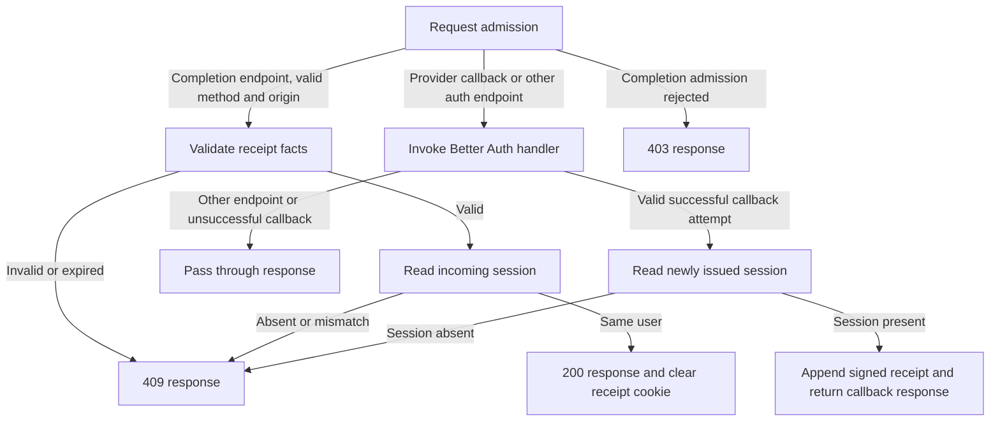
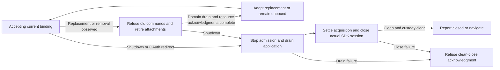
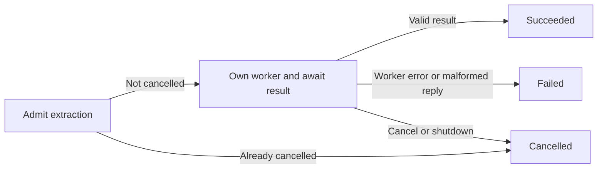
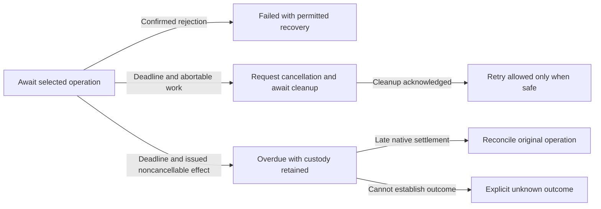

# Workflow ownership hardening specification

**Status:** Proposed implementation specification. **Source baseline:** PR #20, `b33a22d426cfc40d71d265fc824ad4b4950e2fdc`. This document can merge independently; authentication changes require PR #20 or its equivalent before implementation.

Move the remaining authentication and runtime lifecycle decisions into their owning charts. A reader must be able to identify admission, replacement, operation order, completion, failure and cancellation from the statecharts and their typed protocols. Preserve established product and persistence semantics while making resource ownership explicit and adding recoverable outcomes for stalled operations.

Follow [XState memory](../../docs/memory/xstate.md), [worker runtime boundaries](../../docs/memory/worker-runtime.md), [the v6 specification](xstate-v6-migration.md), [the product specification](spec.md), [design decisions](design-decisions.md) and [implementation handoff](implementation-handoff.md). This specification narrows the next refactor; it does not reopen accepted product scope cuts.

## Scope and implementation order

| Order | Workstream | Owning chart | Result |
| --- | --- | --- | --- |
| 1 | Server OAuth callback and completion | New request-scoped server auth chart | Authentication outcomes and cookie effects follow explicit guarded paths. |
| 2 | Application worker binding coordination | Existing `workerHostMachine`, with an invoked attachment owner if needed | Binding replacement, attachment admission and retirement have one lifecycle owner. |
| 3 | Native account binding replacement | Existing application-readiness lifecycle, with a binding child if needed | Native observations are facts; the chart chooses reuse, replacement and release. |
| 4 | Extension extraction worker | Child invoked by the existing clip chart | Result, error, cancellation and native cleanup share one owner. |

The recovery and deadline work below extends these four refactors to OAuth requests, account storage, reader transport, search, sign-out and realm closure. It is required scope, not optional follow-up.

Workstreams 2 and 3 must be designed together before either is implemented. Workstream 3 may change an adapter contract, but must not introduce a competing account authority. No dependency installation, schema migration, new catalog wording, note editor or AT publication feature is needed.

## Source evidence and review boundaries

The following links pin the reviewed implementation rather than a moving branch:

- [Server completion orchestration](https://github.com/delightful-labs/delightful-clipper/blob/b33a22d/apps/web/src/lib/server/auth/completion-handler.ts): endpoint branching, session lookup and completion-cookie effects are sequenced in `handleConfiguredAuth`.
- [Application worker boundary](https://github.com/delightful-labs/delightful-clipper/blob/b33a22d/apps/web/src/lib/runtime/worker/application.worker.ts): callback-local references, subscription maps, binding comparisons, reader revision tracking and surface retirement coordinate actor resources.
- [Worker host](https://github.com/delightful-labs/delightful-clipper/blob/b33a22d/apps/web/src/lib/runtime/worker/host-machine.ts): already owns application drain, recovery and tag actors, scope admission and SDK close. Extend this ownership rather than duplicating it.
- [Account adapter](https://github.com/delightful-labs/delightful-clipper/blob/b33a22d/apps/web/src/lib/backend/jazz/account.ts): `bindHost` caches the current client and observation, rebuilds account capabilities and releases recovery/restoration bindings.
- [Extension extraction adapter](https://github.com/delightful-labs/delightful-clipper/blob/b33a22d/apps/extension/src/worker.ts): `extractSource` sequences worker creation, message/error/abort settlement and termination in a promise closure.

Re-read these paths against the implementation branch before coding. Later fixes must be preserved; this baseline is not an instruction to revert newer behavior. Existing PR #20 extension and hosted-provider qualification gaps remain separate release gates.

## Shared ownership rules

1. Use the installed published XState v6 APIs. Review installed mechanism guides before chart changes; do not copy v5 examples or add dependency patches.
2. Return facts from reads and native observations. Named synchronous guards select operations; invoked actors perform selected asynchronous work. Calculation functions return immutable context patches and enqueue effects through the v6 enqueuer.
3. Keep native Worker, MessagePort, subscription, SDK, response-body and transaction handles in adapters. Keep binding identity, generation, admitted work and lifecycle decisions in chart state/context. Resource handles may not serve as mutable domain-fact side channels.
4. Start roots only at real boundaries such as HTTP requests or worker initialization. Invoke owned child workflows directly from their parent, rather than hiding `createActor` inside a leaf callback.
5. Accept scoped events only for the active binding and generation. Discard stale results; never retarget them at a replacement account.
6. Shutdown must stop admission, settle or drain issued work, release resources and acknowledge completion in that order. Stopping a promise actor does not cancel an issued SDK or storage effect.
7. Preserve local, remote and unknown write outcomes. Never replay an uncertain mutation as part of replacement or retry.
8. Domain work stays in workers. Window adapters retain only DOM and genuinely Window-only native effects. No credentials or native SDK handles enter render DTOs or diagnostics.

## Server OAuth request workflow

### Ownership and data flow

Create one auth request actor at the HTTP handler boundary. Its input contains the request and fixed auth capabilities/configuration. Endpoint classification, cookie parsing, signature/expiry checks, callback redirect decoding and response construction may remain pure helpers. They return bounded decoded facts; chart guards choose the path and permitted effects.

The thin HTTP wrapper starts the actor, consumes exactly one terminal response or mapped failure, and owns cleanup. Secrets, cookies and session identifiers stay on the server and out of actor inspection logs. Better Auth and Jazz retain their internal session/storage ownership.

This is a flow outline; routing guards belong on predecessor completions where possible, not in a state for every helper call.

### Required behavior

- Reject invalid completion method/origin before session lookup or cookie effects. Invalid, forged or expired receipts also fail before private session lookup. The latter is an intentional tightening of the baseline, with the same 409 outcome.
- Admit callback confirmation only from a successful same-origin callback redirect carrying a valid attempt ID. Other endpoints and unsuccessful callbacks preserve delegated status, headers and body.
- Callback session lookup uses cookies from the newly issued response, never the older incoming cookie. Append the completion cookie without losing provider cookies.
- Completion requires receipt user/session equality. Clear the receipt cookie only on the selected successful completion path. Preserve current no-store behavior, cookie scope/security/expiry and response DTOs.
- Session lookup failure and provider-handler failure must select explicit failure outcomes with the existing sanitized error contract. Never emit raw errors or credentials.
- Do not add provider retries or claim exactly-once receipt consumption. The signed-cookie design does not establish server-side atomic single use.
- If the request disconnects, suppress further response delivery and cooperatively cancel supported reads. An already-issued provider operation is not undone or replayed. Preserve returned response-body ownership; actor cleanup must not cancel a body transferred to the HTTP response.

### Acceptance criteria

AUTH-1: Tests prove rejection before session/private effects for invalid origin, method and receipt.

AUTH-2: Callback tests distinguish incoming and newly issued sessions, preserving all provider cookies and response bytes.

AUTH-3: Missing/mismatched/expired receipt and failed session lookup never produce completion success or a success cookie effect.

AUTH-4: The chart exposes endpoint admission, provider invocation, each session read and terminal outcome. No invoked promise wraps the old full orchestration function.

AUTH-5: Existing authorization-attempt matching, native account following, local-first entry and ordered sign-out behavior pass unchanged.

## Application worker attachment ownership

### Owner and protocol

Keep `workerHostMachine` as the realm owner. It owns adoption and replacement of application-derived library/recovery bindings, the tag-form actor, active reader attachments and shutdown admission. An invoked attachment owner is justified only if it owns a distinct resource lifetime and reports retirement completion; it must not independently choose the current account.

Replace binding selection hidden in the publication callback with an owned observer that emits typed facts. Include native binding identity and a monotonically scoped generation/token. Use the existing scope mechanism where sufficient. The host decides whether facts mean no change, removal or replacement. An ordinary callback may attach native listeners and execute selected subscribe/unsubscribe commands.

### Required behavior

- A repeated observation of the same live binding does not restart recovery, tags, subscriptions or the reader.
- Replacement retires the previous binding exactly once. Reject stale library, tag, recovery and reader commands immediately, even while old work drains.
- Preserve the existing application-readiness ownership of library/transaction draining. The host waits for that owner's result; it must not independently close the library or its transactions.
- Reader attachment requires active library scope and matching document snapshot. Surface retirement follows explicit attachment/detachment facts, not a scan of child internals in the view publisher.
- Reader detach captures the final position while DOM exists; resulting writes and fullscreen exit settle before owner completion. No early worker termination substitutes for this acknowledgment.
- Subscription/native surface release is idempotent. A late surface-open request after lease release reports closure without recreating a viewport.
- View publication is a pure projection plus transport delivery. Reader revision caching may remain a transport optimization, but cannot decide binding adoption, resource admission or retirement.
- Recovery secrets use the existing separate sensitive channel and stop delivery on detach/failure. No new sensitive diagnostic snapshots.

### Acceptance criteria

HOST-1: Rapid A → B → C replacement, duplicate observations and replacement during reader attachment never expose A/B data through C's view or accept stale commands.

HOST-2: Tests record subscription and surface lifecycle effects independently and prove one release per acquired resource, with no duplicate attachment from unchanged observations.

HOST-3: Shutdown during replacement, reader detach and in-flight persistence retains the current drain/SDK-close ordering. Drain or retained-custody failure cannot emit clean closure/navigation.

HOST-4: Status-only updates preserve reader DOM and avoid retransmitting unchanged article bytes. Failure/detach suppresses render and recovery delivery.

## Account binding adoption and replacement

### Authority and facts

Application readiness remains the single account lifecycle authority. Native Jazz/DLF owns session readiness and account following. The adapter translates native observations into facts including session status, account identity, client/DB identity and local-first preparation state. SDK handles stay private to the adapter behind an opaque binding capability.

Move reuse/replacement decisions out of the cached `read()` closure into the owning chart's guards. Reuse the existing bind/adopt handshake where possible. A candidate binding must be adopted before becoming the current capability; a superseded or rejected candidate must release its own resources.

### Required behavior

- Same account/client/DB and unchanged preparation facts reuse the current binding. A preparation-state update is evaluated explicitly without manufacturing account replacement.
- Loss of native readiness or replacement revokes old command admission, then drains old library work through its owner before releasing recovery/restoration capabilities.
- Late preparation, restoration or subscription results retain their original account identity and generation. They cannot promote a replacement binding or resume an old library.
- Preserve preparation recovery's distinction between replacement accounts and repeated setup failure on the same account. Do not introduce an automatic retry loop.
- Construct a library capability only for an admitted native binding. A candidate's resource is released once on rejection, shutdown or failed adoption.
- Retain admission/commit checks at existing transaction boundaries; do not add scattered pre/post scope assertions to every repository leaf.
- No signup is required for first web use. The extension still requires confirmed existing-account access. No native identity namespace or remembered-account storage migration is introduced.

### Acceptance criteria

BIND-1: Same-binding observations reuse capabilities; account, client or DB replacement retires old capabilities and adopts only the matching candidate.

BIND-2: Candidate acquisition/prepare failures, replacement during adoption and shutdown before adoption release resources without leaks or stale promotion.

BIND-3: An issued write remains attached to its original DB. Local, remote, rejected and unknown outcomes survive replacement without automatic replay.

BIND-4: Real native account following, restoration, sign-out and offline restart tests retain the saved library and locally acknowledged edits.

## Extension extraction worker lifecycle

Invoke an extraction child directly from the clip chart's existing extraction state. Keep a public promise wrapper only if another real boundary needs it; it must adapt the same workflow rather than implement another lifecycle.

The waiting state's resource adapter owns worker creation, postMessage, native callbacks, abort listeners and termination. Native resource cleanup occurs before terminal acknowledgment. Failure to construct a worker must not imply a resource was acquired.

- Decode the existing worker reply with the canonical content schema; a malformed reply selects failure rather than returning unchecked content.
- Pre-aborted admission does not create or post to a worker. Failure during construction/posting, worker error and `messageerror` all settle through the owning chart.
- The first admitted terminal event determines the outcome. Ignore late or duplicate messages/errors and cancellation after settlement. Terminate exactly once and remove listeners on every acquired-resource exit.
- Preserve the caller's cancellation/failure mapping and clip operation identity. Cancellation before save prevents save admission; it does not roll back an already-issued save.
- Reuse an existing worker-call abstraction only if it supports this lifetime and typed reply without bringing HTTP or database policy into the resource adapter. Preserve the existing parent extraction deadline of 15 seconds and its link-only fallback. The child must clean up on deadline-driven cancellation; do not introduce a competing extraction timer.

EXT-1: Meaningful generated schedules cover result/error/abort ordering, pre-abort, duplicate replies, malformed replies, construction failure, post failure and parent shutdown.

EXT-2: The oracle proves at most one outcome, one termination per acquired worker, no post after pre-abort, and no save after failed/cancelled extraction.

EXT-3: The rebuilt packaged extension passes the complete existing capture suite. Reproduce and resolve or separately explain PR #20's toolbar/source-message regression; do not weaken assertions or call the refactor release-qualified while it remains open.

## Recovery and deadline coverage

### Outcome and clock contract

A rejected operation, an overdue operation and a confirmed cancellation are different outcomes. Each finite wait below must have a named deadline policy, observable overdue/failure outcome and an explicit recovery path. Idle states, intentional subscriptions, user-driven sign-in popup waits and offline remote-acceptance waits do not fail merely because time passes.

- Keep deadlines in the owning chart or its owned clock logic. Configure durations as named, injectable policies. Record the chosen production duration and rationale before implementation qualification; do not invent one universal timeout for network, lock and SDK settlement. Existing qualified limits remain unchanged unless separately justified.
- Observe elapsed time using a monotonic native clock in owned logic. Consume observed time as facts in pure guards. Check the deadline when accepting a completion, so a delayed timer callback cannot admit an already-expired result. Define and test exact-boundary precedence.
- Every timeout must say whether work was unissued, abortable, issued but still draining, or settled. Expiry alone establishes neither rollback nor failure of a remote/native write.
- A recoverable request timeout may stop user waiting and expose an existing retry/reload action. Pending irreversible effects retain operation identity and resource custody until settlement or explicit unknown-outcome handling. Do not release an account-storage lock while its issued write can still execute.
- Late results may settle the original owner's resources, but may not revive a failed UI operation, mutate a replacement binding, deliver a second result or trigger automatic replay.
- Reuse existing localized feedback/actions. If adequate wording is absent, propose the exact catalog addition under the localization approval rule before adding it. A missing string does not justify a hardcoded message.

This outline describes outcome categories, not a requirement to add each state to every chart.

### Required finite waits and recovery

| Owner and affected states | Required handling | Recovery and safety boundary |
| --- | --- | --- |
| OAuth `authorizing`, `completing` in `machines/runtime/atproto.ts` | Bound both HTTP request and response-body decoding. Abort supported work and leave busy feedback on expiry. Preserve explicit rejection handling. | Authorization restart creates a new admitted attempt. Completion recovery retains the callback attempt; a lost response may follow cookie clearing, so never assume completion can be safely replayed or mint success from an existing unrelated session. Return an explicit unavailable/uncertain result when confirmation cannot be re-established. |
| Account-store `acquiring`, `reading`, `writing`, `releasing`, `releasingFailure` in `runtime/worker/account-store.ts` | Bound lock acquisition and storage-port reply waits; handle port/message errors and missing release acknowledgment. Abort a queued lock request before granting cancellation. Correlate operation IDs and ignore stale replies. | Acquisition/read failure before a write can fail without mutation. A WRITE with lost acknowledgment is uncertain: keep the lock/custody and reconcile or drain the original request before another update. A timeout alone cannot release the lock, call the update successful, or reapply the SDK transform. |
| Surface viewport `remote` and reader viewport `closing` | Distinguish a long-lived open reader from finite open/detach acknowledgments. Handle `messageerror`, explicit peer failure and missing acknowledgments. Route transport failure to the reader owner. | On overdue detach, preserve the last confirmed position and mark the final position unavailable/uncertain. Keep any already-issued reader writes under their original owner. Do not fabricate `VIEWPORT_CLOSED` or clean drain. Recover by an explicitly admitted reattachment or existing reload path after resource ownership is resolved. |
| Search `loading`, `indexing`, `querying` | Bound index/query reply waits and expose a stalled native-read outcome. Retain existing `WORKER_ERROR` and retry paths. Generation-check all results. | A silent derived-data worker may be retired/recreated before retrying. A Jazz read without cancellation support remains owned and draining; retry must not start overlapping full-library reads. Search failure must not block local library readiness or erase saved content. |
| Sign-out `provider`, `session` | Bound user-facing waiting for each stage separately and model overdue settlement. Preserve parent application-readiness error handling; lack of child `onError` is not by itself an unhandled-error defect. | Provider failure/expiry never selects native logout as though provider success were confirmed. Native logout expiry cannot claim the account remains signed in or is signed out without observation. Refresh native facts and reconcile settled provider/session effects before admitting retry. Preserve provider-before-native ordering and retain active effects during shutdown. |
| Host `draining`, `settlingAcquisition`, `closingSession`; client `draining` | Add overdue/blocked-close reporting, cause propagation and explicit recovery presentation for missing acknowledgments or unresolved close. Client and host deadlines must preserve one authoritative closure protocol. | No timer emits clean `CLOSED`, terminates the realm, navigates, or discards retained custody. SDK acquisition completing late remains owned and must be closed. Clean closure may occur only after the real drain, custody checks and close acknowledgment. A hard reload is disruptive recovery, never proof of a clean close. |

The account-storage protocol may require a settlement query or peer-side serialization to distinguish a lost reply from an unexecuted request. Specify that handshake before coding; the current raw READ/WRITE protocol is not evidence that safe write cancellation or reconciliation exists. If settlement cannot be established, report blocked/unknown rather than release-and-retry.

Relevant reviewed sources: [OAuth](https://github.com/delightful-labs/delightful-clipper/blob/b33a22d/apps/web/src/lib/machines/runtime/atproto.ts), [account store](https://github.com/delightful-labs/delightful-clipper/blob/b33a22d/apps/web/src/lib/runtime/worker/account-store.ts), [storage RPC](https://github.com/delightful-labs/delightful-clipper/blob/b33a22d/apps/web/src/lib/runtime/worker/storage-channel.ts), [surface viewport](https://github.com/delightful-labs/delightful-clipper/blob/b33a22d/apps/web/src/lib/reader/surface-viewport.ts), [reader experience](https://github.com/delightful-labs/delightful-clipper/blob/b33a22d/apps/web/src/lib/machines/reader/experience.ts), [search](https://github.com/delightful-labs/delightful-clipper/blob/b33a22d/apps/web/src/lib/search/machine.ts), [sign-out](https://github.com/delightful-labs/delightful-clipper/blob/b33a22d/apps/web/src/lib/machines/runtime/sign-out.ts), [host](https://github.com/delightful-labs/delightful-clipper/blob/b33a22d/apps/web/src/lib/runtime/worker/host-machine.ts) and [client](https://github.com/delightful-labs/delightful-clipper/blob/b33a22d/apps/web/src/lib/runtime/worker/client.ts).

### Existing bounds to preserve

The reviewed baseline already bounds extension extraction at 15 seconds with link-only fallback, extension account authorization at 15 seconds with unavailable output, image fetch at 25 seconds, image processing at 20 seconds, capture requests at a default 20 seconds and parser execution at 10 seconds before termination handling. These are not missing-timeout findings. Preserve them and verify subsequent cleanup and acknowledgment; the parser deadline, for example, does not itself prove that worker exit will be acknowledged.

Remote sync may remain pending offline. Transaction drain may remain unresolved when the SDK cannot confirm an issued effect. Those conditions need honest status and custody, not a timeout that invents a rejected write or a successful shutdown.

### Acceptance criteria

REC-1: For each of the six rows, inject a never-settling operation or suppress the expected acknowledgment. The actor reaches its documented overdue/failure presentation within the configured deadline without hanging the user-facing busy state indefinitely. Ongoing drain may remain active with explicit overdue status.

REC-2: Generate completion/error/cancel/deadline schedules, including completions just before, at and after expiry and delayed timer delivery. Independent oracles prove the selected precedence, one externally delivered outcome and no stale-generation promotion.

REC-3: Fault-inject dropped and late storage WRITE replies. Prove no second transform/write or lock release while the original effect can still execute; eventual settlement or blocked/unknown output retains exact operation identity.

REC-4: Suppress viewport open/detach replies, fail the port and replace the account during detach. Prove final-position uncertainty is exposed, stale surfaces cannot attach and clean shutdown is not acknowledged prematurely.

REC-5: Stall search loading, indexing and queries separately. Retry recreates only safe derived resources, does not overlap noncancellable native reads, and leaves library/offline editing usable.

REC-6: Stall provider sign-out, native logout, application drain, SDK acquisition and SDK close separately. Prove provider-before-native ordering, correct parent error recovery, retained custody, no false clean-close/navigation and eventual handling of late native completion.

REC-7: Expire authorization/completion HTTP waits during header and body reads. Prove the UI exits busy status, abort signals reach supported I/O, and retry cannot falsely establish callback confirmation or replay an uncertain effect.

REC-8: Preserve the existing bounded extraction, authorization, image, capture and parser behavior. Test post-timeout cleanup and account/shutdown races rather than asserting timer configuration text.

## State that stays outside charts

Simple drawer/input/footnote/focus presentation state, pure parsing/projection, stream buffers, native handles and RPC reply maps may remain ordinary code. Their enclosing resource lifetime must be owned and tested. Do not turn each calculation or database primitive into a state, and extend the existing account-store owner for its deadline gaps rather than replace its locking protocol. Preserve existing transaction, sync and draft mutation ownership.

Note creation/revision/import and draft APIs remain deferred capabilities with no production note UI caller established by this audit. This refactor neither wires them up nor deletes them. Architecture documentation must keep them separate from active independently invoked roots.

## Validation and delivery gates

For each workstream, update its ownership diagram and protocol before implementation; ship its chart, adapter and regressions together. Use explicit v6 schemas for public events, internal coordination, input, output and state-guaranteed context. Keep calculation-only selection safe for `.can()` and preserve typed source injection.

Prefer installed `@xstate/test` generated campaigns with an independent behavioral oracle, bounded generators, recorded seeds, meaningful coverage and shrinking/replay artifacts. Preserve scenario tests for native boundaries. Do not use source-text assertions or a second copy of the chart as the oracle.

| Gate | Evidence required |
| --- | --- |
| Focused workflow tests | AUTH, HOST, BIND, EXT and REC acceptance cases; actual actor SUT and separately recorded native effects. |
| Repository verification | `pnpm verify`: vendor integrity, format, lint, strict types, unit/native tests and production build. |
| Worker/browser behavior | `pnpm test:worker` and applicable `pnpm test:e2e` cases: stale-scope refusal, reader detach and zero application SDK/WASM initialization on the UI thread. |
| Offline authentication | `pnpm test:offline` including connected and existing-account profiles, expired credentials, complete browser-process restart with app/auth/Jazz unreachable, acknowledged edits surviving another restart and reconciliation after reconnect. |
| Extension | Rebuild and run `pnpm test:extension`; retain original document targeting, toolbar feedback, capture identity and acknowledgment assertions. |
| Hosted auth | Existing same-origin provider callback/completion qualification on the actual target runtime; mocked auth APIs alone cannot qualify provider consent/session cookies. |

Run build/type generation and browser suites sequentially when they share generated output. Use isolated authorities/ports for concurrent development without stopping unidentified servers. No broad new performance claim is made; the UI-thread boundary and unchanged bounded publication behavior are explicit checks.

The implementation PR must report exact commits, checks, skipped cases and unresolved qualification gaps. Completion requires all four ownership workstreams and all six recovery/deadline areas' acceptance criteria, updated architecture views showing active roots and deferred capabilities, and no undocumented workflow decisions remaining in the four targeted adapters. A failed external qualification may be reported as a blocker; it must not be replaced by a claim that unit tests establish release readiness.
